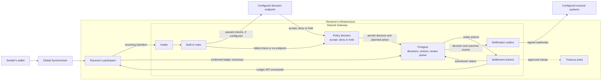

# Deposit Gateway: Receiver-Side Attribution and Settlement for Pooled Deposits

**Organization:** K2F Labs
**Author:** [K2F Labs](https://k2flabs.com), Kevin Ko (kko@k2flabs.com)
**Status:** Draft
**Created:** 2026-10-15
**Proposal Type:** RFP-aligned
**RFP / Roadmap Area:** RFP 13, Payments and DeFi
**Champion:** `Needs Champion`
**Total Funding Request:** 1,750,000 CC
**Project Duration:** 6 months engineering (Milestones 1 to 3), adoption window 12 months from Milestone 3 acceptance
**Label:** financial-workflows-composability

---

## Abstract

Centralized exchanges, custodians and payment processors on Canton receive customer deposits into shared parties and use memo references to identify which customer to credit. Missing or malformed references can delay crediting and require manual investigation. These incidents create recurring work for support and engineering teams, increasing the cost of handling deposits.

This proposal funds Deposit Gateway, an open-source, Apache-2.0 service that receivers run alongside their own validators to automate deposit handling. It gives receivers control over how deposits settle, which deposits they accept and how decisions feed into their existing systems.

1. **Settlement.** The receiver chooses between a two-step transfer or an immediate transfer with preapproval. For deposits received through preapproval, Deposit Gateway can return incorrect deposits, deducting a configurable fee to cover the return transfer cost. In either mode, accepted deposits can also be swept to a separate treasury party.

2. **Validation and policy.** Deposit Gateway provides configurable deposit rules so receivers can automate acceptance and handle exceptions consistently. These rules cover memo format and check digits, instrument acceptance and pause state, minimum and maximum amounts, and per-sender rate and dust limits. Receivers can configure these checks without writing code. For custom rules, including sender screening, the gateway sends the full transfer details to an endpoint configured by the receiver and waits for an accept, deny or hold decision before proceeding.

3. **Monitoring and alerts.** Deposit Gateway connects deposit activity to the receiver’s existing monitoring and alerting systems. After each decision, it sends a signed webhook containing the outcome.

K2F Labs brings production experience from operating a self-custodial wallet and a DEX on Canton MainNet, including direct experience with missing and malformed deposit references.

---

## Motivation

Centralized exchanges, custodians and payment processors that pool customer funds need to match incoming deposits to individual accounts. Memo references support this process, but missing or incorrect references can leave a receiver holding funds without enough information to credit the customer automatically. Resolving these deposits creates work for support teams and can require engineering involvement.

The problem appears across customer support guidance and reports from teams integrating Canton.

- Centralized exchanges such as Kraken [warn](https://support.kraken.com/in/articles/memo-for-canton-deposits) that missing or incorrect memos can delay Canton Coin deposit crediting and, in some cases, make deposits unrecoverable. Customers who omit the memo are directed to contact support.
- Trading platforms such as Trakx report recurring recovery work. A [Trakx engineer wrote](https://forum.canton.network/t/9207) that users forget to include the memo and “every miss becomes a support case to recover funds.”
- Infrastructure providers such as Blockdaemon have [raised questions](https://imgur.com/a/au6Xt81) about whether auto-sweep can be enabled when the receiving party uses memos to identify deposits.

For receivers, each deposit requiring manual recovery adds to the cost of serving customers. Staff may need to locate the transfer, establish which account it belongs to and arrange crediting or a return. Engineering teams may also need to investigate cases that existing tooling cannot resolve. As deposit volumes grow, even a small proportion of exceptions can create a recurring workload, while customers wait for access to their funds. We used the Scan API to examine deposits received by seven exchange treasury parties on MainNet between 9 April and 9 July 2026.

| Exchange | Deposits | Missing or malformed memo | Frequency | Flagged CC | Estimated support hours | Estimated handling cost (USD) |
| --- | ---: | ---: | ---: | ---: | ---: | ---: |
| Kraken | 3,875 | 127 | 3.28% | 490,320 | 63.5 | US$3,175 |
| MEXC | 13,598 | 246 | 1.81% | 57,558 | 123 | US$6,150 |
| Gate | 4,557 | 105 | 2.30% | 637,097 | 52.5 | US$2,625 |
| OKX | 11,864 | 149 | 1.26% | 119,421 | 74.5 | US$3,725 |
| KuCoin | 2,384 | 49 | 2.06% | 294,858 | 24.5 | US$1,225 |
| Bybit | 14,838 | 195 | 1.31% | 1,076,101 | 97.5 | US$4,875 |
| Bitget | 12,818 | 51 | 0.40% | 8,542 | 25.5 | US$1,275 |
| **Three month total** | **63,934** | **922** | **1.44%** | **≈2,683,900** | **461** | **US$23,050** |
| **Annual estimate** | — | — | — | **≈10,735,600** | **1,844** | **US$92,200** |

Table 1. Handling costs assume 30 minutes per flagged deposit at US$50 per hour. Annual figures are four times the figures for the three month period.

As seen in the table, roughly one in every 69 deposits across these seven exchanges had a missing or malformed memo. Under the handling assumptions above, reviewing these deposits would require 461 support hours over three months at a cost of US$23,050. Over a year, that would amount to 1,844 hours and US$92,200 spent resolving deposit errors, while affected customers may face delays accessing their funds.

Deposit Gateway is intended to reduce this recurring work by automatically rejecting deposits with invalid references before settlement when the token uses a two step transfer, or returning them after settlement when transfers are covered by preapproval.

---

## Specification

### 1. Objective

Today, receivers often discover missing or incorrect memos after funds have arrived and must resolve those deposits by hand. The objective of this grant is to let receivers define how incoming deposits are handled before crediting the customer. For each validation rule, the receiver chooses whether a failed check should trigger automatic rejection or a return, depending on the settlement mode, or place the deposit on hold for review. For example, a receiver might automatically return a deposit with an invalid memo but hold one flagged by its screening service for investigation.

At the end of the grant, a receiver can:

1. Run Deposit Gateway beside its own validator and configure it from one file, without writing code.
2. Check every incoming deposit against its own rules and, if it chooses, its own decision endpoint.
3. Reject deposits that fail the checks before they settle, or return deposits that have already settled, deducting a configurable fee to cover the return transfer cost.
4. Review held deposits in a queue, with every decision and ledger action recorded.
5. Receive a signed webhook for every decision and confirmed outcome, and optionally sweep accepted funds to a treasury party.
6. Do all of this from published documentation, without our help.

Changes to sender wallets, a shared reference standard and custody of the receiver's keys are out of scope.

### 2. Implementation Mechanics

Deposit Gateway is a service the receiver runs beside its own validator. It connects to the receiver's participant over the Ledger API, using the rights the receiver already holds for its deposit party. It does not require senders or their wallets to change anything, and the gateway works with the token standard.

The gateway is written in Rust with tonic, axum, sqlx and Postgres, is configured by one TOML file, and ships as a container image with a Helm chart.

#### A deposit arrives

The deposit mechanism varies depending on transfer preapproval status on a given instrument.

- **Two-step.** Without a preapproval, the deposit arrives as a pending offer, a contract implementing the token standard's `TransferInstruction` interface. Funds do not move until the receiver accepts it.
- **Preapproval.** With a preapproval, the deposit settles in the same transaction that sends it. 

The gateway requests ledger effects from the receiver’s update stream so it can read the memo attached to a settled transfer.

Pending offers store the memo under `splice.lfdecentralizedtrust.org/reason` in `Transfer.meta`. For Canton Coin, settled deposits carry it in the `description` field of `TransferPreapproval_SendV2`, or the older `TransferPreapproval_Send`. The receiver can see this step because it is a signatory of the preapproval contract.

Other instruments expose the memo through their own transfer choices, so the reference source for settled deposits is configured per instrument.

The gateway checkpoints its progress in Postgres and processes deposits idempotently, allowing it to resume after a restart without skipping deposits or repeating completed actions.

#### Gateway checks

The receiver defines each instrument’s deposit rules in a configuration file. The gateway checks these rules before calling the decision endpoint. Example settings are shown below.

| Rule | What it checks | Example setting |
| --- | --- | --- |
| Reference | The memo is present, matches a pattern and passes a check digit | Nine or ten digits, surrounding whitespace trimmed |
| Instrument | The instrument is accepted and not paused | Accept Canton Coin and USDCx, pause cBTC during maintenance |
| Amount | The amount is within limits | At least 10 CC, at most 5,000,000 CC |
| Dust floor | Very small deposits are not credited | Deny anything under 1 CC |
| Sender rate | One sender cannot flood the party | At most 50 deposits per sender per hour, hold the rest |

The receiver configures each rule according to how it wants the deposit handled. A deny decision triggers rejection or a return, allowing routine errors such as an invalid memo to be resolved automatically. A hold decision pauses processing when the receiver requires further information or staff review.

The gateway evaluates rules in order and applies the outcome of the first failed check. Deposits that pass all configured rules proceed to the decision endpoint if one is configured, or are accepted automatically.

The receiver can use the decision endpoint for additional checks, such as screening the sender, verifying a customer account or consulting a risk service. The gateway sends a signed JSON request containing the full transfer details and a stable deposit identifier. The endpoint responds with accept, deny or hold, optionally including a reason. If the request times out, fails or returns an invalid response, the gateway holds the deposit for review.

By default, the gateway checks the deposit reference in the memo field, though receivers can additionally configure checks for other metadata fields. If configured, a receiver’s own endpoint receives the full transfer details, allowing the receiver to apply its own checks, such as confirming that the reference belongs to an active customer account.

#### Applying the deposit decision

| Decision | Two-step transfer | Deposit received through preapproval |
| --- | --- | --- |
| **Accept** | Accept the pending offer | Retain the received funds |
| **Deny** | Reject the pending offer | Return the funds, deducting the configured return fee |
| **Hold** | Leave the offer pending for review, unless it expires or the sender withdraws it | Keep the received funds pending review |

**Returns.** Each return includes the original deposit’s update identifier so the sender can identify the deposit being returned. The gateway marks the return complete once the ledger confirms that the sender has received the funds. If the sender has no preapproval, they receive an offer to accept. Pending returns remain visible in the review queue. Staff review returns that expire, are rejected or cannot be completed, including deposits too small to cover the return fee.

**Treasury sweeps.** The receiver can configure a separate treasury party for accepted funds. The gateway transfers those funds only after both policy approval and confirmed settlement. Held deposits and deposits awaiting return remain with the deposit party.

**Recovery after interruption.** The gateway records each planned action before submission and uses a stable command identifier for retries, supporting participant command deduplication. If a restart or connection failure leaves the outcome unclear, the gateway checks the ledger before retrying. An unresolved return or sweep blocks another attempt for that action, preventing uncertainty from triggering a second payment.

#### How staff resolve what is held

The review queue supports deposits that the receiver deliberately holds for investigation. For example, its screening process may require additional information about a sender before approving a deposit. The queue shows the transfer details and the reason for the hold so the receiver can investigate through its existing procedures.

Once the investigation is complete, the receiver updates its screening decision and reruns validation through the admin API or CLI. The gateway checks the current ledger state and applies the resulting decision. An approved deposit proceeds once all required checks pass.

Failed returns and unavailable decision endpoints also appear in the queue so the receiver can address the failure and retry processing. Each case retains its status and history, helping staff resume the work without reconstructing what happened.

#### Interoperation with a receiver's systems

The gateway sends signed webhooks for deposit decisions and ledger outcomes, allowing the receiver’s systems to track deposits and credit customers once funds are approved and confirmed settled. Each webhook includes the deposit identifier, decision, reason and current ledger status, with an HMAC-SHA256 signature.

Each webhook event is saved in Postgres together with the deposit’s updated status before delivery. Failed deliveries are retried using the same unique event identifier so the receiver can recognise duplicates.

The gateway also exposes Prometheus metrics for deposit outcomes, failed checks, review queue size and webhook delays. Receivers can use these metrics in their existing monitoring and alerting systems.

#### Boundaries

Deposit Gateway acts only for the receiver's own deposit party, on the receiver's own participant, with credentials the receiver already holds. It needs no access to anyone else's node, no new Daml packages and no changes to Canton or Splice. Each receiver runs its own instance and keeps its own policy and audit records. Transfer details leave that instance only for the decision endpoint and webhook destinations the receiver configures, which may be hosted inside or outside its infrastructure.

We are not building screening or risk scoring of our own, changes to sender wallets, a reference standard that wallets must adopt, custody of the receiver's keys, or any interface for the receiver's customers.

### 3. Architectural Alignment

RFP 13 asks for "open-source tooling, reference implementations, and standards, for payments, DeFi, settlement, and liquidity workflows on Canton", focused on "reusable components or standards that can support multiple Canton applications rather than one-off application-specific work". Deposit Gateway is one reusable component that any exchange, custodian or payment processor receiving pooled deposits can run, instead of each building its own.

The gateway uses the Canton Network Token Standard (CIP-0056) to accept and reject deposits through `TransferInstruction` and return or sweep funds through `TransferFactory`. The registry API provides the context needed to submit these actions. Reference extraction is configured per instrument so the gateway can read the memo from the transfer details visible to the receiver.

Digital Asset's exchange integration guide describes multi-step deposit automation, in which the exchange accepts known deposits and lets unknown offers expire. Deposit Gateway delivers that pattern as a configurable open-source service, and adds the equivalent for deposits received through a preapproval.

### 4. Backward Compatibility

No backward compatibility impact. Senders and their wallets are unchanged, and a receiver that does not run Deposit Gateway is unaffected. Removing the gateway stops automated deposit handling and leaves the current ledger state unchanged. The receiver remains responsible for pending offers and held funds.

---

## Milestones and Deliverables

All code is public under Apache-2.0, in a repository under the K2F Labs GitHub organization.

### Milestone 1: Deposit intake and validation

- **Estimated Delivery:** Month 2
- **Funding:** 280,000 CC upon committee acceptance, about 7 engineer-weeks
- **Focus:** Detecting incoming deposits and validating them against the receiver’s configured rules, with additional checks through an optional decision endpoint. This milestone records and reports whether each deposit should be accepted, denied or held, without taking action on the ledger.
- **Deliverables / Value Metrics:**
  - Public repository, with the rule engine published as a standalone Rust crate.
  - The gateway reads both two-step offers and deposits received through preapproval, and extracts the memo from each path described in the Specification. Demonstrated on LocalNet and on a public network (DevNet or TestNet), with the party ID and transaction range published.
  - The gateway is restarted in the middle of a run of 1,000 deposits, and every deposit is recorded and decided exactly once. The run script is published.
  - The built-in rules and the decision endpoint work as specified, including holding a deposit when the endpoint times out or answers with something invalid. The endpoint request format is published.
  - Decisions are delivered as signed webhooks.

### Milestone 2: Settlement

- **Estimated Delivery:** Month 4
- **Funding:** 420,000 CC upon committee acceptance, about 10.5 engineer-weeks
- **Focus:** Executing the deposit decisions produced in Milestone 1. The gateway accepts or rejects pending two-step transfers and returns deposits denied after settling through preapproval, deducting the configured return fee. Accepted funds can also be swept to a treasury party. Recovery checks prevent retries or restarts from causing duplicate returns or sweeps.
- **Deliverables / Value Metrics.**
  - Receivers can enforce deposit rules before funds settle through two-step transfers. The gateway accepts offers that pass the receiver’s checks and rejects denied offers, releasing the sender’s funds. Held offers remain pending for review until they expire or the sender withdraws them. A published demonstration shows how each decision affects the offer and the funds, with the party ID and transactions included so reviewers can verify the results on the ledger.
  - Receivers can automate returns for deposits denied after settling through preapproval. Each return deducts the configured fee and includes the original deposit’s update identifier so the payment can be traced. Deposits too small to cover the fee enter the review queue for staff attention. A published demonstration covers returns to senders with and without preapproval, along with a deposit requiring review. The party ID and transactions are published for ledger verification.
  - Receivers can move approved deposits automatically to a separate treasury party after settlement is confirmed.
  - Receivers can resume processing after an interruption without issuing duplicate payments. A published test stops and restarts the gateway at random points during 1,000 deposits covering acceptance, rejection, returns and treasury sweeps. Ledger records verify that each required action completes once and every deposit reaches its expected final state. The test harness runs in CI against LocalNet.
  - Receivers using external signing can authorise gateway transactions through their own signing service.
  - The settlement flow is demonstrated with Canton Coin and at least one other instrument whose registry implements the token standard, showing that receivers can apply the gateway’s handling across multiple instruments.

### Milestone 3: Review, notifications and operations

- **Estimated Delivery:** Month 6
- **Funding:** 300,000 CC upon committee acceptance, about 7.5 engineer-weeks
- **Focus.** Giving staff the tools to review held deposits and resolve failed actions, while connecting deposit outcomes to the receiver’s existing systems. This milestone also delivers the monitoring and deployment tools needed to operate the gateway, with documentation that allows receivers to set it up independently.
- **Deliverables / Value Metrics.**
  - Staff can investigate and resolve held deposits through an authenticated admin API and matching command-line tool. The review queue shows the reason for each hold and allows staff to rerun checks or submit an accept or deny decision with a recorded reason. Before applying that decision, the gateway checks the offer’s current ledger state so staff can see when an offer has expired and requires no further action. 
  - Receiver systems receive signed webhooks for deposit decisions and confirmed ledger outcomes. A published test interrupts webhook delivery for one hour and demonstrates that every queued event is delivered after service resumes, with stable event identifiers for duplicate detection and no repeated ledger actions.
  - Operators can monitor deposit processing through Prometheus metrics and published alert rules.
  - Receivers can deploy the gateway using a published Helm chart and follow an operator guide to configure and run it.
  - Worked decision endpoint examples show receivers how to connect their own checks. A screening stub demonstrates the request and response flow.

### Milestone 4: Adoption

- **Estimated Delivery:** Rolling, within a 12-month window from Milestone 3 acceptance.
- **Funding:** Up to 750,000 CC, paid per event
- **Focus:** Exchanges, custodians and payment processors running Deposit Gateway in production on MainNet.
- **Deliverables / Value Metrics:** Paid per event, so partial adoption pays partially.
  - 150,000 CC per external receiver, up to 4 receivers, 600,000 CC. External means not K2F Labs and not a party K2F Labs operates. The receiver must run at least one production deposit party through the gateway, with settlement actions enabled, for at least 30 days. Evidence is the party ID and the gateway's accept, reject or return transactions on MainNet, or a private attestation to the Canton Foundation.
  - 150,000 CC completion tranche, paid when all of the following hold.
    1. At least 2 external receivers run the gateway in production.
    2. At least 3 external GitHub issues or pull requests have been opened.
    3. At least 3 community-reported issues have been triaged to resolution.
    4. A public case study, coordinated with the Foundation, reports the share of flagged deposits resolved automatically and the staff time spent on cases requiring review. The study compares handling time before and after deployment to measure the reduction in manual work.
  - Any amount not earned within the window returns to the Development Fund.

---

## Acceptance Criteria

The Tech and Ops Committee will evaluate completion based on the following.

- Each milestone delivers the functionality and evidence specified in its deliverables.
- Milestone 1 is demonstrated on a public Canton network. Milestone 2 publishes the party ID and transactions used in its settlement demonstrations so reviewers can verify the results on the ledger.
- Demonstrations use deposits created through the Ledger API and token standard interfaces used by sender wallets, exercising the complete transfer flow.
- Ledger records from the Milestone 2 interruption test confirm that each required action completed once and every deposit reached its expected final state.
- The Milestone 3 webhook outage test confirms that all queued events are delivered after service resumes, and delivery retries cause no additional ledger actions.
- A receiver can deploy and configure the gateway independently using the Helm chart and documentation delivered in Milestone 3.
- Milestone 4 adoption requires at least 30 days of production use on MainNet with settlement actions enabled, within the milestone’s 12-month adoption window. Qualifying receivers are organisations outside K2F Labs running deposit parties operated independently of K2F Labs. Evidence consists of the party ID and the gateway’s accept, reject or return transactions on MainNet, or a private attestation to the Canton Foundation. The completion tranche remains subject to the additional requirements in Milestone 4.

---

## Funding

The base funding request is 1,750,000 CC, comprising 1,000,000 CC for engineering across Milestones 1 to 3 and up to 750,000 CC for adoption in Milestone 4. An additional 200,000 CC early-delivery bonus brings the maximum request to 1,950,000 CC if earned.

### Payment Breakdown by Milestone

- Milestone 1 (Deposit intake and validation), 280,000 CC upon committee acceptance
- Milestone 2 (Settlement), 420,000 CC upon committee acceptance
- Milestone 3 (Review, notifications and operations), 300,000 CC upon committee acceptance
- Milestone 4 (Adoption), up to 750,000 CC, paid per event as described in Milestones and Deliverables

### Delivery schedule

Milestones 1 to 3 are due within 6 months of grant approval.

- Early delivery. If all three are accepted within 5 months, a 20 percent bonus of 200,000 CC is added to the Milestone 3 payment.
- Adoption funding is reviewed 12 months after grant approval under the Volatility Stipulation.

### Sizing

Engineering is about 25 engineer-weeks at roughly 40,000 CC per engineer-week, the rate recent external grants price at. The table below shows where those weeks go.

| Milestone | Work | Engineer-weeks |
| --- | --- | ---: |
| 1 | Intake of two-step offers and preapproval deposits, durable checkpointing | 2.5 |
| 1 | Rule engine and configuration, including reference sources | 2.5 |
| 1 | Decision endpoint, signed requests and hold on failure | 1.5 |
| 1 | Rule validation using representative memo inputs | 0.5 |
| 2 | Two-step accept and reject through registry choice contexts | 2 |
| 2 | Returns less the fee, including senders without a preapproval | 2 |
| 2 | Treasury sweep | 1 |
| 2 | Action tracking, deduplication, recovery and the CI failure harness | 3 |
| 2 | External signing interface and reference signer | 1.5 |
| 2 | A second token standard instrument | 1 |
| 3 | Review queue, admin API and command-line tool | 2.5 |
| 3 | Webhook outbox, signing and retries | 2 |
| 3 | Prometheus metrics and alert rule pack | 0.5 |
| 3 | Helm chart, operator guide, configuration reference and endpoint examples | 2 |
| 3 | Public network demonstrations and the webhook outage test | 0.5 |
| | **Total** | **25** |

Adoption makes up 43 percent of the total and is paid only for receivers other than K2F Labs.

| Grant | Requested | Why it is here |
| --- | --- | --- |
| Extractor by Hacken (Canton Monitor) | 860,000 CC, half adoption-gated | A participant-local Ledger API service with crash-safe ingestion and alerting, which detects but does not settle |
| x402 Protocol Integration | 1,100,000 CC | A payment verification and settlement service under RFP 13 |
| Settlement pattern and reference DEX | 1,100,000 CC | A token standard settlement reference implementation under RFP 13 |
| **This proposal** | **1,750,000 CC, 43 percent adoption-gated** | **Intake, validation, settlement for two modes, review queue, notifications and adoption by receivers** |
| DPM Trace Transaction Visualization (Walnut) | 1,900,000 CC | A single developer tool |
| Daml Package Analyzer (Certora) | 2,010,000 CC | An open-source analysis tool |
| Canton Payment Streams | 900,000 CC plus 200,000 CC audit and up to 1,000,000 CC adoption | A payments primitive under RFP 13 with most funding paid on adoption |
| Kaiko Data Standard | 1,300,000 CC plus up to 1,000,000 CC adoption | Adoption paid per client that goes live, as in our Milestone 4 |
| Go SDKs (Noders) | 2,260,000 CC, including 700,000 CC paid per adopting app | Adoption paid per production deployment, as in our Milestone 4 |
| C# and .NET SDK (Peaceful Studio) | 2,500,000 CC, up to 2,855,000 CC with audit and an acceleration bonus | An open-source component with an early-delivery bonus like ours |

The request sits in the middle of these grants. It is above services that only detect or verify, because the gateway also acts on what it finds, and below the open-source SDK and tooling grants of 1.9 to 2.9 million CC. Its engineering portion of 1,000,000 CC is at the level of the funded RFP 13 grants.

### Volatility Stipulation

Engineering Milestones 1 to 3 are due within 6 months of grant approval. Receivers then have an adoption window of 12 months from Milestone 3 acceptance, giving a maximum planned duration of 18 months. Funding is denominated in Canton Coin. The remaining adoption funding is reviewed for changes in the CC price 12 months after grant approval.

---

## Prior Art

**Awarded.**

- [Hacken Extractor](https://github.com/canton-foundation/canton-dev-fund/pull/302) monitors contract activity and produces risk signals, including alerts for unusual volumes. This relates to Deposit Gateway’s per-sender rate limits. Hacken detects activity that may warrant intervention, while Deposit Gateway enforces the receiver’s deposit rules. A receiver could incorporate Hacken’s signals through the gateway’s custom decision endpoint.

**In review.**

- [Payvol](https://github.com/canton-foundation/canton-dev-fund/pull/859) creates payment requests, checks transactions before the sender signs and reconciles the resulting payments. Its specification leaves settlement execution to a separate application. Deposit Gateway handles the receiver’s decision to accept, reject or return incoming deposits, including those sent without a payment request. The two could run alongside each other, with Deposit Gateway applying deposit policy and Payvol tracking whether requested payments arrived. A receiver accepting Payvol payments can add Payvol's metadata field as an alternative reference source and confirm each payment through the decision endpoint.

**Existing products and guidance.**

- Digital Asset’s [Multi-Step Deposit Automation guidance](https://github.com/canton-network/wallet/blob/21392e4ca7a9d349eaf7b39359db8c0f04f4ce54/docs/wallet-integration-guide/src/exchange-integration/architecture.rst#L168-L180) describes accepting known deposits and allowing unknown offers to expire or be withdrawn. This establishes precedent for the gateway’s two-step settlement workflow. Deposit Gateway makes receiver-configured handling available as an open-source service alongside the receiver’s own validator, including returns for deposits received through preapproval.
- [TRM Labs](https://www.trmlabs.com/blockchain-coverage/canton) offers Canton screening, while [Merkle Science’s grant proposal](https://github.com/canton-foundation/canton-dev-fund/pull/191) covers analytics and screening deployment. These services assess risk that can inform a deposit decision. Receivers could call them through the gateway’s custom endpoint, with Deposit Gateway applying the returned decision and carrying out the deposit action.

---

## Co-Marketing

Upon release, K2F Labs will collaborate with the Foundation on the following.

- Announcement coordination at Milestone 2, when the gateway first accepts, rejects and returns deposits, and at Milestone 4, when the first external receiver runs it in production.
- A technical write-up on deposit attribution for pooled accounts on Canton, covering both settlement modes and the MainNet memo analysis, published on the Canton Network blog or forum.
- The Milestone 4 case study, published jointly with the Foundation and the adopting receiver, reports the share of flagged deposits resolved automatically and the staff time spent on cases requiring review, comparing handling time before and after deployment.

---

## Adoption and Go-to-Market

For adoption we will approach three groups.

- Exchanges receiving pooled Canton deposits, starting with the seven whose deposits we analysed in the Motivation.
- Custodians and payment processors that credit incoming transfers to customer accounts, including teams that have raised memo recovery publicly on the Canton forum.
- Infrastructure providers that run validators for exchanges and custodians. One deployment through a provider can bring the gateway to several receivers.

The decision endpoint lowers the cost of trying the gateway. A receiver can start with the built-in rules and its existing systems, then connect screening or account checks later without changing the gateway.

We ask the Foundation, as a good-faith collaboration and not a precondition for any milestone, for introductions to exchanges and custodians receiving deposits on Canton, and for inclusion in relevant SIG communications when Milestones 2 and 3 land.

---

## Maintenance and Sustainability

Beyond the grant, we propose a maintenance tier of 100,000 CC per quarter, covering the following.

- Compatibility with each Canton and Splice release, and with changes to the token standard such as CIP-0112.
- Issue triage and pull request review within five business days.
- Support for adopting receivers.
- Dependency and security updates.
- A quarterly adoption report to the committee.

The Helm chart, operator guide and configuration reference delivered in Milestone 3 let other receivers run the gateway without us. If K2F Labs can no longer steward the repository, ownership may transfer to the Foundation by mutual agreement.

---

## Team Background

K2F Labs is a Canton Foundation participant and has built on Canton for over a year. We operate validators on MainNet and run a self-custodial wallet and a DEX on Canton MainNet. Together those have processed over 500,000 transactions for more than 60,000 participants, through a production Rust SDK for Canton that we maintain. The team is led by Kevin Ko, an ex-Google engineer.

We work with this problem from the sending side every day. Our wallet sends deposits to exchange parties through both two-step transfers and preapprovals, and the MainNet analysis in the Motivation ran on our own infrastructure. Deposit Gateway is new code written for this grant.
