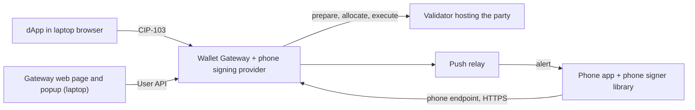
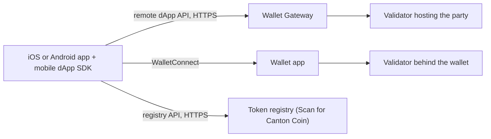

## Development Fund Proposal

**Author:** [VertexPoint Labs LLC (TrustedPoint)](https://trusted-point.com) · `grants@trusted-point.com`
**Status:** Submitted
**Created:** 2026-07-16
**Label:** canton-apis
**Champion:** hythloda (Amanda Martin, Canton Foundation)
**Proposal Type:** RFP-aligned
**RFP / Roadmap Area:** RFP #14: Wallet and dApp Integration tooling (Parts 1 and 2); RFP #17: SDKs in different languages (Part 2)

---

## How this proposal is organised

This proposal has two distinct parts.

| Part | What it is | RFP | Milestones | Engineering CC | Adoption CC |
|---|---|---|---|---|---|
| Part 1: Mobile signer for the Wallet Gateway | Phone signer library and phone signing provider (a Gateway driver). The party key stays on the phone. | #14 | Milestone 1 (engineering), Milestone 3 (adoption, upstream merge) | 130,000 | 250,000 on upstream merge |
| Part 2: Swift and Kotlin dApp SDK | A Swift and Kotlin version of Digital Asset's TypeScript dApp SDK, with Token Standard helpers. Native apps use it to connect to the user's wallet. It holds no party keys. | #14, #17 | Milestone 2 (engineering) | 120,000 | |
| Both parts | Mainnet use of either part by Featured Apps. | #14, #17 | Milestone 4 (adoption) | | up to 750,000 (5 × 150,000) |

The parts do not depend on each other. Part 1 needs no dApp changes. The mobile dApp SDK works with any Wallet Gateway or WalletConnect wallet, with or without Part 1. Each milestone has its own payment, deadline and acceptance. Besides Milestone 4, the parts share only the repository organisation, CI, the docs pipeline and site, the maintenance process and the team. If only one part is funded, we still build the shared CI and docs pipeline at no extra cost.

## RFP Alignment and Ecosystem Need

**Part 1: RFP #14, Wallet and dApp Integration tooling.** For Wallet Gateway users, Part 1 covers the RFP's signing flows, party management and application-to-wallet interactions, with the phone as signer. The [Wallet Gateway](https://github.com/canton-network/wallet) (formerly Wallet Kernel, called the Gateway below) signs through its internal signer, the participant, or a custody vendor. None keeps the key on a user's phone. The Gateway's grant, Dev Fund #109, lists "Mobile Wallets" among key stores, but the repo has no phone signer.

**Part 2: RFP #17, SDKs in different languages, and RFP #14, Wallet and dApp Integration tooling.**

- **Target languages:** Swift for iOS and Kotlin for Android.
- **Developer audience:** teams that build native iOS and Android dApps whose users connect a wallet, as they do with web dApps.
- **APIs and workflows covered:** the methods and events of Digital Asset's TypeScript dApp SDK, over the Wallet Gateway's remote dApp API and WalletConnect, and Token Standard helpers for CIP-0056 and CIP-0112 with the registry API.
- **Common interface:** the CIP-103 dApp API, as the TypeScript dApp SDK implements it. The ledger client standard does not apply, because the app does not call the Ledger API.
- **Compatibility as Canton evolves:** a release within 30 days of each Canton minor release or TypeScript dApp SDK API change, and 60 days of each Splice release while maintenance runs, checked by a public conformance suite.

**Who benefits.** Part 1: Gateway operators, their retail users and wallet app teams. Part 2: teams that build iOS and Android dApps, and the wallets their users connect.

**How it drives adoption.** Part 1: operators turn on phone signing by config, their users install the reference phone app from the App Store or Google Play, and dApps that use the dApp SDK's wallet picker need no change. Part 2: native apps reach the same wallets as web dApps, through a maintained library instead of their own client code.

**Evidence of demand.** Seven mobile wallet apps in the stores already support Canton: Console, C8, Cansai, Askardex, Grofty, Nightly and Cypherock cySync. Three teams are building native apps now: Grofty for iOS, Edel and Owarine. In the Foundation's wallet directory 6 of the 11 wallets list a mobile form factor. None of the seven signing drivers in `canton-network/wallet` keeps the key on a phone, and in the review of this proposal @mjuchli-da (Digital Asset) wrote that a customer base would want a phone as a key store. The full list with links is in [the evidence file](2026-07-VertexPoint-canton-mobile-sdk_evidence.md).

## Abstract

**Part 1: Mobile signer for the Wallet Gateway.** The user's party key lives on the phone, while the party is hosted on the validator behind the user's Gateway. The phone pairs with that Gateway by QR code and from then on talks only to it. For each dApp transaction the Gateway wakes the phone with a push, and the phone checks the request and signs after a biometric prompt. dApps that already use a Wallet Gateway need no change. We build a Swift and Kotlin phone signer library, a TypeScript phone signing provider for `canton-network/wallet`, a push relay and a reference phone app, under Apache-2.0. We list the reference phone app on the App Store and Google Play, so a Gateway operator can offer phone signing without building its own app.

**Part 2: Swift and Kotlin dApp SDK.** We build the mobile dApp SDK, an Apache-2.0 Swift and Kotlin version of Digital Asset's TypeScript dApp SDK. A native iOS or Android app uses it to connect to the user's wallet, such as a Wallet Gateway or a WalletConnect wallet app, and to submit transactions that the user approves in that wallet. Token Standard helpers cover holdings, transfers and allocations. It holds no party keys.

**Total Funding Request: 1,250,000 CC.** Engineering is 250,000 CC (20%). Adoption is up to 1,000,000 CC (80%): Milestone 3 pays 250,000 CC (20%) when the phone signing provider is merged into `canton-network/wallet`, and Milestone 4 pays up to 750,000 CC (60%), 150,000 CC for each of up to 5 Featured Apps that use either part on mainnet.

## Specification

### Part 1: Mobile signer for the Wallet Gateway

#### Objective

Part 1 adds a Wallet Gateway signer that keeps the user's party key on the phone. Its components:

| Component | What it does | Run by |
|---|---|---|
| Phone signer library | Swift and Kotlin library in a phone app. Keeps the party key, checks and shows each request, signs after a biometric prompt | Wallet apps embed it |
| Phone signing provider | TypeScript Gateway driver, contributed upstream. Queues requests and wakes the phone | Gateway operator |
| Phone endpoint | JSON-RPC API the phone calls to pair, fetch requests and answer them | Part of the phone signing provider |
| Push relay | Turns a wake-up into an APNs or FCM alert | App publisher, or us for the reference phone app |
| Reference phone app | iOS and Android app on the phone signer library | Us, on TestFlight and Play testing, then on the App Store and Google Play |

#### How it works: one user, step by step

1. **My party is hosted on my Gateway's validator.** In step 3, the Gateway asks this validator to host my new party with Confirmation rights.
2. **My phone holds my party key.** The app creates it in step 3 and keeps it.
3. **My phone connects to my Gateway.** On my laptop I log in to the Gateway's web page, as today. I open its Phones page and scan the QR code with the app. I confirm that both screens show the same 6-digit code. Then I create my party on the Gateway's party page, confirm on the phone and click Allocate. After that, the phone talks only to my Gateway, over HTTPS.
4. **The dApp reaches my phone through the Gateway.** I pick my Gateway in the dApp's wallet picker, and the dApp talks to it through CIP-103, as today. For each transaction, the Gateway's usual approval popup opens on my laptop, and I leave it open while the phone signing provider wakes my phone with a push. I tap the alert, and the app fetches the request, checks it and asks for my fingerprint or face. When the signature arrives, the popup asks the Gateway to submit the transaction. The dApp gets the result. Until our upstream PRs merge, I click Approve in the popup twice: once to start signing and once to submit.

#### Topology

**Who hosts the party.** The validator behind the Gateway, with Confirmation rights, threshold 1 and no other hosts. These are the Gateway's defaults (`core/ledger-client/src/ledger-client.ts`).

**What the host and the Gateway operator can do.** They see the party's contracts and transactions, and can block the party or drop requests. They can send the phone any well-formed request but cannot produce the party's signature. With one host at threshold 1, a malicious host can confirm a transaction the phone never signed. So the user must trust the validator operator, as with any Canton party hosted this way.

**Who controls the keys.** Only the user holds the party key and the device key. The Gateway operator runs user login and holds validator admin credentials, used for allocation, key listing and wallet sync, not signing. The validator holds its own keys. The app publisher holds push credentials. VertexPoint Labs holds no party or device keys, only the reference phone app's push credentials, and sees no request content. The Gateway's validator submits and pays for traffic.

**How a CIP-103 app reaches the phone.** Through the Gateway. The dApp stays in the laptop browser and only signing moves to the phone. In the wallet picker of Digital Asset's dApp SDK (`@canton-network/dapp-sdk`), the user picks the Gateway or adds it as a "Custom wallet". The dApp talks only to the Gateway, and the phone gets requests only from the Gateway, after a push alert or when the app opens. The phone holds no Ledger API token.

**PartyLayer (Dev Fund #9)** connects dApps to wallets, including React Native dApps on a phone, and holds no private keys. Part 1 is the user's signer on the wallet side. A PartyLayer dApp reaches the Gateway through the dApp SDK's `RemoteAdapter` ("Path B" in PartyLayer's docs), and the Gateway passes the request to the phone. So the two meet at the Gateway and do not overlap.

#### Pairing and party creation

The QR code holds a one-time secret, valid for 5 minutes. The phone creates its keys and registers its public keys, its push relay and a push id. The relay must be on the operator's allowlist. The phone proves it holds the keys and the secret without sending the secret. The 6-digit code is derived from the pairing data, so if someone pairs first from a photo of the QR code, the two screens show different codes.

We add phone keys to the Gateway's party page, next to Fireblocks keys. Our allocator sends the full topology transactions to the phone, as the DFNS allocator does.

#### Upstream changes

- **PR-1:** the phone signing provider, built like the existing custody vendor drivers, with a `signingProviders.phone` config entry. It also adds the phone endpoint with its own device-key auth, an OpenRPC spec and the Phones page.
- **PR-2:** adds the option `review: false` to `signingProviders.<provider>`. With it, `prepareExecute` starts signing at once. It still returns the popup URL, and the popup shows only the signing status (about 20 lines of code). [Issue #2431](https://github.com/canton-network/wallet/issues/2431) asks to hide the approval screen instead, and we propose this variant there.
- **PR-3:** the Approve page executes the transaction when a pending signature turns `signed` (about 10 lines of code). Later, the background worker proposed in [issue #2404](https://github.com/canton-network/wallet/issues/2404) can do this on the server.

We propose these changes on #2431, #2404 and [#1926](https://github.com/canton-network/wallet/issues/1926) before writing code. If #1926 lands first and allows external signing drivers, the driver part of the phone signing provider ships as an external package. If the maintainers want no new routes in the Gateway, the phone endpoint runs next to it as a sidecar. The phone side stays the same.

#### Signing a dApp transaction

The dApp's `prepareExecute` uses the user's primary wallet, which must be the phone party. The phone signing provider gets the prepared transaction and hash, plus the hashing version and dApp origin that PR-1 adds. It queues the request for 4 minutes and returns `pending`. When the phone signs, the provider verifies the signature and reports `signed`. With PR-2, the 4-minute limit fits the dApp SDK's 5-minute `prepareExecuteAndWait` timeout. Without PR-2, signing waits for an Approve click, so the dApp may time out first. The dApp also times out if the popup is closed or stays in the background for the whole 5-minute wait.

#### Phone and Gateway transport

The phone always opens the connection. It calls the phone endpoint over HTTPS at the Gateway URL pinned at pairing and signs each call with its device key. No connection stays open, so a push re-establishes nothing. It only tells the app to make its next call.

- **Wake-up.** For each queued request, the phone signing provider sends the phone's push id and an opaque request id to the phone's push relay. The relay sends a visible alert with fixed text through APNs or FCM. The user taps it, and the app fetches the request. The push carries no request content.
- **Push relay.** Only an app's publisher can push to it, with the publisher's APNs or FCM credentials, so each publisher runs a relay. We run the one for the reference phone app. At pairing, the app registers its APNs or FCM token with its relay, and the Gateway gets only the relay URL and a random push id. The app updates the token at its relay when the OS changes it. The relay rate-limits wake-ups and stores no request data.
- **Without a push.** A request waits 4 minutes. If the alert is late or turned off, the user opens the app, which fetches pending requests.

| | iOS | Android |
|---|---|---|
| Push service | APNs, publisher's auth key | FCM, publisher's Firebase service account |
| Message | Alert push, priority 10, time-sensitive | High-priority message with a notification |
| Not used | Silent pushes, which iOS throttles and does not guarantee | Data-only messages, which FCM deprioritises when no notification is shown |
| Permission | Notifications, asked at pairing | Notifications, needed on Android 13 and later |

Android phones without Google Play services get no FCM pushes. Their users open the app to sign.

#### What the phone checks before it signs

The phone signs only a hash it computed itself, from content it decoded and showed. The user must reject any request they did not start.

- **Every request** comes over TLS from the Gateway URL pinned at pairing, is unexpired and unanswered, and names the paired key.
- **Ledger transactions:** the phone refuses unknown hashing versions and hash mismatches, and checks the acting party. It shows the dApp origin reported by the Gateway. For token-standard transfers and allocations it shows amount, instrument, sender and receiver. Other actions show template, choice and arguments with a warning.
- **Onboarding:** the phone decodes every topology transaction. It accepts only authority for its own key, the expected host with Confirmation, no other hosts and threshold 1. It recomputes the multihash.

The Gateway repo has hash code for V2 only, but the Gateway defaults to V3. We port V2 from that repo and V3 from Canton into shared Kotlin Multiplatform code in the phone signer library. Key storage and biometric prompts use each platform's native APIs. CI test vectors are hashes that Canton returns on LocalNet. V4 (Canton 3.6, protocol version 36) is the next known one. We add it within 30 days of the Gateway allowing it. The phone signing provider always requires the full transaction, even if issue #2209 makes it optional for other providers.

#### Keys and recovery

- **Party key: Ed25519,** the only party key type the Gateway accepts. The iOS Secure Enclave cannot hold Ed25519, so the app creates the key in software and stores it encrypted under a biometric-gated key. That key sits in the Secure Enclave or Android Keystore (StrongBox where present). The party key is decrypted in memory for one signature.
- **Device key: P-256** in secure hardware. It signs each request the phone sends to the Gateway, with a nonce and a short expiry. Canton never sees it.
- **Single-key default.** The party key is both namespace root and signing key. A root namespace key cannot be rotated, so losing the phone loses the party. The app warns about this before the party is created.
- **Optional recovery phrase:** 24 BIP-39 words, with the SLIP-10 derivation path of Digital Asset's planned HD wallet driver (issue #2406). The user chooses it at pairing, before the party key is created. It is off by default. A restore gives the same party. A user who turns it on later gets a new party and moves holdings to it.
- **Not offered:** a Canton-level recovery key or key rotation. The Gateway's allocation path takes one key.
- **Lost phone:** revoking it on the Phones page stops this Gateway from using it. The party key stays valid on the ledger, protected by biometrics on the lost phone. With a phrase, the user restores the key on a new phone and pairs it again. If the key may be compromised, the user moves holdings to a new party.

#### Out of scope for Part 1

- Ledger API access from the phone.
- WalletConnect, new connectivity standards and dApp changes.
- A consumer wallet or custody service. The reference phone app only pairs with a Gateway and signs.
- The browser-extension Gateway, and dApp `signMessage` or self-issued login for phone-held keys.
- Testing a dApp opened on the same phone.
- Hardware-held P-256 party keys beyond the Milestone 1 test, multi-hosting, and moving existing parties to a phone key.
- A third-party security review. If the committee wants one, we request it separately.

#### Architectural alignment and backward compatibility

The phone signing provider uses the Wallet Gateway's driver interface (Dev Fund #50 and #109), plus two optional fields: hashing version and dApp origin. It is off unless the operator adds `signingProviders.phone`. Existing providers, dApps and Canton do not change. PR-2 keeps the review screen by default. PR-3 removes the second click for all asynchronous providers. Releases follow semantic versioning. At each Milestone 1 checkpoint and before Milestone 1 acceptance, we offer a demo to the `canton-network/wallet` maintainers and the Digital Asset wallet team, and include their feedback before acceptance.

### Part 2: Swift and Kotlin dApp SDK

#### Objective

The mobile dApp SDK gives native iOS and Android apps what Digital Asset's TypeScript dApp SDK (`@canton-network/dapp-sdk`, Dev Fund #69) gives web dApps. The app connects to the user's wallet, reads the user's accounts and submits transactions that the user approves in the wallet. Token Standard helpers add the token functions of the TypeScript Wallet SDK. The app does not call a participant's Ledger API itself.

#### Topology

**Who hosts the party.** The user's wallet: the validator behind a Wallet Gateway, or the one behind a WalletConnect wallet app.

**Who controls the keys.** The wallet. The mobile dApp SDK holds no party keys and signs nothing. It keeps only the wallet session, in the iOS Keychain or in Keystore-backed storage on Android.

**Ledger access.** Only through the wallet: reads through its `ledgerApi` method and submissions through `prepareExecute`, as with the TypeScript dApp SDK. The wallet decides what the app can see and do.

**PartyLayer (Dev Fund #9)** connects JavaScript and React Native dApps to wallets. The mobile dApp SDK is for native Swift and Kotlin apps, so the two do not overlap.

#### How it works

**Same API.** The mobile dApp SDK has the TypeScript dApp SDK's methods and events, such as `connect`, `status`, `listAccounts`, `prepareExecute`, `prepareExecuteAndWait`, `ledgerApi`, `statusChanged`, `accountsChanged` and `txChanged`, with Swift async/await and Kotlin coroutines. A parity table in the docs maps each TypeScript method and event to its Swift and Kotlin form.

**Wallet Gateway.** The mobile dApp SDK calls the Gateway's remote dApp API over HTTPS and follows its event stream, as the TypeScript remote provider does. The Gateway's login page passes the login token to the browser window that opened it, and a native app has no such window. So the SDK makes the same OIDC request as the login page, with the Gateway's client id, scope and audience, in the system browser (`ASWebAuthenticationSession` on iOS, Custom Tabs on Android) with PKCE, as RFC 8252 describes. It then opens the Gateway session with the token, as the login page does. The Gateway needs no change. The operator adds the app's redirect URI to the Gateway's client at its identity provider. The user approves each transaction on the Gateway's approval page in the system browser, and the SDK then reads the result from the Gateway.

**WalletConnect.** The mobile dApp SDK uses the same `canton` WalletConnect namespace as the TypeScript dApp SDK, through WalletConnect's Swift and Kotlin SDKs. The app supplies its own WalletConnect project id.

**Wallet picker.** SwiftUI and Jetpack Compose views list Gateways and WalletConnect wallets, as the TypeScript wallet picker does.

**Token Standard helpers.** The TypeScript Wallet SDK's token functions, for an app that submits through a wallet: holdings, CIP-0056 transfers, transfer instructions and allocations. The helpers read through `ledgerApi` and get factories, choice context and disclosed contracts from the instrument admin's registry API (Scan for Canton Coin). They submit through `prepareExecute`, so the wallet shows and signs each transaction. CIP-0112 V2 follows the rule in Milestone 2.

**Core.** One internal Kotlin Multiplatform core holds the protocol logic, under hand-written Swift and Kotlin APIs.

**Conformance.** A public CI suite runs each method, event and helper against a Wallet Gateway on LocalNet and against the WalletConnect example wallet in `canton-network/wallet`. A compatibility matrix maps mobile dApp SDK versions to TypeScript dApp SDK, Gateway, Splice, iOS and Android versions.

#### Out of scope for Part 2

- Party keys and signing. They stay in the wallet.
- Direct calls to a participant's Ledger API.
- Browser-extension wallets, which phones do not have.
- New connectivity standards and Gateway changes. The mobile dApp SDK uses the Gateway's remote dApp API and WalletConnect as they are.
- A consumer wallet or custody service, exchange integrations and any hosted backend.
- **Deferred to a later Part 2 grant:** React Native and Flutter bridges, Swift and Kotlin DAR codegen, and more sample apps.

#### Architectural alignment and backward compatibility

The mobile dApp SDK follows the TypeScript dApp SDK (Dev Fund #69) and the CIP-103 methods and events it implements. Wallets and Gateways need no change. An operator that wants native apps adds their redirect URIs to the Gateway's client at its identity provider. *No backward compatibility impact on existing Canton ecosystem components.* Releases use semantic versioning, with a changelog and migration notes.

## Milestones and Deliverables

### Part 1 milestones

#### Milestone 1 (Part 1): Engineering

- **Estimated Delivery:** month 5. **Hard deadline:** 6 months from grant approval.
- **Focus:** the end-to-end flow on Android and iOS, push alerts and the target flow with no laptop click. Then recovery, the upstream PRs and release.
- **Checkpoints (no payment):**
  - First: an Android end-to-end demo to the `canton-network/wallet` maintainers and the Digital Asset wallet team. It uses today's Gateway plus PR-1, without push. The app is open and fetches requests from the phone endpoint. PR-1 is opened upstream.
  - Then: the iOS and push target-flow demo, to the same teams. PR-2 and PR-3 are opened upstream.
- **Deliverables:**
  - Phone signing provider, phone endpoint and Phones page.
  - Android and iOS phone signer library and reference phone app, with topology checks and readable token-standard summaries.
  - V2 and V3 hashing, with Canton test vectors for both.
  - Push relay for APNs and FCM, and alerts.
  - Optional recovery phrase, with a documented way to move holdings to a new party.
  - Security model document covering key roles, key loss, the recovery phrase and trust in the host.
  - P-256 party key test on DevNet, published, to scope a later Gateway change.
  - PR-1, PR-2 and PR-3 opened, and upstream review until they merge.
  - End-to-end suite in public CI, DevNet regression runs, and one mainnet smoke run on a Gateway run by us or a partner validator operator.
  - Operator guide, wallet app guide and upstream docs.
  - Releases: the phone signer library as a Swift Package and on Maven Central (`io.github.trusted-point`, `canton-phone-signer-*`, with a transfer to a Foundation group offered).
  - Push relay image, and reference phone apps on TestFlight and Play testing. Public Apache-2.0 repositories.
  - Compatibility matrix of supported Gateway, Canton and OS versions.
- **Verification** (DevNet, with CI on LocalNet):
  - A stock Android phone and a stock iPhone each pair and create a party, showing the decoded topology. The party id ends in the phone key's fingerprint. The Gateway stores no private key for it.
  - In a laptop browser, a dApp on the dApp SDK calls `prepareExecute` with the phone party as primary wallet. With the Gateway set to V2 hashing and only PR-1, the phone shows a matching recomputed hash. After two laptop clicks, the dApp receives `txChanged executed`.
  - The target flow, recorded, on a stock iPhone and Android phone: app closed, phone locked, Gateway popup open, V3 hashing, and PR-2 and PR-3 merged or on our branch. No laptop click.
  - At acceptance, the target flow on DevNet on both platforms, with the upstream Gateway. An unmerged PR-2 adds one laptop click, and so does an unmerged PR-3. If PR-1 is still in upstream review at the hard deadline, this runs on our Gateway branch with PR-1.
  - Rejection and expiry reach the dApp as `txChanged failed`.
  - With notifications off, the user opens the app and signs a queued request. Push-to-prompt times from the DevNet runs on both platforms are published.
  - CI refuses tampered transactions, wrong hashes, unknown hashing versions, extra keys or hosts, expired or replayed requests, revoked phones and wrong-key signatures.
  - A phone restored from the phrase signs a transfer.
  - PR-1 to PR-3 merged, or the maintainers' written decision on record and the agreed alternative delivered. A PR still in upstream review at the hard deadline does not block acceptance. Its review continues under maintenance.
  - Suite green, docs published, artefacts resolving.
  - P-256 test and compatibility matrix published, mainnet smoke run recorded.
- **Payment:** 130,000 CC upon committee acceptance.

#### Milestone 3 (Part 1): Adoption, upstream merge

- **Estimated Delivery:** month 6. **Hard deadline:** 18 months from grant approval. This is an explicit exception to the 9-month default.
- **Deliverable:** the phone signing provider merged into `canton-network/wallet`.
- **Verification:** the merged pull request.
- **Payment:** 250,000 CC on the merge.

### Part 2 milestones

#### Milestone 2 (Part 2): Engineering

- **Estimated Delivery:** month 5. **Hard deadline:** 6 months from grant approval.
- **Focus:** the mobile dApp SDK on both platforms with Wallet Gateway and WalletConnect connections, then the Token Standard helpers, conformance and the first release.
- **Checkpoint (no payment):** the sample apps on both platforms connect to a Wallet Gateway and a WalletConnect wallet and submit a transaction, in a recorded demo to the `canton-network/wallet` maintainers and the Digital Asset wallet team.
- **Deliverables:**
  - Mobile dApp SDK core: dApp API models and errors, the remote dApp API client with its event stream, WalletConnect sessions and session restore.
  - Swift Package and Kotlin library at parity with the TypeScript dApp SDK's methods and events, with the parity table.
  - Wallet picker in SwiftUI and Jetpack Compose.
  - Token Standard helpers on both platforms: holdings, CIP-0056 V1 transfers and transfer instructions, allocations, and the registry API calls. CIP-0112 V2 too, unless CIP-0112 is still changing at Milestone 2 acceptance. V2 then follows within 30 days of CIP-0112 running unchanged on DevNet for a full release cycle.
  - Android and iOS sample apps that connect, transfer and accept a transfer instruction.
  - Conformance suite and compatibility matrix.
  - Public Apache-2.0 repository with green CI. Quickstarts, API docs, an operator guide for the identity provider setup, recorded demos, and `docs/maintainers/` with the upgrade playbook and release pipelines.
  - Tagged release on Maven Central (`io.github.trusted-point`, `canton-mobile-dapp-*`, transfer to a Foundation group offered) and as a Swift Package.
- **Verification:**
  - The release artefacts resolve, and tests pass in public CI.
  - On a stock iPhone and Android phone, a sample app logs in to a Wallet Gateway through the operator's identity provider, restores the session after a restart and calls `prepareExecuteAndWait`. The user approves in the Gateway and the app receives `txChanged executed`. A rejection gives `failed`.
  - On both platforms, a sample app connects to the WalletConnect example wallet in `canton-network/wallet` and gets a transaction approved.
  - A V1 transfer settles live on DevNet on both platforms without mocks, and the receiver accepts the transfer instruction. So does a V2 transfer or allocation, unless the CIP-0112 rule applies.
  - The session is stored only in the Keychain or Keystore-backed storage, and the mobile dApp SDK holds no party keys.
  - The conformance suite is green in public CI against LocalNet.
  - Docs and the matrix are published.
- **Payment:** 120,000 CC upon committee acceptance.

### Adoption milestone for both parts

#### Milestone 4 (Parts 1 and 2): Adoption

- **Estimated Delivery:** opens when Milestone 1 or Milestone 2 is accepted. **Hard deadline:** 18 months from grant approval. This is an explicit exception to the 9-month default.
- **Focus:** production use of Part 1 or Part 2 on mainnet by Featured Apps.
- **Deliverables:**
  - Up to 5 independent adopters, each a Featured App, under the tranche rules in Funding.
  - Our own items, delivered whether or not a tranche is paid:
    - The reference phone app on the App Store and Google Play, kept working until this milestone's acceptance, against a mainnet Gateway run by us or a partner validator operator.
    - Sample apps and quickstart kept current with mainnet releases.
    - Sessions for Gateway operators, wallet app teams and app teams.
    - Docs on a docs site linked from the Canton developer docs.
    - An updated long-term maintenance plan and a final report.
- **Verification:** for adopters, the evidence in the tranche rules. For our own items, listings and links, confirmed with adopting teams and the champion.
- **Payment:** one acceptance, at the hard deadline or earlier once 5 adopters are verified. It pays 150,000 CC for each verified independent adopter, up to 5. Maximum 750,000 CC.

## Acceptance Criteria

Each milestone is accepted on its Verification items. Independent reviewers named in the pull request thread go through the Milestone 1 and 2 deliverables before the committee decides. Milestones 1 and 2 also need:

**Part 1 (Milestone 1)**

- **Phone signing provider:** an operator turns it on from the operator guide.
- **Phone signer library:** signs only after its own checks and a biometric prompt. The party key leaves the phone only as the optional recovery phrase.
- **Target flow:** an unchanged dApp receives `txChanged executed` after the user confirms on the phone.
- **Maintenance plan for the free period:** published.

**Part 2 (Milestone 2)**

- **Mobile dApp SDK:** a developer adds the Swift Package or Maven artefact, connects a stock device to a Wallet Gateway or a WalletConnect wallet, and submits a first transaction that the user approves in the wallet. The mobile dApp SDK holds no party keys.
- **Maintenance plan for the free period:** published.

## Funding

**Total Funding Request: 1,250,000 CC**

| Milestone | Part | Payment |
|---|---|---|
| Milestone 1: Engineering | 1 | 130,000 CC |
| Milestone 2: Engineering | 2 | 120,000 CC |
| Milestone 3: Adoption, upstream merge | 1 | 250,000 CC |
| Milestone 4: Adoption | 1 and 2 | up to 750,000 CC |
| **Total** | | **1,250,000 CC** |

Both parts run in parallel over about 6 months.

Engineering is 250,000 CC (20%): 130,000 CC for Part 1 and 120,000 CC for Part 2. Adoption is up to 1,000,000 CC (80%): 250,000 CC (20%) for the upstream merge in Milestone 3, and up to 750,000 CC (60%) in Milestone 4, 150,000 CC for each of up to 5 Featured Apps.

Maintenance is free from each part's engineering acceptance until 6 months after Milestones 1 and 2 are both accepted. After that, we ask for a separate maintenance grant of 150,000 CC a quarter for both parts, outside this request. See Maintenance Commitment.

### Adoption tranche rules (Milestone 4)

An adopter is a Featured App that uses Part 1 or Part 2 on mainnet. A Part 1 adopter is a Gateway operator or wallet app whose users sign mainnet transactions on their phones through the phone signing provider, with the reference phone app or another app. A Gateway operator and a phone app serving the same users count as one. A Part 2 adopter is an app whose iOS or Android production build submits mainnet transactions through the mobile dApp SDK and its users' wallets. A Featured App counts once, whichever part it uses. Adopters must be unaffiliated with each other.

Independent means no common ownership or control with VertexPoint Labs, and no payment from us for the integration. The Foundation verifies this. A tranche pays only for an independent adopter with:

- Real use on its production path. A nominal integration that signs or submits a single transaction does not count.
- Mainnet activity in at least 4 weeks.
- Evidence: party IDs and on-chain submissions in a public roster with adopter consent, or a private attestation under NDA that the Foundation confirms to the committee.

We deliver our own items even if no adopter tranche is paid: the reference phone app, sample apps, sessions, docs, the maintenance plan and the final report. If adoption stalls, engineering payments are unaffected.

### Deadline rationale

Milestones 3 and 4 need more than the 9-month default. Upstream review runs on the maintainers' schedule. Integration, app-store review, operator releases and 4 weeks of mainnet use often take over 9 months. Dev Fund #46 carries an 18-month exception on the same grounds.

### Volatility Stipulation

The grant is denominated in fixed Canton Coin.

## Maintenance Commitment

We maintain each part at no extra cost from the day its engineering milestone is accepted. The free period ends 6 months after Milestones 1 and 2 are both accepted. If only one part is funded, it ends 6 months after that part's engineering milestone is accepted. After that, we ask for paid maintenance as its own grant, outside the 1,250,000 CC request: 150,000 CC a quarter for both parts. Each quarter ends with a maintenance note. The committee pays the quarter when it accepts the note, and can end maintenance at any quarterly review.

Maintenance, free or paid, includes:

- **Compatibility:** a compatible release or patch within the times below.
- **Security patches:** Critical or High CVEs within 7 days, Medium CVEs within 30 days.
- **Issues:** critical issues (security, signing correctness, broken install) get a 48-hour response and a 7-day fix. Normal issues get a 7-day response and a 30-day fix. External PRs are reviewed within 7 days.
- **CI:** toolchains and the compatibility matrices kept current.
- **Maintenance note:** releases, issues closed and known limitations.

| Event | Compatible release or patch within |
|---|---|
| Canton minor release | 30 days |
| Splice release | 60 days |
| Gateway release that changes the signing driver interface (Part 1) | 30 days |
| TypeScript dApp SDK release that changes its methods or events (Part 2) | 30 days |
| iOS or Android major release | 30 days |

When maintenance ends, released artefacts stay resolvable and the repositories stay public. Others can continue from the upgrade playbook in `docs/maintainers/`. If we cannot keep these times, or the Foundation requests it, the repositories and Maven coordinates move to the canton-foundation organisation, with a 30-day handover.

## Co-Marketing

With the Foundation, on release:

- Part 1: an announcement, a phone-signing walkthrough and joint posts for each verified Part 1 adopter.
- Part 2: a "first Canton transaction from an iPhone" walkthrough and joint posts for each verified Part 2 app.
- Demos and office hours for each part, and one Canton hackathon workshop with a session for each part.

## Motivation

**Part 1.** The Gateway's own checklist says "Do not use internal signing for valuable assets." Part 1 gives Gateway users a signer that keeps the key on their phone.

**Part 2.** Digital Asset's dApp SDK and Wallet SDK are TypeScript libraries, and none of the kits listed in RFP #17 is a native Swift or Kotlin library. A native app cannot use them without a JavaScript bridge.

## Rationale

**Part 1.** The design follows the custody vendor drivers: Fireblocks and DFNS also return `pending` until approval arrives, for example from Fireblocks' phone app. If Digital Asset adds phone signing to the Gateway, we align our provider with it.

**Part 2.** Mobile apps reach the network through the user's wallet, as web dApps do. So the mobile dApp SDK follows the TypeScript dApp SDK and leaves keys and signing to the wallet. `vsima/canton-mobile-sdk`, a community Swift and Kotlin SDK on the gRPC Ledger API, is a ledger client, so the two do not overlap. If Digital Asset ships its own mobile dApp SDK, we align with it instead of keeping a second one.

### Why us

VertexPoint Labs LLC, operating as TrustedPoint, has run Proof-of-Stake validator infrastructure since 2020.

- Currently validating 9 networks: Sui, Story, Ika, Somnia, Walrus, Initia, Celestia, ZetaChain, Monad.
- $350M+ in staked assets secured across our validators.
- 19,000+ delegators across nine networks.
- Hands-on Canton engineering: production integration experience with the JSON Ledger API v2 against cn-quickstart deployments, including the Featured App reward flow end to end, and Canton validator operations on DevNet.

The build is staffed with dedicated iOS and Android engineers alongside our Canton integration experience.

Channels: [trusted-point.com](https://trusted-point.com) · [github.com/trusted-point](https://github.com/trusted-point) · [twitter.com/Trusted_Point](https://twitter.com/Trusted_Point) · [t.me/TrustedPointCorp](https://t.me/TrustedPointCorp)
