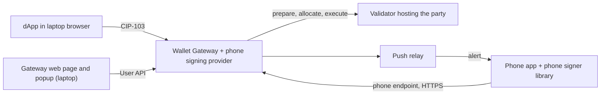

## Development Fund Proposal

**Author:** [VertexPoint Labs LLC (TrustedPoint)](https://trusted-point.com) · `grants@trusted-point.com`
**Status:** Submitted
**Created:** 2026-07-16
**Label:** canton-apis
**Champion:** hythloda (Amanda Martin, Canton Foundation)
**Proposal Type:** RFP-aligned
**RFP / Roadmap Area:** RFP #14: Wallet and dApp Integration tooling (Part 1); RFP #17: SDKs in different languages (Part 2)

---

## How this proposal is organised

This proposal has two distinct parts.

| Part | What it is | RFP | Milestones | Engineering CC | Adoption CC |
|---|---|---|---|---|---|
| Part 1: Mobile signer for the Wallet Gateway | Phone signer library and phone signing provider (a Gateway driver). The party key stays on the phone. | #14 | Milestone 1 (engineering), Milestone 3 (adoption) | 345,000 | up to 420,000 (3 × 120,000 + 60,000 completion) |
| Part 2: Swift and Kotlin ledger SDK | A Swift and Kotlin library that reads and submits transactions through a participant's JSON Ledger API v2. It holds no signing keys. | #17 | Milestone 2 (engineering), Milestone 4 (adoption) | 335,000 | up to 150,000 (2 × 60,000 + 30,000 completion) |

The parts do not depend on each other. Part 1 does not use the ledger SDK. The ledger SDK does not use the Wallet Gateway or the phone signer library. Each milestone has its own payment, deadline and acceptance. The parts share only the repository organisation, CI, the docs pipeline and site, the maintenance process and the team. If only one part is funded, we still build the shared CI and docs pipeline at no extra cost.

## RFP Alignment and Ecosystem Need

**Part 1: RFP #14, Wallet and dApp Integration tooling.** For Wallet Gateway users, Part 1 covers the RFP's signing flows, party management and application-to-wallet interactions, with the phone as signer. The [Wallet Gateway](https://github.com/canton-network/wallet) (formerly Wallet Kernel, called the Gateway below) signs through its internal signer, the participant, or a custody vendor. None keeps the key on a user's phone. The Gateway's grant, Dev Fund #109, lists "Mobile Wallets" among key stores, but the repo has no phone signer.

**Part 2: RFP #17, SDKs in different languages.**

- **Target languages:** Swift for iOS and Kotlin for Android.
- **Developer audience:** mobile apps that call a participant's JSON Ledger API directly, such as an operator's own app, internal tools, or a custodian's companion app.
- **APIs and workflows covered:** JSON Ledger API v2, JWT/OIDC, interactive submission with an app-supplied signer, CIP-0056 and CIP-0112 token flows with the CIP-0056 registry API, and Splice DAR bindings.
- **Compatibility as Canton evolves:** a release within 30 days of each Canton minor release and 60 days of each Splice release while maintenance runs, checked by a public conformance suite.

**Who benefits.** Part 1: Gateway operators, their retail users and wallet app teams. Part 2: teams that build iOS and Android apps against a participant.

**How it drives adoption.** Part 1: operators turn on phone signing by config, and dApps that use the dApp SDK's wallet picker need no change. Part 2: mobile teams use a maintained library instead of writing their own.

## Abstract

**Part 1: Mobile signer for the Wallet Gateway.** The user's party key lives on the phone, while the party is hosted on the validator behind the user's Gateway. The phone pairs with that Gateway by QR code and from then on talks only to it. For each dApp transaction the Gateway wakes the phone with a push, and the phone checks the request and signs after a biometric prompt. dApps that already use a Wallet Gateway need no change. We build a Swift and Kotlin phone signer library, a TypeScript phone signing provider for `canton-network/wallet`, a push relay and a reference phone app, under Apache-2.0.

**Part 2: Swift and Kotlin ledger SDK.** We build the ledger SDK, an Apache-2.0 Swift and Kotlin library that mobile apps use to read and submit transactions through a participant's JSON Ledger API v2. It holds no signing keys. For external parties, the app supplies the signer.

**Total Funding Request: 1,250,000 CC**, plus a security review pass-through for Part 1, capped at 130,000 CC (all-in up to 1,380,000 CC). Engineering is 680,000 CC (54%). Milestones 3 and 4 pay up to 570,000 CC (46%) for mainnet adoption.

## Specification

### Part 1: Mobile signer for the Wallet Gateway

#### Objective

Part 1 adds a Wallet Gateway signer that keeps the user's party key on the phone. Its components:

| Component | What it does | Run by |
|---|---|---|
| Phone signer library | Swift and Kotlin library in a phone app. Keeps the party key, checks and shows each request, signs after a biometric prompt | Wallet apps embed it |
| Phone signing provider | TypeScript Gateway driver, contributed upstream. Queues requests and wakes the phone | Gateway operator |
| Phone endpoint | JSON-RPC API the phone calls to pair, fetch requests and answer them | Part of the phone signing provider |
| Push relay | Turns a wake-up into an APNs or FCM alert | App publisher, or us for the reference phone app |
| Reference phone app | Sample iOS and Android app | Us, on TestFlight and Play testing |

#### How it works: one user, step by step

1. **My party is hosted on my Gateway's validator.** In step 3, the Gateway asks this validator to host my new party with Confirmation rights.
2. **My phone holds my party key.** The app creates it in step 3 and keeps it.
3. **My phone connects to my Gateway.** On my laptop I log in to the Gateway's web page, as today. I open its Phones page and scan the QR code with the app. I confirm that both screens show the same 6-digit code. Then I create my party on the Gateway's party page, confirm on the phone and click Allocate. After that, the phone talks only to my Gateway, over HTTPS.
4. **The dApp reaches my phone through the Gateway.** I pick my Gateway in the dApp's wallet picker, and the dApp talks to it through CIP-103, as today. For each transaction, the Gateway's usual approval popup opens on my laptop, and I leave it open while the phone signing provider wakes my phone with a push. The phone fetches the request, checks it and asks for my fingerprint or face. When the signature arrives, the popup asks the Gateway to submit the transaction. The dApp gets the result. Until our upstream PRs merge, I click Approve in the popup twice: once to start signing and once to submit.

#### Topology

**Who hosts the party.** The validator behind the Gateway, with Confirmation rights, threshold 1 and no other hosts. These are the Gateway's defaults (`core/ledger-client/src/ledger-client.ts`).

**What the host and the Gateway operator can do.** They see the party's contracts and transactions, and can block the party or drop requests. They can send the phone any well-formed request but cannot produce the party's signature. With one host at threshold 1, a malicious host can confirm a transaction the phone never signed. So the user must trust the validator operator, as with any Canton party hosted this way.

**Who controls the keys.** Only the user holds the party key and the device key. The Gateway operator runs user login and holds validator admin credentials, used for allocation, key listing and wallet sync, not signing. The validator holds its own keys. The app publisher holds push credentials. VertexPoint Labs holds no party or device keys, only the reference phone app's push credentials, and sees no request content. The Gateway's validator submits and pays for traffic.

**How a CIP-103 app reaches the phone.** Through the Gateway. The dApp stays in the laptop browser and only signing moves to the phone. In the wallet picker of Digital Asset's dApp SDK (`@canton-network/dapp-sdk`), the user picks the Gateway or adds it as a "Custom wallet". The dApp talks only to the Gateway, and the phone gets requests only from the Gateway, after a push alert or when the app opens. The phone holds no Ledger API token.

**PartyLayer (Dev Fund #9)** connects dApps to wallets, including React Native dApps on a phone, and holds no private keys. Part 1 is the user's signer on the wallet side. A PartyLayer dApp reaches the Gateway through the dApp SDK's `RemoteAdapter` ("Path B" in PartyLayer's docs), and the Gateway passes the request to the phone. So the two meet at the Gateway and do not overlap.

#### Pairing and party creation

The QR code holds a one-time secret, valid for 5 minutes. The phone creates its keys and registers its public keys and push relay. The relay must be on the operator's allowlist. The phone proves it holds the keys and the secret without sending the secret. The 6-digit code is derived from the pairing data, so if someone pairs first from a photo of the QR code, the two screens show different codes.

We add phone keys to the Gateway's party page, next to Fireblocks keys. Our allocator sends the full topology transactions to the phone, as the DFNS allocator does.

#### Upstream changes

- **PR-1:** the phone signing provider, built like the existing custody vendor drivers, with a `signingProviders.phone` config entry. It also adds the phone endpoint with its own device-key auth, an OpenRPC spec and the Phones page.
- **PR-2:** adds the option `review: false` to `signingProviders.<provider>`. With it, `prepareExecute` starts signing at once. It still returns the popup URL, and the popup shows only the signing status (about 20 lines of code). [Issue #2431](https://github.com/canton-network/wallet/issues/2431) asks to hide the approval screen instead, and we propose this variant there.
- **PR-3:** the Approve page executes the transaction when a pending signature turns `signed` (about 10 lines of code). Later, the background worker proposed in [issue #2404](https://github.com/canton-network/wallet/issues/2404) can do this on the server.

We propose these changes on #2431, #2404 and [#1926](https://github.com/canton-network/wallet/issues/1926) before writing code. If #1926 lands first and allows external signing drivers, the driver part of the phone signing provider ships as an external package. If the maintainers want no new routes in the Gateway, the phone endpoint runs next to it as a sidecar. The phone side stays the same.

#### Signing a dApp transaction

The dApp's `prepareExecute` uses the user's primary wallet, which must be the phone party. The phone signing provider gets the prepared transaction and hash, plus the hashing version and dApp origin that PR-1 adds. It queues the request for 4 minutes and returns `pending`. When the phone signs, the provider verifies the signature and reports `signed`. With PR-2, the 4-minute limit fits the dApp SDK's 5-minute `prepareExecuteAndWait` timeout. Without PR-2, signing waits for an Approve click, so the dApp may time out first. The dApp also times out if the popup is closed or stays in the background for the whole 5-minute wait.

Each push is a visible alert with fixed text and an opaque id, so the push carries no request content.

#### What the phone checks before it signs

The phone signs only a hash it computed itself, from content it decoded and showed. The user must reject any request they did not start.

- **Every request** comes over TLS from the Gateway URL pinned at pairing, is unexpired and unanswered, and names the paired key.
- **Ledger transactions:** the phone refuses unknown hashing versions and hash mismatches, and checks the acting party. It shows the dApp origin reported by the Gateway. For token-standard transfers and allocations it shows amount, instrument, sender and receiver. Other actions show template, choice and arguments with a warning.
- **Onboarding:** the phone decodes every topology transaction. It accepts only authority for its own key, the expected host with Confirmation, no other hosts and threshold 1. It recomputes the multihash.

The Gateway repo has hash code for V2 only, but the Gateway defaults to V3. We port V2 from that repo and V3 from Canton into shared Kotlin Multiplatform code in the phone signer library. Key storage and biometric prompts use each platform's native APIs. CI test vectors are hashes that Canton returns on LocalNet. V4 (Canton 3.6, protocol version 36) is the next known one. We add it within 30 days of the Gateway allowing it. The phone signing provider always requires the full transaction, even if issue #2209 makes it optional for other providers.

#### Keys and recovery

- **Party key: Ed25519,** the only party key type the Gateway accepts. The iOS Secure Enclave cannot hold Ed25519, so the app creates the key in software and stores it encrypted under a biometric-gated key. That key sits in the Secure Enclave or Android Keystore (StrongBox where present). The party key is decrypted in memory for one signature.
- **Device key: P-256** in secure hardware. It signs each request the phone sends to the Gateway, with a nonce and a short expiry. Canton never sees it.
- **Single-key default.** The party key is both namespace root and signing key. A root namespace key cannot be rotated, so losing the phone loses the party. The app warns about this before the party is created.
- **Optional recovery phrase:** 24 BIP-39 words, with the SLIP-10 derivation path of Digital Asset's planned HD wallet driver (issue #2406). The user chooses it at pairing, before the party key is created. It is off by default. A restore gives the same party. A user who turns it on later gets a new party and moves holdings to it.
- **Not offered:** a Canton-level recovery key or key rotation. The Gateway's allocation path takes one key.
- **Lost phone:** revoking it on the Phones page stops this Gateway from using it. The party key stays valid on the ledger, protected by biometrics on the lost phone. With a phrase, the user restores the key on a new phone and pairs it again. If the key may be compromised, the user moves holdings to a new party.

#### Out of scope for Part 1

- Ledger API access from the phone, including through the ledger SDK.
- WalletConnect, new connectivity standards and dApp changes.
- A consumer wallet or custody service.
- The browser-extension Gateway, and dApp `signMessage` or self-issued login for phone-held keys.
- Testing a dApp opened on the same phone.
- Hardware-held P-256 party keys beyond the Milestone 1 test, multi-hosting, and moving existing parties to a phone key.

#### Architectural alignment and backward compatibility

The phone signing provider uses the Wallet Gateway's driver interface (Dev Fund #50 and #109), plus two optional fields: hashing version and dApp origin. It is off unless the operator adds `signingProviders.phone`. Existing providers, dApps and Canton do not change. PR-2 keeps the review screen by default. PR-3 removes the second click for all asynchronous providers. Releases follow semantic versioning. At each Milestone 1 checkpoint and before Milestone 1 acceptance, we offer a demo to the `canton-network/wallet` maintainers and the Digital Asset wallet team, and include their feedback before acceptance.

### Part 2: Swift and Kotlin ledger SDK

#### Objective

The ledger SDK lets an iOS or Android app talk to a Canton participant over the JSON Ledger API v2.

#### Topology

**Who hosts the party.** The participant the app connects to. Its operator creates the app's Ledger API user and grants its rights. The app authenticates with a JWT from its identity provider.

**Who controls the keys.** For a party hosted with submission rights, the participant holds the keys, and the ledger SDK submits with the app's JWT. For an external party, the app's own signer holds the key, and the ledger SDK uses interactive submission. The app or the participant operator onboards external parties with their own tooling. OIDC tokens stay in memory unless the app supplies a token store.

**PartyLayer (Dev Fund #9).** PartyLayer, including its React Native bindings, connects a dApp to a wallet, and the wallet signs. The ledger SDK does not connect to a wallet. An app on it calls a participant's JSON Ledger API directly, and for external parties the app supplies the signer. Part 2 does not overlap with PartyLayer either.

#### How it works

**Signer callback.** The ledger SDK defines one asynchronous signer interface, in Swift and Kotlin, that the app implements. An external-party submission runs in 4 steps:

1. The ledger SDK calls `/v2/interactive-submission/prepare`.
2. It passes the signer callback the party, the full `preparedTransaction`, the participant's hash and the `hashingSchemeVersion`.
3. The signer returns the signature with its format, signing algorithm and key fingerprint, or a rejection. Milestone 2 tests Ed25519.
4. On a signature, the ledger SDK calls `execute` or `executeAndWait` with `partySignatures` and tracks the completion. On a rejection it executes nothing.

The ledger SDK also ships a hash check helper. It decodes `preparedTransaction`, recomputes the hash under the stated `hashingSchemeVersion` (V2 and V3 at launch) and compares it with the participant's hash. It rejects unknown hashing versions. The app's signer should call the helper before signing. A signer that skips it signs the participant's hash blind. The sample apps include an Ed25519 test signer with an in-memory throwaway key, marked as not for production.

**Token registries.** For CIP-0056 flows, the ledger SDK also calls the instrument admin's registry API for factories, choice context and disclosed contracts. For Canton Coin that is Scan. The app sets the registry URL for each admin party.

**Command recovery.** Commands carry a change ID for de-duplication. If the OS kills the app or the network changes mid-submit, the ledger SDK recovers the command through the completion endpoint. It never submits it twice.

**Ledger SDK core.** One internal Kotlin Multiplatform core holds the protocol logic, under hand-written Swift and Kotlin APIs.

**Conformance.** One public CI suite maps each shipped capability to the [ledger client standard](https://docs.google.com/spreadsheets/d/1iR3GqKx6ktqqBiNIwRhoOuzOh0jf_7H-pQ7QRGOLl9s/edit?gid=541890420#gid=541890420) referenced in RFP #17. Capabilities the standard does not list are tested and documented as extras. PQS, in-memory ACS and OpenTelemetry are out of scope on a phone, and structured-logging hooks replace OpenTelemetry. A compatibility matrix maps ledger SDK versions to Canton, Splice, iOS and Android versions.

#### Out of scope for Part 2

- Key storage, biometric signing, and transaction display before signing.
- External-party onboarding.
- CIP-103, WalletConnect and deep links.
- A consumer wallet or custody service, exchange integrations, any hosted backend, and any new connectivity standard.
- **Deferred to a later Part 2 grant:** the `dpm` DAR codegen CLI, gRPC, React Native and Flutter bridges, and more sample apps.

#### Architectural alignment and backward compatibility

The ledger SDK uses the participant's public JSON Ledger API v2 and needs Canton 3.4 or later. *No backward compatibility impact on existing Canton ecosystem components.* Releases use semantic versioning, with a changelog and migration notes.

## Milestones and Deliverables

### Part 1 milestones

#### Milestone 1 (Part 1): Engineering

- **Estimated Delivery:** month 5. **Hard deadline:** 6 months from grant approval.
- **Focus:** the end-to-end flow on Android and iOS, push alerts and the target flow with no laptop click. Then recovery, the security review, upstream merge and release.
- **Checkpoints (no payment):**
  - First: an Android end-to-end demo to the `canton-network/wallet` maintainers and the Digital Asset wallet team. It uses today's Gateway plus PR-1, without push. The app is open and fetches requests from the phone endpoint. PR-1 is opened upstream.
  - Then: the iOS and push target-flow demo, to the same teams. PR-2 and PR-3 are opened upstream.
- **Deliverables:**
  - Phone signing provider, phone endpoint and Phones page.
  - Android and iOS phone signer library and reference phone app, with topology checks and readable token-standard summaries.
  - V2 and V3 hashing, with Canton test vectors for both.
  - Push relay and alerts.
  - Optional recovery phrase, with a documented way to move holdings to a new party.
  - Security model document covering key roles, key loss, the recovery phrase and trust in the host.
  - P-256 party key test on DevNet, published, to scope a later Gateway change.
  - PR-1, PR-2 and PR-3 opened, and upstream review until they merge.
  - End-to-end suite in public CI, DevNet regression runs, and one mainnet smoke run on a Gateway run by us or a partner validator operator.
  - Operator guide, wallet app guide and upstream docs.
  - Releases: the phone signer library as a Swift Package and on Maven Central (`io.github.trusted-point`, `canton-phone-signer-*`, with a transfer to a Foundation group offered).
  - Push relay image, and reference phone apps on TestFlight and Play testing. Public Apache-2.0 repositories.
  - Compatibility matrix of supported Gateway, Canton and OS versions.
- **Security review:** runs during this milestone. The pass-through is paid on Milestone 1 acceptance. See Security review pass-through in Funding.
- **Verification** (DevNet, with CI on LocalNet):
  - A stock Android phone and a stock iPhone each pair and create a party, showing the decoded topology. The party id ends in the phone key's fingerprint. The Gateway stores no private key for it.
  - In a laptop browser, a dApp on the dApp SDK calls `prepareExecute` with the phone party as primary wallet. With the Gateway set to V2 hashing and only PR-1, the phone shows a matching recomputed hash. After two laptop clicks, the dApp receives `txChanged executed`.
  - The target flow, recorded, on a stock iPhone and Android phone: app closed, phone locked, Gateway popup open, V3 hashing, and PR-2 and PR-3 merged or on our branch. No laptop click.
  - At acceptance, the target flow on DevNet on both platforms, with the upstream Gateway. An unmerged PR-2 adds one laptop click, and so does an unmerged PR-3. If PR-1 is still in upstream review at the hard deadline, this runs on our Gateway branch with PR-1.
  - Rejection and expiry reach the dApp as `txChanged failed`.
  - CI refuses tampered transactions, wrong hashes, unknown hashing versions, extra keys or hosts, expired or replayed requests, revoked phones and wrong-key signatures.
  - A phone restored from the phrase signs a transfer.
  - PR-1 to PR-3 merged, or the maintainers' written decision on record and the agreed alternative delivered. A PR still in upstream review at the hard deadline does not block acceptance. Its review continues under maintenance.
  - Suite green, docs published, artefacts resolving, review remediation summary published.
  - P-256 test and compatibility matrix published, mainnet smoke run recorded.
- **Payment:** 345,000 CC upon committee acceptance.

#### Milestone 3 (Part 1): Adoption

- **Estimated Delivery:** opens on Milestone 1 acceptance. **Hard deadline:** 12 months from Milestone 1 acceptance, but no later than 18 months from grant approval. This is an explicit exception to the 9-month default.
- **Focus:** production use of Part 1 on mainnet.
- **Deliverables:**
  - Up to 3 independent adopters, under the tranche rules in Funding.
  - Completion items, all of:
    - At least 2 independent phone apps on the phone signer library, other than the reference phone app, in a public app store or public beta track.
    - The reference phone app kept working until this milestone's acceptance, against a mainnet Gateway run by us or a partner validator operator.
    - Sessions for Gateway operators and for wallet app teams.
    - At least 5 GitHub issues or PRs from external contributors.
    - At least 3 community-reported issues triaged to resolution.
    - Docs on a docs site linked from the Canton developer docs.
    - An updated long-term maintenance plan and a final report.
- **Verification:** for adopters, the evidence in the tranche rules. For completion, listings, GitHub insights and issue links, confirmed with adopting teams and the champion.
- **Payment:** one acceptance, at the hard deadline or earlier once 3 adopters are verified and the completion items are met. It pays 120,000 CC for each verified independent adopter, up to 3, and the 60,000 CC completion tranche if all completion items are met. Maximum 420,000 CC.

### Part 2 milestones

#### Milestone 2 (Part 2): Engineering

- **Estimated Delivery:** month 5. **Hard deadline:** 6 months from grant approval.
- **Focus:** the ledger SDK and its core on both platforms, then token flows, Splice bindings, conformance and the first release.
- **Checkpoint (no payment):** the ledger SDK core and the sample apps on both platforms, shown in a recorded demo before the token-standard work.
- **Deliverables:**
  - Ledger SDK core: models, command construction and recovery, ACS and update paging, resumable HTTP and WebSocket streams, error classes and TLS.
  - Kotlin library and a Swift Package at parity, with JWT/OIDC (PKCE, token refresh, provider presets), the signer callback and the hash check helper.
  - Typed CIP-0056 V1 and CIP-0112 V2 flows on both platforms: holdings, transfer instructions, allocations, choice context and disclosed contracts from the registry API, and V2 transfer events. If CIP-0112 is still changing at Milestone 2 acceptance, Milestone 2 can be accepted with V1 only. V2 then follows within 30 days of CIP-0112 running unchanged on DevNet for a full release cycle.
  - Splice DAR bindings generated in CI with `daml-lf-archive`, and a typed-value layer for application contracts.
  - Android and iOS sample apps with the test signer and transfer examples.
  - Conformance checklist, version-pinned, with the conformance suite and compatibility matrix.
  - Public Apache-2.0 repository with green CI. Quickstarts, API docs, recorded demos, and `docs/maintainers/` with the upgrade playbook and release pipelines.
  - Tagged release on Maven Central (`io.github.trusted-point`, `canton-ledger-*`, transfer to a Foundation group offered) and as a Swift Package.
- **Verification:**
  - The release artefacts resolve, and tests pass in public CI.
  - On a stock iPhone and Android phone, the sample apps submit and read a transaction as a party hosted with submission rights.
  - On both platforms, an external party's transaction runs through `prepare`, the test signer and `executeAndWait`, and settles on DevNet. A test script outside the ledger SDK onboards the party.
  - A CI test interrupts a submission. The ledger SDK recovers it through the completion endpoint and does not submit it twice.
  - In CI, the hash check helper matches the V2 and V3 hashes Canton returns on LocalNet and rejects a tampered `preparedTransaction`.
  - A V1 transfer settles live on DevNet on both platforms, without mocks. So does a V2 `Account`-based transfer or allocation, unless the CIP-0112 rule applies.
  - The conformance suite maps every shipped capability to the checklist and is green in public CI against LocalNet.
  - Docs and the matrix are published.
- **Payment:** 335,000 CC upon committee acceptance.

#### Milestone 4 (Part 2): Adoption

- **Estimated Delivery:** opens on Milestone 2 acceptance. **Hard deadline:** 12 months from Milestone 2 acceptance, but no later than 18 months from grant approval. This is an explicit exception to the 9-month default.
- **Focus:** production use of Part 2 on mainnet.
- **Deliverables:**
  - Up to 2 independent apps, under the tranche rules in Funding.
  - Completion items, all of:
    - At least 2 independent apps on the ledger SDK, other than our sample apps, in a public app store or public beta track.
    - Sample apps and quickstart kept current with mainnet releases.
    - A session for app teams.
    - At least 5 GitHub issues or PRs from external contributors.
    - At least 3 community-reported issues triaged to resolution.
    - Docs on a docs site linked from the Canton developer docs.
    - An updated long-term maintenance plan and a final report.
- **Verification:** for apps, the evidence in the tranche rules. For completion, listings, GitHub insights and issue links, confirmed with adopting teams and the champion.
- **Payment:** one acceptance, at the hard deadline or earlier once 2 apps are verified and the completion items are met. It pays 60,000 CC for each verified independent app, up to 2, and the 30,000 CC completion tranche if all completion items are met. Maximum 150,000 CC.

## Acceptance Criteria

Each milestone is accepted on its Verification items. Milestones 1 and 2 also need:

**Part 1 (Milestone 1)**

- **Phone signing provider:** an operator turns it on from the operator guide.
- **Phone signer library:** signs only after its own checks and a biometric prompt. The party key leaves the phone only as the optional recovery phrase.
- **Target flow:** an unchanged dApp receives `txChanged executed` after the user confirms on the phone.
- **Maintenance plan for the free period:** published.

**Part 2 (Milestone 2)**

- **Ledger SDK:** a developer adds the Swift Package or Maven artefact, points it at a participant and submits a first transaction from a stock device. The ledger SDK holds no signing key.
- **Maintenance plan for the free period:** published.

## Funding

**Total Funding Request: 1,250,000 CC**

Plus the Part 1 security review pass-through, capped at 130,000 CC. All-in: up to 1,380,000 CC.

| Milestone | Part | Payment |
|---|---|---|
| Milestone 1: Engineering | 1 | 345,000 CC |
| Milestone 2: Engineering | 2 | 335,000 CC |
| Milestone 3: Adoption | 1 | up to 420,000 CC |
| Milestone 4: Adoption | 2 | up to 150,000 CC |
| **Total** | | **1,250,000 CC** |

Both parts run in parallel over about 6 months.

Engineering is 680,000 CC (54%): 345,000 CC for Part 1 and 335,000 CC for Part 2. Adoption is up to 570,000 CC (46%). Part 1 adoption is up to 420,000 CC: 3 × 120,000 CC plus 60,000 CC for completion. Part 2 adoption is up to 150,000 CC: 2 × 60,000 CC plus 30,000 CC for completion.

Maintenance is free from each part's engineering acceptance until 6 months after Milestones 1 and 2 are both accepted. After that, we ask for a separate maintenance grant of 150,000 CC a quarter for both parts, outside this request. See Maintenance Commitment.

### Adoption tranche rules (Milestones 3 and 4)

A Part 1 adopter is a Gateway operator or wallet app whose users sign mainnet transactions on their phones through the phone signing provider. A Gateway operator and a phone app serving the same users count as one. A Part 2 app is one whose iOS or Android production build submits to mainnet through the ledger SDK. An adopter is paid in one part only.

Independent means no common ownership or control with VertexPoint Labs, and no payment from us for the integration. The Foundation verifies this, also for the completion tranche apps. A tranche pays only for an independent adopter or app with:

- Real use on its production path. A nominal integration that signs or submits a single transaction does not count.
- At least 4 consecutive weeks of mainnet activity.
- Evidence: party IDs and on-chain submissions in a public roster with adopter consent, or a private attestation under NDA that the Foundation confirms to the committee.

Featured App status is not required. We deliver our own completion items even if no adopter tranche is paid: the reference phone app, sample apps, sessions, docs, maintenance plans and final reports. If adoption stalls, engineering payments are unaffected.

### Security review pass-through (Part 1)

Paid on Milestone 1 acceptance, against the vendor invoice, outside the 1,250,000 CC base.

- Budget: capped at 130,000 CC, so all-in is up to 1,380,000 CC. We expect 100,000 to 130,000 CC. Any amount above the cap needs committee re-approval. The review continues while the committee decides.
- Vendors: Cure53 plus a mobile specialist such as NCC Group or Trail of Bits. Vendor and scope are agreed with the Tech & Ops security subcommittee before the review starts.
- Scope: the phone signer library (keys, checks, recovery phrase), the phone signing provider with the phone endpoint (pairing, device-key auth, request flow), and the push relay. Before the review, we publish the scope document and signed vendor quote.
- Findings: Critical and High are fixed before any v1.0 tag, with a published remediation summary. Accepted or deferred Medium and Low findings are listed with reasons.

The ledger SDK holds no signing keys, so Part 2 is outside the security review.

### Deadline rationale

Milestones 3 and 4 need more than the 9-month default. Integration, app-store review, operator releases and 4 weeks of mainnet use often take over 9 months. Dev Fund #46 carries an 18-month exception on the same grounds.

### Volatility Stipulation

The grant is denominated in fixed Canton Coin.

## Maintenance Commitment

We maintain each part at no extra cost from the day its engineering milestone is accepted. The free period ends 6 months after Milestones 1 and 2 are both accepted. If only one part is funded, it ends 6 months after that part's engineering milestone is accepted. After that, we ask for paid maintenance as its own grant, outside the 1,250,000 CC request: 150,000 CC a quarter for both parts. Each quarter ends with a maintenance note. The committee pays the quarter when it accepts the note, and can end maintenance at any quarterly review.

Maintenance, free or paid, includes:

- **Compatibility:** a compatible release or patch within the times below.
- **Security patches:** Critical or High CVEs within 7 days, Medium CVEs within 30 days.
- **Issues:** critical issues (security, signing correctness, broken install) get a 48-hour response and a 7-day fix. Normal issues get a 7-day response and a 30-day fix. External PRs are reviewed within 7 days.
- **CI:** toolchains and the compatibility matrices kept current.
- **Maintenance note:** releases, issues closed and known limitations.

| Event | Compatible release or patch within |
|---|---|
| Canton minor release | 30 days |
| Splice release | 60 days |
| Gateway release that changes the signing driver interface (Part 1) | 30 days |
| iOS or Android major release | 30 days |

When maintenance ends, released artefacts stay resolvable and the repositories stay public. Others can continue from the upgrade playbook in `docs/maintainers/`. If we cannot keep these times, or the Foundation requests it, the repositories and Maven coordinates move to the canton-foundation organisation, with a 30-day handover.

## Co-Marketing

With the Foundation, on release:

- Part 1: an announcement, a phone-signing walkthrough and joint posts for each verified Part 1 adopter.
- Part 2: a "first Canton transaction from an iPhone" walkthrough and joint posts for each verified Part 2 app.
- Demos and office hours for each part, and one Canton hackathon workshop with a session for each part.

## Motivation

**Part 1.** The Gateway's own checklist says "Do not use internal signing for valuable assets." Part 1 gives Gateway users a signer that keeps the key on their phone.

**Part 2.** None of the kits listed in RFP #17 is a native Swift or Kotlin library.

## Rationale

**Part 1.** The design follows the custody vendor drivers: Fireblocks and DFNS also return `pending` until approval arrives, for example from Fireblocks' phone app. If Digital Asset adds phone signing to the Gateway, we align our provider with it.

**Part 2.** Leaving the signer to the app keeps key material out of the ledger SDK. `vsima/canton-mobile-sdk`, a community Swift and Kotlin SDK on the gRPC Ledger API, started on 7 August 2026. The ledger SDK uses the JSON Ledger API v2. We will work with its author to share code instead of building a second, separate SDK, and do the same if Digital Asset ships a mobile ledger SDK.

### Why us

VertexPoint Labs LLC, operating as TrustedPoint, has run Proof-of-Stake validator infrastructure since 2020.

- Currently validating 9 networks: Sui, Story, Ika, Somnia, Walrus, Initia, Celestia, ZetaChain, Monad.
- $350M+ in staked assets secured across our validators.
- 19,000+ delegators across nine networks.
- Hands-on Canton engineering: production integration experience with the JSON Ledger API v2 against cn-quickstart deployments, including the Featured App reward flow end to end, and Canton validator operations on DevNet.

The build is staffed with dedicated iOS and Android engineers alongside our Canton integration experience.

Channels: [trusted-point.com](https://trusted-point.com) · [github.com/trusted-point](https://github.com/trusted-point) · [twitter.com/Trusted_Point](https://twitter.com/Trusted_Point) · [t.me/TrustedPointCorp](https://t.me/TrustedPointCorp)
