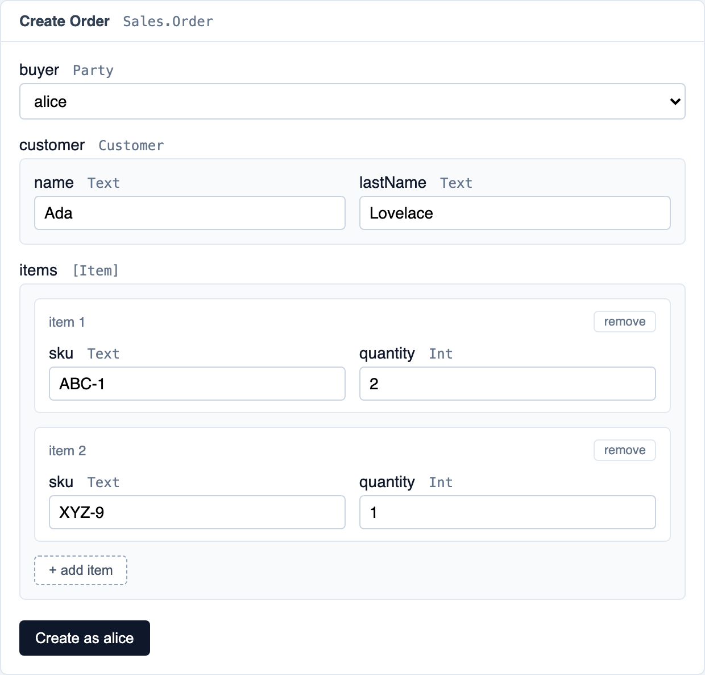

## Development Fund Proposal: contracts-workbench

| Field | Value |
| :---- | :---- |
| Organization | [BootNode](https://bootnode.dev) |
| Author / Primary Contact | Pablo Fullana <pablo@bootnode.dev> |
| Status | Submitted |
| Created | 2026-10-21 |
| PR | [#927](https://github.com/canton-foundation/canton-dev-fund/pull/927) |
| Proposal Type | RFP-aligned |
| RFP / Roadmap Area | RFP-19: DPM Components and Extension Ecosystem (Developer Experience, Tooling & Education) |
| Champion | Needs Champion |
| Total Funding Request | 960,000 CC |
| Project Duration | ~11 weeks of build, then adoption windows of up to 6 months after each build milestone |
| Label | daml-tooling |

---

## Abstract

**contracts-workbench** is a local development tool for Daml. It lets a developer read and operate any Daml package on their development network from the browser: browse the contracts a party can see, create contracts, exercise choices, and see exactly what each submission created and archived. It removes the scaffolding that trying out a template costs today, namely writing a Daml script or a hand-crafted Ledger API request, working out the contract id, the choice name and the shape of its arguments, and redoing all of it after the next change to the template.

None of that is specific to this application, so it is published as an SDK and a React component library. The SDK checks a call against a template's own types and encodes it the way the ledger expects; the components render it as a form. By installing these packages, an explorer that today only shows contracts can let its users create them and exercise their choices, without having to build the forms or the validation itself.

Daml Navigator used to fill this role and is deprecated. Most of what exists today is read-only: developers can look at the ledger, but they cannot act on it without writing code. The tools that do write keep that capability inside their own application, so no other tool can reuse it.

---

## Specification

### 1. Objective

Give developers building on Canton a way to create contracts and exercise any choice on any package, as any party, without writing code, and publish that capability so other tools can embed it.

This responds to **RFP-19, DPM Components and Extension Ecosystem**, which calls for reusable `dpm` components such as local dashboards and debugging workflows that make Canton applications easier to build, operate and understand. **contracts-workbench** is that component for the developer's inner loop, where a template already exists and the question is simply whether it behaves the way it was meant to.

Today every small check during development costs the same setup: a script, generated bindings, or a hand-written JSON payload. That cost is paid again on every change to the template, and again by every person who wants to try a package someone else wrote. The proposal converts that repeated effort into a tool installed with one command.

There is a second half to the problem, specific to Canton. A choice is not simply callable or not: it depends on who is acting. The same contract offers different choices to different parties, and a party that is not authorized gets a rejection that is hard to read. Understanding "who can do what" today means reading the Daml source and reasoning about signatories, observers and choice controllers on your own. **contracts-workbench** makes that observable: switching the acting party changes which contracts are visible, each choice shows the party that controls it when the package declares it from the contract or the choice arguments, and a submission the party is not authorized for comes back as a plain sentence rather than a Canton error code.

### 2. Implementation Mechanics

**How it connects:** everything goes through the participant that is already running, over its JSON Ledger API, using the Foundation's own `@canton-network/core-ledger-client`. Wallets are reached through CIP-0103, the standard dApp API for Canton, using `@canton-network/dapp-sdk` through [`@bootnodedev/canton-connect`](https://github.com/BootNodeDev/canton-dappbooster/tree/main/canton-connect), BootNode's React layer over it, so one integration works with any compliant wallet.

**How it ships:** as a `dpm` component, installed next to the network the developer already has, whichever tool started it.

**How it is reused:** two packages are published, an SDK that describes and validates a call from a template's own types, and a React component library that renders that description as a form. Fetching packages and reaching the ledger stay with `@canton-network/core-ledger-client`, and the tool decodes what it fetches with the published Daml-LF definitions. Signing stays with `@canton-network/dapp-sdk`. The application itself is a consumer of both.

**Core capabilities:**

- **Read any package with no configuration:** a Daml package already describes itself. Its templates, their fields, their choices and the type of every argument travel inside the DAR. The tool reads that description directly, so a package works the moment it is on the participant, with no configuration and no code generation step.
- **Operate as any party:** create parties from the app, pick one, and act as it. Everything the app shows and everything it can submit is scoped to that party.
- **Create and exercise through generated forms:** every template and every choice gets a form built from its own arguments, with an input matching each declared type all the way down, including nested records, repeatable rows for lists and sets, and a selector for variants whose options are simple. What is too complex for a form is entered as JSON, and the whole payload is validated locally before anything is sent.
- **Use contracts the acting party cannot see:** the developer adds disclosure sources, the parties whose contracts they want to use, such as the provider of a factory. Their contracts appear next to the acting party's, marked with the party they come from. When one is picked, the tool fetches it as that party and attaches it to the submission as a disclosed contract, standing in for the provider's API that serves it in production. Contracts a choice reads internally are picked from the same list and attached by hand, and contracts from another participant can be pasted.
- **Read what a submission did:** the contracts created and the contracts archived, with their data, taken from the transaction the participant returned rather than from what was submitted.
- **Sign with a wallet the participant does not control:** for parties that own their own key, the browser connects to the user's CIP-0103 wallet, the user sees what they are about to sign, and the wallet signs it.
- **Embed the forms in other tools:** the form engine ships as an npm SDK and React components, so an explorer or dashboard can add create and exercise to its own screens without building form generation or payload validation itself.

#### Installation example

```bash
dpm add component contracts-workbench
```

#### From template to form

A package says what type every field is. The tool turns each type into the input that fits it, and does that at every level of nesting.

| The package declares | The developer gets |
| :---- | :---- |
| `Text`, `Int`, `Numeric`, `Bool` | a text box, a number box, a checkbox |
| `Date`, `Time` | a date picker |
| `Party` | a dropdown of the parties on the network |
| `ContractId T` | a dropdown of the `T` contracts the acting party can see, plus those of the disclosure sources, attached as disclosed when picked |
| a record | one input per field, grouped under the field name |
| a list, a set | one row per element, with the inputs of the element type, and buttons to add and remove |
| a map, an optional inside another optional, a type that contains itself | a JSON input, with the expected shape shown |
| a variant with simple options | a dropdown of its options |
| an `Optional` | the same input, left empty when there is no value |

For example, this template:

```daml
template Order
  with
    buyer: Party
    customer: Customer
    items: [Item]
  where
    signatory buyer

    choice Order_Ship : (ContractId Shipment, ContractId Order)
      with
        carrier: Party
        sku: Text
      controller buyer

data Customer = Customer with name: Text, lastName: Text
data Item = Item with sku: Text, quantity: Int
```

produces this form, with nothing to configure:



A field that holds other fields opens in place. `customer` is a `Customer`, so it opens as a box with the fields of a `Customer` inside it. `items` is a list, so it shows one box per item, with a button to add another and a button to remove one. If an `Item` had a list inside it, that list would be drawn the same way, one level further in. A field whose shape is too complex for a form is entered as JSON instead, with the expected shape shown next to it. That covers maps, optionals inside other optionals, types that contain themselves, such as a comment whose replies are comments too, and variants whose options carry structures of their own.

Daml values have a JSON form with rules that are easy to miss: a whole number goes as text, a map as a list of pairs, and an optional nested inside another optional changes shape entirely. Those are the mistakes hardest to understand, because the ledger rejects the payload without naming the rule that was broken. The form applies those rules itself, and a field entered as JSON starts from a template already in the right shape, so the developer edits values instead of guessing the structure.

The form can be switched for the raw JSON of the same call. Coming from the form, that JSON is already filled in and ready to copy into a script, a test or the app being built. Going the other way, the argument can be written by hand, which is what a payload from a bug report needs. One mode is in use at a time.

#### Result example

A choice usually does more than the one thing it was asked to do. `Order_Ship` hands one item to a carrier, and to do that it archives the order, creates a shipment, and creates a new order holding whatever has not shipped yet. The developer named none of those three contracts, and the order they will work with next has an id that did not exist a moment ago.

So the result is read from the transaction the ledger produced, not from what was submitted:

```
Created
  Shipment   carrier bob, sku ABC-1, quantity 2
  Order      buyer alice, customer Ada Lovelace, items XYZ-9 x1

Archived
  Order      by Order_Ship
```

Each created contract is shown with its data and can be opened from there.

#### Walkthrough example

A developer starts their local network, adds the component and opens the browser:

1. Create the parties the scenario needs from the header, for example an issuer and a user, and select the issuer.
2. Upload the package, or pick one already on the participant. Its templates appear, each with the choices it declares and the arguments each choice takes.
3. Pick a template and create a contract from the generated form. Party fields offer the parties that exist, contract fields offer the contracts the acting party can see, plus those of any disclosure source, which are attached as disclosed contracts.
4. Open the new contract from the contract list and read its data.
5. Exercise one of its choices, filling its arguments in the same kind of form. The result lists every contract the choice created and every one it archived, with their data.
6. Switch to the user, open the contract the choice created for them, and exercise a choice as them. Same list, same forms, same result.

#### Scope and assumptions

**contracts-workbench** connects to environments but does not provision them. It requires a running participant and confirms it is reachable before doing anything. It will not start a local network, deploy a package on the developer's behalf, or manage the network's lifecycle.

**Authentication** is development-network scoped. The tool assumes the shared credentials of a local network and mints the self-signed ledger tokens that configuration accepts. Production identity providers are out of scope, and the tool is not meant to be pointed at a real deployment.

**Signing** works for both kinds of party. Parties hosted by the participant are signed for by the participant on request, with no wallet software involved. External parties, where the key belongs to the user, sign in their own CIP-0103 wallet.

**Package discovery** lists every package on the participant, with a search box that narrows the list as the developer types. The developer picks one and works with its templates. A package uploaded twice, after an update, appears twice with its version next to it.

**Writing tests** is out of scope. The tool is for the inner loop, where a developer is trying something out by hand. Automated end-to-end testing of a dApp is the subject of a separate BootNode proposal, **canton-testkit** ([#888](https://github.com/canton-foundation/canton-dev-fund/pull/888)).

### 3. Architectural Alignment

**contracts-workbench** operates as a thin layer above existing Canton ecosystem interfaces. It drives the participant through the JSON Ledger API using `@canton-network/core-ledger-client`, and reaches wallets through CIP-0103, the Foundation's own standard for dApp to wallet communication, so it integrates once rather than per wallet vendor. The connection itself goes through `@canton-network/dapp-sdk`, wrapped by `@bootnodedev/canton-connect`, which handles the connection lifecycle cases the SDK leaves open, such as a wallet popup the user closes or a wallet that locks mid-session.

A DAR does not carry Daml source code. It carries the compiled form the ledger actually executes, called Daml-LF, and the exact layout of that form is published as protobuf definitions in the Canton repository. The tool reads packages with those definitions, pinned to the Canton version it is tested against, so what the tool believes a template declares is exactly what the participant believes.

It ships as a `dpm` component, the distribution mechanism the Foundation's own tooling uses, so it sits next to the network a developer already runs. Because discovery happens through the participant rather than through project files, any package is usable by the tool the moment it is uploaded, by whatever means.

The published packages cover one step of that picture. They turn a template's type description into a form, and a filled form into a payload the ledger accepts. Reaching the participant stays with `@canton-network/core-ledger-client`, and wallet connection and signing with `@canton-network/dapp-sdk`.

### 4. Backward Compatibility

*No backward compatibility impact.* **contracts-workbench** is a new tool for local development. It does not change the participant, the ledger, or any deployed package. It consumes the JSON Ledger API, the official client libraries and the CIP-0103 standard without modification.

---

## Milestones and Deliverables

The four milestones are two builds and the adoption of each: the developer app and its adoption, the SDK and its adoption.

### Milestone 1: The workbench developer app

- **Estimated Delivery:** ~8 weeks
- **Focus:** A tool a developer installs with one command to create contracts and exercise any choice, as any party, through forms generated from the package itself, including parties whose key lives in a CIP-0103 wallet.
- **Description:** The component connects to the running participant and loads its packages, or one uploaded from the app, with no configuration. The developer picks an acting party, browses its contracts, and creates or exercises through forms generated from the template's types. Payloads are validated locally, rejections come back as one plain sentence, and each result lists the contracts created and archived. Contracts the party cannot see are attached as disclosed contracts, and CIP-0103 wallet parties sign every submission in their wallet.
- **Deliverables / Value Metrics:**
    - Installable with `dpm add component contracts-workbench`, MIT licensed, in a public GitHub repository, with a README covering installation and a complete walkthrough.
    - Parties created and selected from the app, every package on the participant listed with a search box, DAR upload, and contracts browsed as the acting party.
    - Generated forms for every common Daml type at any depth, JSON input for the shapes too complex for a form, and a switch to the raw JSON of the same call.
    - Local validation naming the exact path of each problem, and ledger rejections in plain language with the raw Canton error available.
    - Explicit disclosure: contracts from chosen disclosure sources offered in contract selectors and attached as disclosed contracts.
    - Results listing every contract created and archived, with its data.
    - CIP-0103 wallet connection (injected provider and WalletConnect), with wallet-held parties selectable as the acting party and every submission signed in the wallet.
    - An end-to-end suite run in CI against a local Canton network and a CIP-0103 browser wallet.
- **Acceptance Criteria:** a developer outside BootNode, following only the README, operates their own package without writing code: a nested argument built through the form, a wrong field caught before submitting, a disclosed contract used, and a CIP-0103 wallet party signing in the wallet.

### Milestone 2: The workbench SDK

- **Estimated Delivery:** ~3 weeks
- **Focus:** Publish the form engine, so another tool gains create and exercise by installing a package.
- **Description:** Two packages are published so any Canton tool can offer the same create and exercise forms as **contracts-workbench**:
    1. **SDK:** given a template or choice, it returns the fields to ask for, their default values, which ones are invalid and why, and the payload ready to submit to the ledger.
    2. **React library:** renders that as a form.

    Neither connects to the participant or handles credentials: each tool keeps its own authentication and submits the payload itself. **contracts-workbench** moves onto these same packages, so a real app has tested them before anyone else adopts them.
- **Deliverables / Value Metrics:**
    - An SDK published to npm: the argument description of a template or choice, field by field, with the input each one calls for, starting values, encoding to and decoding from the Daml JSON form, and validation reporting the exact path of every problem. No user interface, no framework, no network access and no credentials.
    - A React component library published to npm: the nested form with its inputs, the party and contract pickers and the validation display, taking their data from the host application and styled lightly enough to adopt its design.
    - A documented input format for the type description, so a host that already knows its own templates feeds the SDK without depending on how this tool reads packages.
    - The application consuming only the public API of both packages, with private imports rejected in CI.
    - API documentation for both packages, and a worked example embedding the components in a second application that points at a participant other than a local one.
    - Semantic versioning with a stated compatibility policy naming the Canton and Daml SDK versions each release is tested against.
- **Acceptance Criteria:** both packages are on npm, and a developer outside BootNode renders a working form in their own application and submits its payload to a participant, without copying code from **contracts-workbench**.

### Milestone 3: Adoption of the developer app

- **Estimated Delivery:** within 6 months of Milestone 1 acceptance, with no additional build effort
- **Focus:** Prove that developers outside BootNode use the workbench in their own projects.
- **Description:** Teams building on Canton add the workbench to their projects and use it in their development loop. BootNode supports them, and what they find missing is fixed in regular releases.
- **Deliverables / Value Metrics:**
    - At least 3 teams outside BootNode using **contracts-workbench** in their own projects, each confirmed by a written attestation from that team.
    - A public artifact per team where possible (repository, announcement or demo).
- **Acceptance Criteria:** within 6 months of Milestone 1 acceptance, at least 3 teams outside BootNode use **contracts-workbench** in their projects, each verified by a written attestation from that team plus a public artifact where possible. BootNode and its affiliates do not qualify. The milestone is paid in full or not at all.

### Milestone 4: Adoption of the SDK

- **Estimated Delivery:** within 6 months of Milestone 2 acceptance, with no additional build effort
- **Focus:** Prove the published packages are used where it matters: inside an explorer real users rely on, on a network other than LocalNet.
- **Description:** An explorer team outside BootNode integrates the packages into its own application, pointed at DevNet, TestNet or a production participant, so its users create contracts and exercise choices from the screens where they already inspect them. The explorer keeps its own authentication, connection and submission path. BootNode supports the integration, and anything it shows to be missing from the public API is fixed in the packages rather than worked around in the explorer.
- **Deliverables / Value Metrics:**
    - A written attestation from the explorer team, plus public evidence of the integration where possible (release notes, source or the live explorer).
- **Acceptance Criteria:** within 6 months of Milestone 2 acceptance, an explorer maintained outside BootNode has adopted the packages, verified by a written attestation from its team plus public evidence where possible.

---

## Acceptance Criteria

The Tech & Ops Committee will evaluate each milestone against the **Acceptance Criteria** stated in that milestone above. Each milestone can be evaluated and paid out independently.

Each milestone is judged on ecosystem value rather than code delivered. Milestone 1 shows that a developer outside BootNode can operate their own package without code, from the README alone. Milestone 2 shows that another application can embed the forms without forking them. Milestones 3 and 4 show that teams outside BootNode actually use each one.

Documentation and knowledge transfer sessions for each milestone are part of its acceptance. Payment is released on the Committee's acceptance of that value.

---

## Funding

**Total Funding Request:** 960,000 CC

### Payment Breakdown by Milestone

- Milestone 1 (the workbench developer app): 468,000 CC, released on Tech & Ops Committee acceptance of the Milestone 1 criteria.
- Milestone 2 (the workbench SDK): 108,000 CC, released on Tech & Ops Committee acceptance of the Milestone 2 criteria.
- Milestone 3 (adoption of the developer app): 312,000 CC, released on Tech & Ops Committee acceptance of the Milestone 3 criteria, and not paid if they are not met within the window.
- Milestone 4 (adoption of the SDK): 72,000 CC, released on Tech & Ops Committee acceptance of the Milestone 4 criteria, and not paid if they are not met within the window.

Payments are released on Committee acceptance only. No funds are requested upfront or retroactively. Without adoption, the Fund pays 576,000 CC for the two build milestones.

### Volatility Stipulation

The grant is denominated in fixed Canton Coin. The build (Milestones 1 and 2) is delivered in about 11 weeks, well under 6 months. Only the adoption milestones, which need no further build work, can fall later, since each window runs up to 6 months after its build milestone is accepted. For that reason the grant will be re-evaluated at the 6-month mark to account for significant USD/CC price volatility.

---

## Co-Marketing

Upon the Milestone 1 release, and again on the Milestone 2 release, BootNode will coordinate with the Canton Foundation on:

- A joint announcement.
- A technical blog post on exploring and operating Daml packages without writing code, covering the derivation of forms from package definitions and the party-scoped view of authorization.
- A walkthrough video from install to exercising a choice on your own package.
- An updated entry in the Canton developer documentation linking the tool, the published packages and a worked example.

---

## Motivation

Once a Daml package is on a network, there is no simple way to interact with the contracts it defines. To exercise a single choice you need to know the contract id, the template it belongs to, the exact name of the choice, and the shape of its arguments, and then either write a script, generate typed bindings, or hand-craft a JSON payload for the Ledger API. Every small check during development costs that setup, and the setup is thrown away and rebuilt after the next change to the template.

This hits hardest exactly when it should be easy: trying out a package someone else wrote, checking whether a choice behaves as expected before wiring it into an app, or reproducing a bug a teammate reported. Daml Navigator used to fill this role and is deprecated. Most of what exists today is read-only: developers can look at the ledger, but they cannot act on it without writing code.

The authorization half of the problem is worse, because it is specific to Canton and has no equivalent elsewhere. Whether a choice can be exercised depends on who is acting, and getting it wrong produces a rejection that names an internal position rather than the party that was missing. Today the only way to know is to read the Daml source and reason about signatories, observers and controllers by hand. A tool that is scoped to an acting party turns that into something a developer observes in a few clicks.

The same gap exists one level up. Several tools in the ecosystem already explore a participant and explain what happened on it, and most of them cannot act on it. What separates the two is not access to the ledger, which they have, but the ability to turn a template's types into a form and what a person typed into a valid payload. Publishing that as a library means the next tool that wants a write capability installs it instead of rebuilding it.

**Expected adoption:** every developer writing Daml on a local or development network is a potential user, from the first hour of a tutorial onwards. The surface is immediately familiar to developers coming from Ethereum, where a block explorer's read and write tabs are how you poke at a contract before writing any code against it. Because discovery comes from the participant rather than from project files, the tool also works on packages the developer did not write, which is the case the current workflow serves worst.

---

## Rationale

### Why a UI rather than generated bindings or a script

The obvious approach to interacting with a package is to generate typed bindings and write code against them, which is what the current workflow amounts to. A DAR already carries a complete description of every template, every choice and the type of every argument. Anything a generator could produce is derivable from the package itself at the moment it is needed, so the generation step buys nothing for an interaction a developer performs once, by hand, to answer a question. Skipping it also removes the step that goes stale: there is no regeneration to forget after changing a template, and no version skew between bindings and the package actually on the participant.

Code remains the right answer for anything repeated or asserted, which is why automated testing is explicitly out of scope and left to **canton-testkit**. The two tools meet the same participant from opposite ends of the loop.

### Why only the forms engine is published

An application is used by whoever installs it. A library is used by whoever builds the next application. What is published here is one piece, the piece no tool publishes today: deriving a form from a template's own types, and turning what a person filled in into a payload the ledger accepts. That is also the exact piece the tools that might embed it are missing. Several of them already list a participant's packages and templates; most cannot act on them, because acting requires this.

Publishing it turns a tool that competes for a developer's attention into infrastructure other tools install, without taking anything away from the tool itself. **contracts-workbench** is still what a developer downloads to work against their own network, and it is also the proof that the packages hold up in something real.

### Fit with existing tooling, and why it is not a duplicate

The Canton ecosystem already funds developer tooling on different axes:

- **Debugging and inspection tools for `dpm`** explore a participant, render transaction traces and explain why a submission failed. They answer what already happened.
- **Daml package analyzer** (Certora, [canton-dev-fund #130](https://github.com/canton-foundation/canton-dev-fund/pull/130), approved) reads a DAR offline and maps every place a package can call into another, for security review. It reads the same package description this tool reads, for the opposite purpose: it reports what a package could do, without a ledger. **contracts-workbench** does it, against a running participant, as a chosen party.
- **DPM Ledger Operations and Reproducible Testing Suite** ([canton-dev-fund #520](https://github.com/canton-foundation/canton-dev-fund/pull/520)) operates at the ledger and CLI level, with no notion of a package's templates or of forms derived from them.
- **canton-testkit** (BootNode, [#888](https://github.com/canton-foundation/canton-dev-fund/pull/888)) is test-infrastructure-facing: it removes the setup cost of automated end-to-end suites.
- **dApp SDK** ([canton-dev-fund #69](https://github.com/canton-foundation/canton-dev-fund/pull/69), approved) and the **Wallet Provider Compliance Test Suite** ([canton-network/wallet #1759](https://github.com/canton-network/wallet/issues/1759)) are wallet-provider-facing, verifying conformance to CIP-0103.
- **Raposza Tools** (community project, public beta in October 2026) includes a workbench that browses a participant and creates contracts and exercises choices from a desktop application for Windows and Linux. It confirms the need. **contracts-workbench** differs in how it is delivered and reused: a `dpm` component opened in the browser on any operating system, external parties signing in their own CIP-0103 wallet (Milestone 1), and the form engine published as an SDK and React components other tools embed (Milestone 2).

**contracts-workbench** answers what a party can do next: it creates contracts, exercises choices and signs, which is the Write tab to their Read tab. The component library published in Milestone 2 is what an inspection tool would install to let its users act on what they are looking at.

### Why not extend what exists

The closest thing that ever existed is Daml Navigator, which is deprecated and was never built on the JSON Ledger API, the client libraries or `dpm`. Reviving it would mean carrying an abandoned codebase and its assumptions rather than a small tool on current, supported surfaces.

Most explorers available today stop exactly where the problem starts. They answer "what is on the ledger", not "what can this party do with it", and adding write support to a read-only explorer means building the form generation, the local validation and the party-scoped authorization view from scratch anyway, which is the bulk of this proposal. Milestone 2 exists so that they do not have to: the same capability arrives as a package they install.

---

## Maintenance

- All code is published open source (MIT licensed).
- Contributions welcomed via GitHub issues and pull requests.
- Each release states the tested Canton, Daml SDK and Splice versions so adopters know compatibility.
- The published packages follow semantic versioning, so an embedding tool knows what an upgrade costs.
- Through Milestone 4, BootNode triages issues, ships fixes, and documents the package shapes and ledger behaviors found while working against real packages.
- Maintenance beyond funded work is intentionally excluded; if adoption warrants continued support, that will be a separate grant proposal.

---

## Why BootNode?

BootNode is a high-trust engineering collective partnering with founding teams, foundations, and protocols to build, launch, and scale Web3 products. The team has shipped 30+ dApps across the Ethereum ecosystem since 2017.

Major contributions include Safe Wallet, MakerDAO, Aave, Derive Finance, Open Intents Framework, EigenLayer, Nexus Mutual, and Uniswap. BootNode was a core contributor to Safe (Gnosis Safe), shipping work on Safe React App, Safe Apps SDK, and the Safe Apps ecosystem. Shipped on POA Network (EVM bridges, Proof-of-Authority validator governance, Token Wizard) and xDAI Chain/Gnosis Chain (Unified Bridge, Explorer, Gnosis Pay, CoW Protocol).

Recent engagements: Infinex, Wormhole, Open Intents Framework (Ethereum Foundation funded). More at [bootnode.dev/case-studies](https://www.bootnode.dev/case-studies).

### Already building on Canton

BootNode built **dAppBooster for Canton** ([canton-dev-fund #390](https://github.com/canton-foundation/canton-dev-fund/pull/390)), the full-stack dApp starter, whose Milestone 1 the Tech & Ops Committee has accepted and paid. The team also maintains **[canton-barebones](https://github.com/BootNodeDev/canton-barebones)**, a launcher for a local Canton network, and **[Carpincho](https://github.com/BootNodeDev/carpincho-wallet)**, an open source CIP-0103 browser wallet, and [`@bootnodedev/canton-connect`](https://github.com/BootNodeDev/canton-dappbooster/tree/main/canton-connect), React hooks that connect a dApp to any CIP-0103 wallet over the official dApp SDK, published to npm. All three are open source and public, and already exist independently of this proposal. Wallet signing in Milestone 1 is built on canton-connect.

### Aligned incentives

BootNode routinely accepts project tokens as a compensation portion, sometimes entirely in tokens. This is intentional long-term alignment: BootNode succeeds when the project succeeds, with work directly contributing to token utility rather than one-shot deliverables.

### Direct analog: operating a contract without writing code

On Ethereum, a block explorer's read and write tabs are how a developer first interacts with a contract: the ABI describes the functions and their arguments, the explorer turns that description into a form, and the developer calls the contract before writing a single line against it. BootNode built and shipped the dApp-side equivalents of that surface for years, including the Safe Apps SDK and Token Wizard, where a contract's own description drives the interface.

**contracts-workbench** applies that pattern to Canton, with the two things Ethereum never had to solve: a package description rich enough to type every argument, and an authorization model where the answer depends on who is asking.
