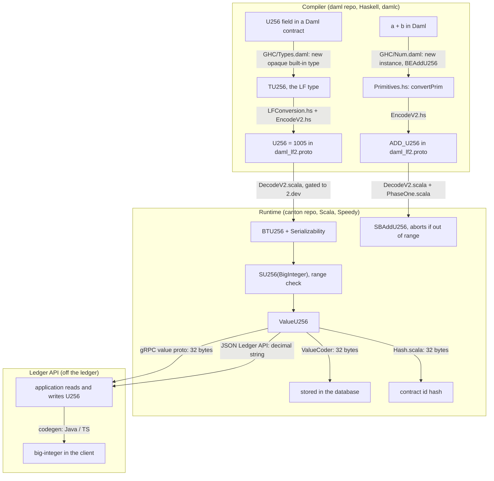

# Development Fund Proposal: Daml U256 Native Type

**Organization:** [Walnut](https://walnut.dev)<br>
**Authors / Primary Contacts:** Roman Mazur, CEO ([roman@walnut.dev](mailto:roman@walnut.dev)); Djordje Todorovic, CTO ([djordje@walnut.dev](mailto:djordje@walnut.dev)); Marija Mijailovic, Senior Software Engineer ([marija@walnut.dev](mailto:marija@walnut.dev))<br>
**Status:** Draft<br>
**Created:** 2026-09-15<br>
**Proposal Type:** RFP-aligned<br>
**RFP / Roadmap Area:** [RFP 16, Daml / Developer Usability Gaps (Daml U256 Support)](https://github.com/canton-foundation/canton-dev-fund/blob/main/2026-2028-strategic-roadmap.md#L191)<br>
**Champion:** Curtis Hrischuk, Digital Asset (curtis.hrischuk@digitalasset.com)<br>
**Total Funding Request:** 2,760,000 Canton Coin (CC)<br>
**Project Duration:** 25 weeks of development (one engineer) to Milestone 5; the stable release follows the Daml-LF release train (dev → staging → stable); 12 months of adoption and maintenance after Milestone 5 acceptance<br>
**Label:** daml-tooling<br>

---

## Abstract

Daml has no integer type wide enough for a 256-bit value. The widest type
is Numeric, which holds 38 digits. We propose adding U256 as a native Daml
type, with arithmetic in the Canton runtime, storage in contracts, and
support in the Ledger API. A team building on Canton, or moving an
application from a chain that uses 256-bit integers, then writes the same
operations on the same numbers and gets the same results.

---

## Specification

### 1. Objective

`U256` will be a native Daml type, like `Int` and `Numeric`, not a
library. A Daml contract can declare a U256 field. Its values support the
arithmetic operators `+`, `-`, `*`, `/`, and `^`, and the comparison
operators `==`, `<`, and `>`.

```
template Pool
  with
    operator : Party
    reserve : U256
  where
    signatory operator

value : U256 -> U256 -> U256 -> U256
value amount price wad = amount * price / wad
```

The other item in RFP 16, a native bytes type, is out of scope. It is a
separate type with its own operations and needs its own design.

### 2. Semantics

`U256` is an unsigned integer with the range [0, 2^256), and holds 32
bytes.

#### Operations

`U256` supports the arithmetic operators `+`, `-`, `*`, `/`, `^`, a
remainder, and the comparison operators `==`, `/=`, `<`, `<=`, `>`, `>=`,
`min`, and `max`.

- `/` is integer division, truncating toward zero.
- `^` raises a `U256` to an `Int` power (type `U256 -> Int -> U256`), so
  the exponent is an Int, not a U256.
- `remU256 a b` is the remainder of a divided by b: what integer division
  leaves over, `a - (a / b) * b`. It is always in [0, b), and b = 0
  aborts. It is a function, not the % operator, because Daml's `%` is
  `Int`-only.
- `negate` aborts for any non-zero operand, because `U256` is unsigned.

The arithmetic operators are new `Additive`, `Multiplicative`, and
`Divisible` instances in
[GHC/Num.daml](https://github.com/digital-asset/daml/blob/main/sdk/compiler/damlc/daml-prim-src/GHC/Num.daml),
each backed by a new primitive. The comparisons are `Eq` and `Ord`
instances in
[GHC/Classes.daml](https://github.com/digital-asset/daml/blob/main/sdk/compiler/damlc/daml-prim-src/GHC/Classes.daml)
and reuse the generic comparison primitives. Daml has no bitwise or shift
operators on integers, so they are out of scope.

#### Overflow and errors

A result outside [0, 2^256), a division by zero, or a subtraction below
zero aborts the transaction with `ArithmeticError` instead of wrapping
modulo 2^256. `Int` behaves the same on overflow. In Solidity, unchecked
arithmetic wraps modulo 2^256, while checked arithmetic (the default
since 0.8) aborts, as `U256` does.

#### Literals

Daml desugars an integer literal through `fromInteger : Integer -> Int`,
so today each literal is always Int, and one literal outside
[-2^63, 2^63) produces an error. The new literal rule:

```
a = 43 : U256    -- a U256
a = 43           -- an Int
a = (2^255)      -- a U256
```

If the type is annotated, as in `43 : U256`, the literal takes that type.
Without an annotation, a literal that fits Int is an Int, and one too
large for Int is a U256, checked against the range [0, 2^256).

#### Conversions

U256 provides the same conversions `Int` and `Numeric` already have, each
implemented as a new primitive:

- `Int → U256`: converts any non-negative Int; aborts on a negative
  `Int`.
- `U256 → Int`: aborts at ≥ 2^63, as `truncate : Numeric n -> Int` aborts
  when the value does not fit `Int`.
- `Numeric n → U256`: drops the fractional part; aborts on a negative
  value. `round`, `floor`, and `ceiling` variants match `Numeric → Int`.
- `U256 → Numeric n`: converts any value below 10^(38-n); aborts at
  ≥ 10^(38-n), because `Numeric n` holds 38 digits, n of them after the
  point. The largest value that converts is 10^38-1, into Numeric 0.
- `U256 → Text` (`show`): the decimal string.
- `Text → U256` (`parseU256`): `Some` for a decimal string in
  [0, 2^256), `None` otherwise.

### 3. Implementation Mechanics

Adding a native type touches the Daml compiler, the Daml-LF package
format, the Canton runtime, and the Ledger API:

1. Daml compiler: declare U256 and its operators in
   [digital-asset/daml](https://github.com/digital-asset/daml)
2. Daml-LF: number the type and its operations in the package format,
   [daml_lf2.proto](https://github.com/digital-asset/canton/blob/dd2ce77f2f1d7429bfb39db3a7ec6514afa424f3/community/daml-lf/archive/src/main/protobuf/com/digitalasset/daml/lf/archive/daml_lf2.proto)
3. Canton runtime: implement the operations, storage, and hashing in
   Speedy, in [digital-asset/canton](https://github.com/digital-asset/canton)
4. Ledger API: carry the value to applications over the gRPC and JSON
   Ledger APIs, in
   [value.proto](https://github.com/digital-asset/canton/blob/main/community/daml-lf/ledger-api-value-proto/src/main/protobuf/com/daml/ledger/api/v2/value.proto)
   and
   [ledger-json-api](https://github.com/digital-asset/canton/tree/main/community/ledger/ledger-json-api)

#### Daml compiler (daml repo)

`U256` is declared in
[`GHC/Types.daml`](https://github.com/digital-asset/daml/blob/1afed47bf9473f29e8891cd78c39317f21befb74/sdk/compiler/damlc/daml-prim-src/GHC/Types.daml)
as an opaque built-in type, like `Text`, and
[`LFConversion.hs`](https://github.com/digital-asset/daml/blob/1afed47bf9473f29e8891cd78c39317f21befb74/sdk/compiler/damlc/daml-lf-conversion/src/DA/Daml/LFConversion.hs)
maps it to a Daml-LF type.

Its arithmetic operators are the `Additive`, `Multiplicative`, and
`Divisible` instances in
[`GHC/Num.daml`](https://github.com/digital-asset/daml/blob/1afed47bf9473f29e8891cd78c39317f21befb74/sdk/compiler/damlc/daml-prim-src/GHC/Num.daml#L126-L145),
each operator is its own primitive: `+`, `-`, `*`, `^`, and `/` map to
`BEAddU256`, `BESubU256`, `BEMulU256`, `BEExpU256`, and `BEDivU256`. The
remainder is a new primitive `BEModU256`, exposed as a function
`remU256`, since Daml's `%` is `Int`-only. `negate` is not a primitive,
as it is `0 - x` and aborts for a non-zero operand.

Comparison is the `Eq` and `Ord` instances in
[`GHC/Classes.daml`](https://github.com/digital-asset/daml/blob/main/sdk/compiler/damlc/daml-prim-src/GHC/Classes.daml),
which bind `==` and `<` to the generic primitives `BEEqual` and `BELess`
as `Int` does; `/=`, `<=`, `>`, `>=`, `min`, and `max` come from the
class defaults (`min` and `max` are defined over `<=` in Daml), so
comparison adds no primitive.

For literals, `LFConversion.hs` gains a `U256` path, as it has for
`Numeric`: an integer literal desugars through
`fromInteger: Integer -> Int` and is rejected above 2^63, so with the
new path an annotated `n: U256` is read at full precision, and a literal
that does not fit `Int` is typed `U256` instead of being rejected.
Conversions to and from `Int`, `Numeric`, and `Text` are new primitives.

#### Daml-LF package format (daml_lf2.proto)

[`daml_lf2.proto`](https://github.com/digital-asset/canton/blob/dd2ce77f2f1d7429bfb39db3a7ec6514afa424f3/community/daml-lf/archive/src/main/protobuf/com/digitalasset/daml/lf/archive/daml_lf2.proto)
assigns numbers in two enums and holds literals in a third message.
Everything above 1000 is for `2.dev`.

- **Type:** `U256` is a new entry in the `BuiltinType` enum. We propose
  `U256 = 1005`, since 1002 and 1003 are `BIGNUMERIC` and `ROUNDING_MODE`
  and 1004 is reserved.
- **Operations:** Each arithmetic operation is a new entry in the
  `BuiltinFunction` enum, in its dev range alongside
  `ADD_BIGNUMERIC = 2003`. Comparison is different: the builtins `EQUAL`,
  `LESS_EQ`, `LESS`, `GREATER_EQ`, and `GREATER` are type-parameterized
  and already work for every comparable type, so `U256` reuses them and
  adds no entry.
- **Literal:** A `U256` constant in compiled code is a new case in the
  `BuiltinLit` message (`Expr.builtin_lit`), the oneof that holds every
  builtin literal. It sits next to the `Int` literal (an inline `sint64`)
  and the `Numeric` literal (an interned string). `U256` follows
  `Numeric` and is stored as an interned string, because a 256-bit
  constant does not fit a proto scalar.

#### Canton runtime (Speedy, canton repo)

A `U256` value is `SU256`, a Speedy value wrapping `java.math.BigInteger`.
`BigInteger` is arbitrary-precision, so the [0, 2^256) bound is not a
property of the representation: every arithmetic primitive enforces it
and aborts on a result outside the range, with no wrap. That same bound
is why a value serializes and hashes to exactly 32 bytes. Comparison adds
the `U256` case to Speedy's generic value comparators
[`Equality.scala`](https://github.com/digital-asset/canton/blob/main/community/daml-lf/interpreter/src/main/scala/com/digitalasset/daml/lf/speedy/svalue/Equality.scala)
and
[`Ordering.scala`](https://github.com/digital-asset/canton/blob/main/community/daml-lf/interpreter/src/main/scala/com/digitalasset/daml/lf/speedy/svalue/Ordering.scala):
two values are equal when their `BigInteger`s are equal, and ordered by
`BigInteger.compareTo`.
[`DecodeV2.scala`](https://github.com/digital-asset/canton/blob/main/community/daml-lf/archive/src/main/scala/com/digitalasset/daml/lf/archive/DecodeV2.scala)
decodes the literal; Speedy builds `SU256` from the literal, the stored
value, and conversions.

#### Storage (value serialization and hashing)

A `U256` is a new `ValueU256` case in
[`Value.scala`](https://github.com/digital-asset/canton/blob/main/community/daml-lf/transaction/src/main/scala/com/digitalasset/daml/lf/value/Value.scala).
When a contract is persisted or sent,
[`ValueCoder`](https://github.com/digital-asset/canton/blob/main/community/daml-lf/transaction/src/main/scala/com/digitalasset/daml/lf/value/ValueCoder.scala)
encodes it into the value proto as a fixed 32-byte big-endian field and
decodes it back, and
[`Hash.scala`](https://github.com/digital-asset/canton/blob/main/community/daml-lf/transaction/src/main/scala/com/digitalasset/daml/lf/crypto/Hash.scala)
feeds those 32 bytes into the contract-id hash. The fixed width keeps the
serialized size constant, so transaction cost is known in advance, and
the big-endian, zero-padded encoding is canonical, mapping one value to
one byte sequence, so every participant derives the same contract id.

[`ValueCoder`](https://github.com/digital-asset/canton/blob/main/community/daml-lf/transaction/src/main/scala/com/digitalasset/daml/lf/value/ValueCoder.scala)
gates every value kind on a
[`SerializationVersion`](https://github.com/digital-asset/canton/blob/main/community/daml-lf/transaction/src/main/scala/com/digitalasset/daml/lf/transaction/SerializationVersion.scala)
(`assertSince`), and the transaction hash used for external signing
([`NodeHashBuilder`](https://github.com/digital-asset/canton/blob/main/community/base/src/main/scala/com/digitalasset/canton/protocol/hash/NodeHashBuilder.scala))
is versioned by
[`HashingSchemeVersion`](https://github.com/digital-asset/canton/blob/main/community/base/src/main/scala/com/digitalasset/canton/version/HashingSchemeVersion.scala).
`U256` is gated on `SerializationVersion.VDev` while it is in `2.dev`.
When it is promoted, it moves to the next `SerializationVersion` and
`HashingSchemeVersion` and the protocol version that comes with them, as
external call results moved to `SerializationVersion` V3 and protocol
version 36.

#### Ledger API

An application off the ledger can read and write a `U256` over gRPC or
the JSON Ledger API: the gRPC value is the 32 bytes, and the JSON value
is a decimal string. Codegen then turns it into a big integer in the
application's language, such as Java `BigInteger` or TypeScript `bigint`,
so the developer works with a normal large number rather than raw bytes
or a string.

A diagram of the path through the code and what needs to be implemented:



### 4. Architectural Alignment

`U256` takes the same path as `Int`, `Numeric`, and `BigNumeric`.
Synchronization and node configuration are unchanged. It ships first in
`2.dev`, then graduates to a stable Daml-LF version.

### 5. Backward Compatibility

Existing packages, contracts, and values are unaffected; only packages
that use `U256` read the type. A package with `U256` requires a Daml-LF
version that supports it, so its host participant must run a Canton
version with this change. Clients reading a `U256` field need updated
codegen. Contract upgrades do not permit a field type change, so an `Int`
or `Numeric` field cannot become `U256`; the upgrade check rejects it. A
team adopting `U256` defines a new template and migrates data at the
application level, archiving the old contracts and creating new ones.
Within `U256`, upgrades behave as for `Int`: the field stays `U256`, and
a new optional `U256` field can be added.

---

## Milestones and Deliverables

The following milestone estimates are development time for one engineer,
with support from the Walnut team for adoption and maintenance.

### Milestone 1: Design note

- **Estimated Delivery:** 2 weeks
- **Estimated Effort:** 2 engineer-weeks (1 engineer for 2 weeks)
- **Focus:** Discuss the type, its encoding, and its rules with the Daml
  language team before implementation starts.
- **Deliverables / Value Metrics:**
  - A design note posted on
    [Daml#22827](https://github.com/digital-asset/daml/issues/22827) and
    discussed with the Daml language team. It covers:
    - the type, its range, and the abort-on-overflow rule
    - the operations, which are built-ins
    - the literal rule
    - the Daml-LF encoding and the value encoding (proto, JSON, hashing)
    - the conversions to and from `Int`, `Numeric n`, and `Text`
    - the version gating, from `2.dev` to a stable version
    - a diagram of the path through the compiler, runtime, and Ledger API
- **Acceptance Criteria:**
  - The design note is published and approved.

### Milestone 2: U256 arithmetic in Daml (LF `2.dev`)

- **Estimated Delivery:** 10 weeks
- **Estimated Effort:** 10 engineer-weeks (1 engineer for 10 weeks)
- **Focus:** In the development SDK, a developer can declare a `U256`,
  compute with it, and convert to and from `Int`, `Numeric`, and `Text`.
- **Deliverables / Value Metrics:**
  - Native U256 integer literals, so `42 : U256` is a U256.
  - Arithmetic, comparison, and conversions, with the range check in
    Speedy.
  - Tests in the `daml` and `canton` repositories.
  - A tutorial that runs `U256` in Daml Script on the development SDK.
- **Acceptance Criteria:**
  - A package that declares and computes with `U256` builds against LF
    `2.dev` with the development `damlc`.
  - In Daml Script on a `2.dev` build, `+`, `-`, `*`, `/`, `^`,
    `remU256`, and the comparisons return the correct values.
  - An out-of-range result, a division by zero, and a subtraction below
    zero each abort with `ArithmeticError`.
  - Conversions to and from `Int`, `Numeric`, and `Text` behave as
    specified, including the abort cases.
  - Tests pass in the `daml` and `canton` repositories.

### Milestone 3: U256 as a contract field

- **Estimated Delivery:** 6 weeks
- **Estimated Effort:** 6 engineer-weeks (1 engineer for 6 weeks)
- **Focus:** A developer can store a `U256` in a contract; it is stored
  and hashed as 32 bytes on every participant.
- **Deliverables / Value Metrics:**
  - `U256` as a serializable value: template field and choice argument.
  - `ValueU256` in `Value.scala`, and a fixed 32-byte `bytes` field in the
    value proto.
  - Encoding and decoding in `ValueCoder`.
  - 32-byte contract-id and transaction hashing in `Hash.scala`.
  - `U256` encoding and hashing gated on `SerializationVersion.VDev` and
    `ProtocolVersion.dev`.
  - Tests in both repositories.
- **Acceptance Criteria:**
  - A template with a `U256` field and a choice with a `U256` argument
    that can be built and run.
  - A developer can create such a contract, exercise the choice, and read
    the stored value back in Daml Script.
  - The serialized value is 32 bytes, and the encoding and hash are
    identical on all participants for the same value.
  - Tests pass in both repositories.

### Milestone 4: U256 in the Ledger API and JSON API

- **Estimated Delivery:** 4 weeks
- **Estimated Effort:** 4 engineer-weeks (1 engineer for 4 weeks)
- **Focus:** An application off the ledger can read and write `U256`
  through the gRPC and JSON Ledger APIs.
- **Deliverables / Value Metrics:**
  - `U256` in the gRPC Ledger API value proto.
  - JSON Ledger API encoding and decoding as a decimal string.
  - Codegen support for `U256` fields in Java and TypeScript.
  - An example application that reads and writes `U256` through the API.
  - Tests and documentation.
- **Acceptance Criteria:**
  - An application creates a contract with a `U256` field and reads the
    value back through the gRPC Ledger API and the JSON Ledger API.
  - The JSON value is a decimal string and round-trips without loss.
  - Codegen produces a usable big-integer representation of a `U256`
    field.
  - Tests and documentation are included.

### Milestone 5: U256 in a stable Daml-LF version

- **Estimated Delivery:** 3 weeks of development. The release date
  follows the Daml-LF release train.
- **Estimated Effort:** 3 engineer-weeks, plus follow-up during the
  release train
- **Focus:** A developer can use `U256` on a stable SDK and Canton
  release, without a development build.
- **Deliverables / Value Metrics:**
  - `U256` moved from `2.dev` to a stable Daml-LF version, and released.
  - `U256` moved to the next `SerializationVersion` and
    `HashingSchemeVersion`, released with a protocol version.
  - Tests and documentation for the stable release.
- **Acceptance Criteria:**
  - `U256` is available in a stable Daml-LF version and in a stable SDK
    and Canton release, with no development build required.
  - A package using `U256` builds and runs on the stable target.
  - A transaction with a `U256` value is accepted on a protocol version
    released for it, and its external-signing hash is computed under the
    matching `HashingSchemeVersion`.
  - Tests pass on the stable release, and the documentation covers it.

### Milestone 6: Ecosystem adoption

- **Estimated Delivery:** Within 12 months of Milestone 5 acceptance
- **Estimated Effort:** 4 engineer-weeks, plus support for adopting teams
- **Focus:** Independent teams adopt `U256` in applications on TestNet or
  MainNet.
- **Deliverables / Value Metrics:**
  - A migration pattern and worked example for moving a `Numeric`-based
    template to a `U256`-based one: new template, convert
    `Numeric → U256`, archive and recreate.
  - Support for teams moving arithmetic from `Numeric` to `U256`.
  - Fixes for adoption-blocking bugs.
- **Acceptance Criteria:**
  - At least three organizations use `U256` in their applications.
  - Adoption-blocking bugs reported during the window are fixed or
    documented with a workaround.

### Milestone 7: Maintenance

- **Estimated Delivery:** 12 months after Milestone 5 acceptance, in four
  quarterly periods
- **Estimated Effort:** Up to 20 hours per month
- **Focus:** `U256` keeps working on each new Daml SDK and Canton release.
- **Deliverables / Value Metrics:**
  - Fixes for bugs reported against `U256`.
  - Updates to `U256` code and tests when a Daml SDK or Canton release
    changes the code it depends on.
  - A maintenance report for each quarter: issues reported, fixed, and
    open, and the SDK and Canton releases checked.
- **Acceptance Criteria:**
  - A maintenance report is delivered for each quarter, and every
    reported `U256` bug is fixed, has a workaround, or is listed as open
    with a reason.

---

## Acceptance Criteria

The Tech & Ops Committee will evaluate completion based on:

- Deliverables completed as specified for each milestone
- Demonstrated functionality or operational readiness
- Documentation and knowledge transfer provided
- Alignment with stated value metrics

U256 can be declared in Daml contracts, and arithmetic operations must
match Solidity uint256, with overflow checks; any result outside
[0, 2^256) aborts the transaction. The encoding and the hash must be the
same on all participants, and well documented with comprehensive
examples.

At least 3 organizations outside Walnut use `U256` in an application on
TestNet or MainNet, at least one of them on MainNet.

---

## Funding

**Total Funding Request:** 2,760,000 CC, denominated in fixed Canton
Coin.

### Effort Estimates

| Milestone | Calendar | Engineer-weeks | CC | CC per engineer-week |
| --- | --- | --- | --- | --- |
| M1 Design note | 2 weeks | 2 | 100,000 | 50,000 |
| M2 U256 arithmetic (LF `2.dev`) | 10 weeks | 10 | 500,000 | 50,000 |
| M3 U256 as a contract field | 6 weeks | 6 | 270,000 | 45,000 |
| M4 Ledger API and JSON API | 4 weeks | 4 | 180,000 | 45,000 |
| M5 Stable Daml-LF version | 3 weeks, then the release train | 3, plus follow-up | 160,000 | 53,000 |
| **Build subtotal (M1–M5)** | **25 weeks + release train** | **25** | **1,210,000** | **48,000** |
| M6 Adoption | Within 12 months of M5 | 4, plus support | 950,000 | outcome-based |
| M7 Maintenance | 12 months after M5 | Up to 20 hours per month | 600,000 | 150,000 per quarter |
| **Total** | | | **2,760,000** | |

### Payment Breakdown by Milestone

- Milestone 1, Design note: 100,000 CC upon committee acceptance
- Milestone 2, U256 arithmetic in Daml (LF `2.dev`): 500,000 CC upon
  committee acceptance
- Milestone 3, U256 as a contract field: 270,000 CC upon committee
  acceptance
- Milestone 4, U256 in the Ledger API and JSON API: 180,000 CC upon
  committee acceptance
- Milestone 5, U256 in a stable Daml-LF version: 160,000 CC upon the
  stable SDK and Canton release and committee acceptance
- Milestone 6, Ecosystem adoption: 950,000 CC upon committee acceptance
  of the adoption criteria (three organizations outside Walnut on TestNet
  or MainNet, at least one on MainNet)
- Milestone 7, Maintenance (12 months): 600,000 CC, paid as 150,000 CC
  per quarter against a quarterly maintenance report

### Funding Rationale

- **Build (M1–M5): 1,210,000 CC** for 25 engineer-weeks of one engineer
  across two upstream repositories (`digital-asset/daml` and
  `digital-asset/canton`), under review by the Daml language and runtime
  teams. This is about 48,000 CC per engineer-week, the rate of the only
  accepted compiler milestone in the fund so far, the Obsidian Package
  Distribution proposal's `damlc` source-to-DAR milestone (1,300,000 CC
  for 6.25 person-months), and above the rate of Walnut's approved
  `dpm trace` proposal (950,000 CC for 30 engineer-weeks), because the
  work lands in Digital Asset's compiler and runtime rather than in a
  Walnut-owned tool. For comparison, Digital Asset's own estimate in
  [Daml#22827](https://github.com/digital-asset/daml/issues/22827) is "a
  few weeks of design" plus "a single engineer ... a few months"; at the
  rate of the Daml Open Source maintenance grant (1,000,000 CC per month
  for about three engineers) that is roughly 1.5–2 million CC of Digital
  Asset engineering time.
- **Milestone 1 is small and paid first on purpose.** The design note is
  where the Daml language team accepts or rejects the type, the literal
  rule, the encoding and the version gating. Paying for it separately
  means the committee knows the design is agreed upstream before funding
  the implementation.
- **Adoption (M6): 950,000 CC**, 34% of the total, paid only when
  independent teams run `U256` in applications. This is the same amount
  and shape as Milestone 4 of the approved `dpm trace` proposal.
  Candidate adopters already on record: the CLMM team on the
  [forum](https://forum.canton.network/t/u256-in-daml/8142), the DEX team
  and Tradecraft in
  [PR #177](https://github.com/canton-foundation/canton-dev-fund/pull/177),
  and the EVM-migration customer quoted in Daml#22827.
- **Maintenance (M7): 600,000 CC** for 12 months after the stable
  release, in line with the BitDynamics DevKit (600,000 CC / 12 months)
  and above Obsidian LMS (500,000 CC / 12 months). A native type is a
  permanent part of the language, so compatibility work on every Daml SDK
  and Canton release is unavoidable; quarterly payment limits the
  committee's exposure.
- **Milestone 5 is priced on effort, not on calendar time.** Its release
  date is set by the Daml-LF release train, not by Walnut: the recent
  `external-call` LF feature took about four months from its first merged
  Canton PR (May 2026) to promotion to LF 2.4-staging (August 2026), and
  required a new serialization version, a new hashing scheme and a
  protocol-version gate. Walnut carries that latency; payment for M1–M4
  does not depend on it.

### Volatility Stipulation

The project duration is greater than 6 months. The grant is denominated
in fixed Canton Coin and will require a re-evaluation at the 6-month
mark. Should the timeline extend beyond the plan due to
Committee-requested scope changes, upstream review latency outside
Walnut's control, or the Daml-LF release schedule, the remaining
milestones may be renegotiated to account for significant USD/CC price
volatility. Milestone 7 is paid quarterly, so at most one quarter of
maintenance is exposed to price movement at any time.

---

## Co-Marketing

Upon release, Walnut will collaborate with the Foundation on:

- Announcement that U256 is available in Daml
- Blog post on how to use the Daml U256 type, and how to port an EVM app
  to the Canton
- Outreach to teams via X; comment on the GitHub issues.

---

## Motivation

Teams that build financial applications on Canton work with amounts that
current Daml types cannot hold. The widest type a contract can store is
Numeric, at 38 digits, but the amounts most financial applications carry
can be larger. For example, the request in
[Daml#22827](https://github.com/digital-asset/daml/issues/22827) asks for
`uint256` so that an application from EVM chains gets the same arithmetic
results on both chains. The problem was that one token 1e18 for 2000
dollars (2000e18) gives 2e39, which is 40 digits, and Numeric holds up to
38 digits. So in Daml, this raises ArithmeticError: the value cannot be
stored.

No existing Daml type is both wide enough for a 256-bit value and
storable. `Int` is an 8-byte integer with the range [-2^63, 2^63).
`Numeric` is a decimal type that holds at most 38 digits. `BigNumeric`
holds up to 2^15 digits on each side of the point, but it is not
serializable, so a contract cannot store it.

On the [forum](https://forum.canton.network/t/u256-in-daml/8142), a team
building a concentrated liquidity market maker writes: "*We need U256 or
BigNumeric for our CLMM implementation. Without them, we will have to
emulate, but it is not ideal.*" In the comments on
[PR #177](https://github.com/canton-foundation/canton-dev-fund/pull/177),
a team planning a DEX calls U256 a blocker, and Tradecraft plans to test
the library as soon as it is available.

---

## Rationale

A native type is the only way to store `U256` on the ledger with one
fixed encoding and to calculate with it in the Canton runtime.

`BigNumeric` is the closest existing type, but
[Daml#22827](https://github.com/digital-asset/daml/issues/22827) gives
two reasons not to bring it back to the ledger: its memory use depends on
the value, not on the input size, so its cost cannot be charged
correctly, and it cannot be represented directly in the Ledger API. A
`U256` value has a fixed size of 32 bytes, so its cost in a transaction
is known in advance.

A library was proposed in
[PR #177](https://github.com/canton-foundation/canton-dev-fund/pull/177)
and closed by its author. A library cannot add a type that is stored on
the ledger: values would be split into several fields, and the arithmetic
would be implemented in Daml instead of as a built-in operation in
Speedy. A native type removes both limits.

---

## About Walnut

Walnut has built debugging tools for blockchain programs for four years,
and a large part of this work is in compilers:

- debug info generation in the official Solidity compiler
  [`solc`](https://github.com/argotorg/solidity), with the Ethereum
  Foundation / Argot
- [Walnut Starknet Debugger](https://walnut.dev/), with Starkware
- [StylusDB](https://github.com/OffchainLabs/stylus-sdk-rs/blob/main/cargo-stylus/docs/StylusDebugger.md),
  a debugger for Stylus, with Offchain Labs

On Canton, we are building `dpm trace` under the approved proposal
[2026-08-Walnut-dpm-trace-visualization](https://github.com/canton-foundation/canton-dev-fund/blob/main/proposals/2026-08-Walnut-dpm-trace-visualization.md).
In our [fork of `damlc`](https://github.com/walnuthq/daml/tree/feature/debug-info)
we added debug info generation, which we proposed in
[PR #743](https://github.com/canton-foundation/canton-dev-fund/pull/743),
so we already work with the same compiler and the same Daml-LF format
that this proposal changes.
