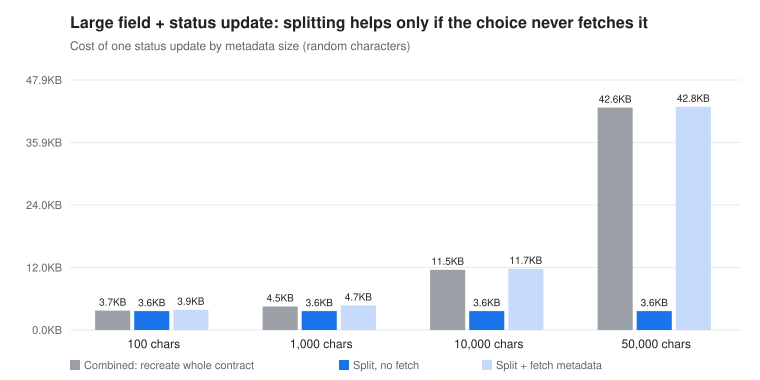
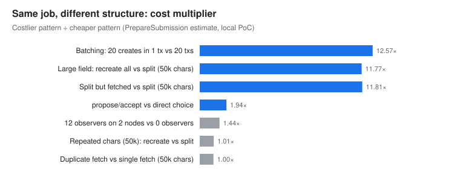
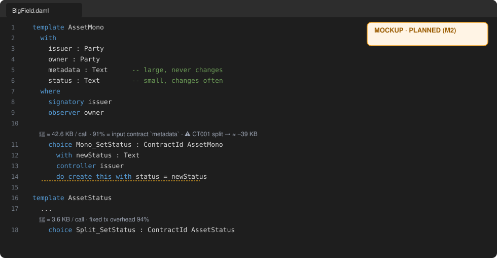

# Daml Traffic Cost Attribution: What a Choice Pays For and What to Change

## Development Fund Proposal

**Organization:** CURG (grant recipient: CURG Canton Team)  
**Author / Primary Contact:** Wilson, CURG, slee000220@gmail.com  
**Team:** Wilson, developer (slee000220@gmail.com); Reindeer, developer (reindeer002@gmail.com); Yejin, project manager. Both developers hold Daml certifications issued by Digital Asset.  
**Status:** Submitted  
**Created:** 2026-11-22  
**Proposal Type:** RFP-aligned proposal  
**RFP / Roadmap Area:** Developer Experience, Tooling & Education: RFP #19, DPM Components and Extension Ecosystem (primary); RFP #18, Integration into SDLCs (CI cost checks)  
**Suggested SIGs:** Daml Language & Developer Tooling; DAR Package Management & App Lifecycle  
**Champion:** `Needs Champion`  
**Total Funding Request:** 1,550,000 CC (about USD 114,000 at USD 0.0735/CC on 2026-11-22)  
**Project Duration:** 6 months of delivery and adoption, followed by 6 months of maintenance  
**Label:** daml-tooling  

---

## Abstract

Daml developers pay for every byte their transactions sequence on the Global Synchronizer, but today they see only one cost number per transaction. They cannot tell which field, observer or workflow step makes a choice expensive, even though the same feature can cost more than 10× as much depending on how it is modeled. Developers on other smart contract platforms get per-function cost from their editor and test suite; Daml developers have no equivalent. CURG has built a proof of concept that measures this on a local Canton network. It confirmed that Canton's native estimate is accurate (0.67% mean error across 52 transactions) and showed where the cost comes from: in one status update, a field the choice never changed accounted for about 39 KB of 42.6 KB, and batching 20 creates cut cost 12.6×. Raw sizes do not explain the charge, because it applies to compressed bytes and scales with receiving participants rather than parties. CURG will turn the proof of concept into an open-source DPM component that attributes each choice's *charged* traffic to its causes (fixed per-transaction overhead, compressed field bytes, receiving participants) and suggests the fix. The same attribution appears in VS Code, as a cause-level cost diff in CI, and as lint rules backed by measurements.

## Specification

### 1. Objective

A Daml developer can see what a choice costs, why it costs that much, and which change would make it cheaper, without leaving their editor or PR workflow. The single objective is attributing *charged* traffic to its causes. The editor, CI and linter are three views of that one attribution, not separate products.

### 2. Proof of Concept Results

Before writing this proposal, we built a proof of concept that measures traffic cost on a local Canton network. It runs Daml workflows, records the cost estimate returned by `prepare` before each submission, and records the traffic actually charged after it. We wrote several pairs of Daml patterns that do the same job in different ways and compared their costs.

Setup: Canton 3.7.2 open source, Daml SDK 3.7.1, 1 BFT sequencer, 1 mediator, 3 participants, traffic control enabled with Global Synchronizer-like parameters (`readVsWriteScalingFactor=4`, `baseEventCost=0`).

**Result 1: the total is accurate, so the gap is attribution.** Across 52 transactions, the request part of the native estimate (`totalTrafficCostEstimation` minus the response estimate) differed from the request cost actually charged (`paidTrafficCost` on the completion, available from Canton 3.7) by 0.67% on average and 1.2% at most.

**Result 2: raw size does not explain the charge.** We used a contract that holds a 50,000-character `metadata` field and a small `status` field, and measured one status update in two layouts:

- **Combined:** both fields live in one contract, so every status update archives and recreates the whole contract.
- **Split:** `metadata` lives in a separate contract, and the status update touches only the small status contract.

| `metadata` content (50,000 characters) | Combined | Split | Cost of carrying `metadata` |
|---|---:|---:|---:|
| Random characters | 42,617 B | 3,621 B | about 39,000 B |
| One character repeated | 3,666 B | 3,613 B | under 100 B (measurement noise) |

The two fields have the same raw size, but one costs more than 300× as much as the other, because charges apply to compressed bytes. Ranking fields by raw size, or a lint rule based on field length, cannot tell them apart.

The same applies to observers. Each additional receiving participant added about 370 B. An additional party on a participant that already receives the message added about 100 B. Cost follows receiving participants, not parties. Fetching the same contract twice cost the same as fetching it once.

**Result 3: the causes are worth fixing.** Pairs of patterns that do the same job:

- Splitting the frequently updated status out of a contract with 50,000 random characters: 11.8× cheaper.
- Batching 20 `create`s into one transaction instead of 20 transactions: 12.6× cheaper.
- A single direct choice instead of a two-step `propose/accept`: 1.94× cheaper.

Milestone 1 turns this proof of concept into the released component.

### 3. Implementation Mechanics

All components share one measurement engine.

**Measurement engine (per-choice cost).** It runs a project's existing Daml Script tests against a local Canton with traffic enabled and records two values for every submitted transaction: the cost estimated by the `prepare` API before submission, and the traffic actually charged after submission. Without traffic enabled, local cost is zero, so the tool configures this automatically. Output is a per-choice cost table (JSON and Markdown).

**Attribution.** The engine breaks each cost down using three inputs:

1. The decoded `prepare` response shows which contracts the transaction created, consumed and fetched, with their fields and parties.
2. The Ledger API endpoint `/v2/state/connected-synchronizers` maps parties to participants, which identifies the receiving and confirming participants. We verified this query on a local network.
3. Calling `prepare` again with a specific field emptied and measuring the size difference gives that field's compressed size.

The engine combines these inputs with coefficients measured in the proof of concept (about 3.4 KB fixed cost per transaction and about 370 B per receiving participant). The 3.4 KB figure assumes `baseEventCost` = 0, and Milestone 1 recalibrates the coefficients against the Global Synchronizer's actual configuration. Each breakdown shows an "unexplained" remainder so that the model's error is always visible.

Example: in the combined layout above, most of the 42.6 KB status update comes from the `metadata` field, which the choice never changes. The tool suggests moving that field to a separate contract, which saves about 39 KB.

**Editor (VS Code CodeLens).** This brings the attribution to where Daml is written, beyond the DPM CLI. A choice can only run against contracts that exist on the ledger, so cost cannot be computed from source alone. The extension shows the latest measured cost above each choice, from stored test runs. A "re-estimate" action calls `prepare` again, which uses no traffic. Linter warnings appear in the same place. Where possible, CURG contributes this to the existing Daml VS Code extension. If its maintainers prefer otherwise, it ships as a separate extension.

The video below shows how a developer would use the tool.

https://github.com/user-attachments/assets/6bb2e135-3997-4cf4-93b9-4527d760911a

**CI cost checks (RFP #18).** A GitHub Action starts a local Canton, runs the same tests on `main` and on the PR branch, and posts the per-choice cost difference, broken down by cause, as a PR comment. Teams can set a threshold that warns or blocks the merge. This catches changes that the editor cannot show: a shared helper that makes several other choices more expensive, a one-line `fetch` of a large contract, and changes in Canton version or dependencies.

**Linter with measured rules.** It reads Daml-LF from the compiled DAR, not the source, to find templates, fields and the actions each choice performs (`create`, `fetch`, `exercise`). It reports in SARIF, so findings show up in GitHub PRs and VS Code. A rule ships only if a measurement shows its effect, and each rule's documentation includes that measurement. The duplicate-`fetch` rule was dropped after the proof of concept showed no cost difference. Static analysis cannot see compressibility or participant placement, so the linter only points out candidates. The measurement engine makes the final call.

**Packaging.** The engine and CLI ship as a DPM component that follows DPM component conventions. The proposed command is `dpm cost`. Final naming follows the DPM maintainers' guidance. The VS Code extension and GitHub Action use the same component. Reports use a documented JSON schema so other tools can consume them.

### 4. Architectural Alignment

- RFP #19: the engine and CLI are a reusable DPM component with documentation, examples and a maintenance plan.
- RFP #18: the GitHub Action adds cost regression checks to existing CI/CD and testing workflows.
- The tool only uses public Ledger API endpoints (`prepare`, completions, `connected-synchronizers`) against a local network the developer controls. It needs no protocol changes and reads no data outside the developer's own nodes.
- The Q2 DevRel Survey rated transaction debugging and observability lowest. A cost breakdown gives developers a transaction-level view of where bytes go.

### 5. Backward Compatibility

No impact on existing applications. The tool creates no on-ledger contracts and changes no Canton components. It needs Canton 3.7 or later for `paidTrafficCost`. On earlier versions it falls back to estimate-only mode.

## Milestones and Deliverables

Deadlines count from grant approval.

| Milestone | Deadline | Deliverables | Done when |
|---|---|---|---|
| 1. Measurement engine | Month 2 | DPM component; per-choice cost table; attribution with an unexplained remainder; automatic traffic-enabled local setup | An outside developer runs it on a public Daml repository from the README and gets a per-choice breakdown. Estimate vs. paid cost agrees within 2% on a published benchmark set. |
| 2. Editor integration | Month 3 | CodeLens costs and re-estimate, contributed to the Daml VS Code extension or shipped as a separate extension | The feature is available in the Daml VS Code extension or published as a separate extension on the VS Code Marketplace, and shows measured costs for the benchmark project. |
| 3. CI and linter | Month 5 | GitHub Action with cause-level cost-diff PR comments and threshold checks; DAR-based linter with SARIF output; rule docs with measurements | A sample PR in a public repository shows a cost-diff comment and SARIF findings. Every shipped rule cites a reproducible measurement. |
| 4. Adoption | Month 6 | Cost reports for at least 5 public Daml repositories; upstream optimization PRs or issues; public tutorial | All three conditions are met and linked in the milestone submission. |
| 5. Maintenance | 6 months from Milestone 4 | Compatibility releases, issue triage, coefficient recalibration | CURG submits an accepted maintenance report each quarter (see Maintenance Plan). |

## Acceptance Criteria

The Tech & Ops Committee accepts each milestone against the "Done when" criteria above. All code is released under Apache-2.0 in a public repository.

## Funding

**Total Funding Request:** 1,550,000 CC

The budget is USD 114,000. It covers about 900 developer hours over the 6-month delivery period and up to 20 hours per month of maintenance for the following 6 months. It is converted at USD 0.0735/CC, the market price on 2026-11-22.

| Milestone | Deadline | CC | Paid upon |
|---|---|---|---|
| 1. Measurement engine | Month 2 | 430,000 | Committee acceptance |
| 2. Editor integration | Month 3 | 215,000 | Committee acceptance |
| 3. CI and linter | Month 5 | 355,000 | Committee acceptance |
| 4. Adoption | Month 6 | 430,000 | All adoption conditions met |
| 5. Maintenance | 6 months from M4 | 120,000 | 60,000 per accepted quarterly report |
| Total | | 1,550,000 | |

Development (M1 to M3) is 1,000,000 CC. Adoption is 430,000 CC, paid only when the adoption conditions are met. Maintenance is 120,000 CC (20,000 CC per month).

### Volatility Stipulation

The project duration is greater than 6 months. The grant is denominated in fixed Canton Coin. At the 6-month mark, either CURG or the Committee may request a re-evaluation of unpaid milestones if the CC price has moved more than 25% in either direction from its price at approval. The Tech & Ops Committee runs the re-evaluation.

## Maintenance Plan

For 6 months after Milestone 4 acceptance, CURG will:

- release a compatible version within four weeks of each Canton or DPM release that affects the Ledger API endpoints, Daml-LF or traffic accounting the tool uses;
- recalibrate the attribution coefficients when Global Synchronizer traffic parameters change, and publish the new measurements;
- triage issues within five business days and review outside contributions;
- submit a quarterly maintenance report listing releases, issues and recalibrations.

CURG may propose a further maintenance period, subject to Committee approval. If maintenance is not renewed after month 12, CURG will offer to transfer the repository to the Foundation's GitHub organization. Wilson and Reindeer share maintenance responsibility.

## Co-Marketing

At release, CURG will publish a technical post and a tutorial showing how to find and fix an expensive choice.

## Motivation

Developers on other smart contract platforms see cost per function as part of their normal workflow. Remix shows estimated gas next to each Solidity function. Hardhat's gas reporter and Foundry's `forge test --gas-report` and `forge snapshot` print per-function gas from the test suite and flag changes in CI. Canton has no equivalent. A Daml developer gets one estimate per transaction from `prepare` and nothing per choice, per field or per observer, even though, as the proof of concept shows, the same feature can differ in cost by more than 10× depending on how it is modeled. Teams either optimize without evidence or never notice the problem. This proposal gives Daml developers the per-choice cost view that developers on other platforms already take for granted, adapted to Canton's cost model (compressed bytes and receiving participants instead of gas). Every application team that submits Daml transactions on MainNet pays for traffic, so the tool applies to any Daml project that has Daml Script tests. Milestone 4 measures actual adoption across at least five public repositories.

## Rationale

- **Breakdown instead of a new estimator:** the proof of concept showed the native estimate is already accurate (0.67% average error), so the tool builds on it instead of reimplementing fee calculation.
- **Measurement before rules:** the proof of concept disproved two intuitive lint rules (duplicate fetch, field length), so rules ship only with measured evidence.
- **Extend existing tools first:** the editor feature is contributed to the existing Daml VS Code extension where its maintainers agree, and the engine follows DPM component conventions instead of introducing a separate CLI.
- **Daml-LF instead of source:** DAR analysis works regardless of source layout and matches what is deployed.

## About CURG

[CURG](https://curg.io/) is a blockchain research society of professionals working in the blockchain industry, who research, build and share work on blockchain technology ([blog](https://medium.com/curg)). The grant recipient is the CURG Canton Team.

Two CURG developers, Wilson and Reindeer, work on this project part-time, about 900 hours in total over the 6-month delivery period. Both hold Daml certifications issued by Digital Asset. They built and ran the proof of concept described above on Canton 3.7.2 and Daml SDK 3.7.1. Yejin is the project manager.
