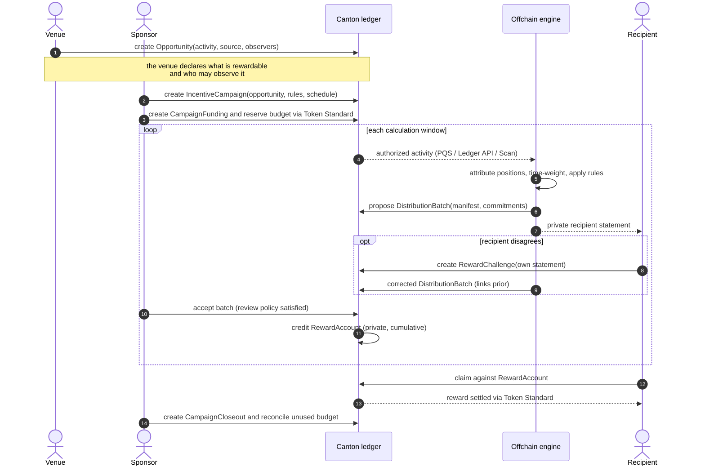

# Canton Reward Engine

| Field | Value |
| :---- | :---- |
| Organization | R13N Labs |
| Author / Primary Contact | @ethan-r13n |
| Status | Draft |
| Created | 2026-08-18 |
| Label | rfp-13:payments-defi |
| [Champion](https://github.com/canton-foundation/canton-dev-fund/blob/main/sig-directory.md) | Needs Champion |
| Software license | Apache 2.0 |
| Proposal Type | RFP-aligned |
| RFP / Roadmap Area | Financial Markets, Standards & Verification: Payments and DeFi (RFP 13) |
| Total Funding Request | 3,636,363.64 CC maximum  |
| Project Duration | 16-weeks build + adoption milestones |

## Abstract

The Canton Reward Engine is open-source infrastructure for running reward campaigns on Canton. Asset issuers, institutions, and applications can configure, calculate, review, and distribute rewards, yield, and dividends, without having to build separate reward systems.

The request is 3,636,363.64 CC, approximately $400,000 at a $0.11/CC planning rate. TestNet and MainNet technical delivery account for 43.3% of funding; the remaining 56.7% is payable at three and five qualifying independent MainNet adopters, with 5% of the total grant reserved for five qualifying adopters using the engine through Featured Apps.

## Specification

### 1. Objective

Deliver shared, open-source infrastructure for reward programs on Canton that:

- **Removes the cost of building reward infrastructure** by publishing the campaign contracts, calculation engine, adapters, and claim flows as Apache 2.0 packages. A venue only needs to write one data adapter.
- **Grows measurable on-ledger activity** by giving issuers and venues a practical, expressive standard to reward users for supplying, borrowing, providing liquidity, or holding an asset. Incentive programs are the standard instrument for attracting liquidity to a network, and Canton currently has no shared way to run customized ones.
- **Gives users a neutral, standardized platform to find, verify, and claim rewards;** users can see which programs they qualify for, check how their reward was calculated, and claim it, building trust between Canton’s liquidity providers and financial applications.
- **Improves Canton's developer tooling** by publishing the Daml contracts, SDK, and API as reusable components. Teams can run them as shipped or build yield, dividend, and reward programs we have not anticipated on top of them.

### 2. Implementation Mechanics

#### Architecture Overview

The engine has three layers.

**On-ledger.** Daml contracts record campaign configuration and funding, proposed and accepted distributions, private reward balances, and campaign closeout. Contract configuration determines who may approve, correct, or claim.

**Offchain.** The calculation service reads the dataset exposed through the selected adapter. It applies attribution and campaign rules, checks the accounting invariants, and writes a calculation manifest and a private statement for each recipient.

**Application.** The API, SDK, and CLI let sponsors configure campaigns, reviewers inspect results, recipients prepare wallet-signed claims, and integrators replay calculations.

##### Authorized data sharing

A venue must provide the fields needed by the campaign. The engine cannot calculate rewards unless the venue authorizes one of these paths:

| Path | What the venue does | Visibility |
| :---- | :---- | :---- |
| **Default: Daml view contracts** | Emit a projection of campaign-required fields (party/account, instrument, signed balances, timestamps). A Reward Engine party is an observer. | Protocol-enforced. Observers see the full view-contract payload, not the source contract. The hosting validator stores that payload. Adding or removing an observer archives and recreates the view. |
| **Fallback: subset role on the venue validator** | Grant read-only access through a venue-controlled filtered API or restricted SQL view, or use readAs only for a party whose visible data is limited to approved campaign data. | Operator-granted and revocable. The venue controls the Ledger API user or SQL view. This path relies on venue operator controls rather than Daml observer rights. |
| **Optional: indexer** | Export the same shared subset. | The indexer receives only the fields the venue exports. It does not gain access to other private contracts. |

The engine does not use divulgence. Each path feeds the same adapter interface and produces the same checkpoint and manifest format. A venue can use one or multiple paths.

#### Campaign Lifecycle

| Stage | Process |
| :---- | :---- |
| **Configure** | The sponsor selects the opportunity, campaign type, distribution method, scoring method, data source, eligibility rules, and review policy |
| **Fund** | The sponsor registers or reserves the reward budget through a Token Standard-compatible funding adapter  The sponsor locks the campaign budget on-ledger so committed funds cannot be spent elsewhere. Recipients initiate claims; the designated payout operator executes transfers only to recipients and for amounts approved under the campaign’s review policy. The operator cannot redirect funds or withdraw them for itself. Unused funds return only to the sponsor under the campaign’s closeout rules. |
| **Observe** | The engine reads the authorized source from the last accepted checkpoint to the end of the current calculation window |
| **Compute** | The engine calculation service reconstructs time-weighted activity, applies the campaign rules, checks the accounting invariants, and produces a proposed allocation |
| **Review** | Authorized reviewers inspect the distribution batch, and each recipient can inspect only their own statement |
| **Finalize** | An accepted batch updates private cumulative reward accounts |
| **Claim and close** | Recipients claim through Token Standard flows, and the sponsor reconciles unused or expired budget at closeout |

#### On-Ledger: Records, Authority, and Settlement

A campaign uses seven Daml contract types:

- **Opportunity:** the rewardable activity at a venue.
- **IncentiveCampaign:** the campaign schedule and rules.
- **CampaignFunding:** the reserved budget.
- **DistributionBatch:** one proposed distribution.
- **RewardAccount:** one recipient's private balance.
- **RewardChallenge:** a recipient's challenge to their own statement.
- **CampaignCloseout:** the final reconciliation.

Rewards are finalized and claimed through Daml contract choices. The ledger enforces permissions and balances, while the offchain engine calculates allocations from venue-provided data and authorized reviewers approve them under the campaign’s review policy.

##### Campaign Configuration

An Opportunity identifies the venue activity being rewarded. Multiple campaigns can target the same opportunity using different assets and rules.

Each IncentiveCampaign references the opportunity, sponsor, reward asset, and funding record. Its versioned configuration sets the calculation schedule, eligibility rules, and review policy. Rules for completed windows cannot be changed retrospectively.

Each DistributionBatch records the campaign version, calculation window, source checkpoints, and manifest digest. If it corrects an earlier distribution, it links back to that distribution.

| Design axis | Purpose | Delivered under this grant |
| :---- | :---- | :---- |
| Distribution method | How the campaign budget is spent | Variable budget, fixed rate, capped APR, target total APR, fixed allocation |
| Scoring method | How participant activity becomes a reward share | Proportional time weighting, net position, maximum eligible balance |
| Eligibility controls | Which activity qualifies | Allowlist, denylist, minimum balance, minimum duration, credential gate, affiliate exclusion |

##### Distribution Methods

The following methods give venues granular control and expressivity over incentivized actions allowing them to maximize reward ROI, and remain compliant with CC reward-related CIPs.

- **Variable budget:** A fixed budget is split by each recipient's share of eligible time-weighted activity.
- **Fixed rate:** Every eligible unit of activity earns a set rate, until the campaign ends or the budget runs out.
- **Capped APR:** A variable budget campaign with a ceiling on the annualized rate. Whatever is not paid out returns at closeout.
- **Target total APR:** The engine pays the gap between a target rate and the venue's own rate, and nothing when there is no gap.
- **Fixed allocation:** The sponsor supplies a recipient list directly, for grants, rebates, or one-off programs.

##### Review and Correction

A campaign can require sponsor approval, a reviewer quorum, or a fixed review window; until that policy is met, nothing in the batch can be claimed.

A recipient can challenge only their own statement. If the campaign’s review policy allows, undisputed statements can finalize while held or disputed statements remain unclaimable. Corrections create linked replacement versions for held statements; they cannot overwrite accepted credits or reverse settled claims.

##### Claims

Reward accounts are cumulative; a recipient can claim part of a balance rather than all of it; a campaign can set a claim expiry. The recipient signs their own claim.

##### Finalization Design

Each reward added to a recipient’s claimable balance is tracked by campaign, calculation window, statement version, and recipient. If processing is interrupted, it resumes without adding the same reward twice. Recipients must authorize their claims and cannot claim more than their available balance.

The funding adapter handles pending, failed, and retried Token Standard transfers. A claim is marked as paid only after settlement is confirmed. Tests verify that retries cannot add duplicate rewards or make duplicate payments.

Each record is visible only to its contract signatories and observers.

#### Offchain: The Calculation Service

The calculation service uses only data shared by the venue, which is responsible for providing a complete dataset.

The adapter provides a starting snapshot followed by ordered updates. Each update identifies the source event, asset, party or account, quantity, effective time, and a checkpoint for resuming processing. The adapter also explains how timestamps are interpreted, duplicate records are removed, and gaps in historical data are detected.

Interest or yield rates used in reward calculations, such as a venue’s supply or borrowing APR, include their source and when they take effect. Finalization stops if required data is missing, required rates are outdated, or reconciliation checks fail.

##### Position Attribution

A user may hold a position directly, or through a vault, a pooled account, a custody structure, or a receipt instrument. Attribution works out who a reward actually belongs to.

The engine delivers attribution for direct party and account positions, Token Standard holdings, lending and liquidity positions, and one receipt-instrument adapter. Every adapter records its attribution path, tests check that value is conserved, and that no position is miscounted.

##### Time-Weighted Activity

Rewards can scale with how long a position was held. Campaign windows are half-open, \[start, end), so no interval is counted twice at a boundary. Within each interval the engine computes eligible balances in fixed-precision arithmetic.

Each reward calculation uses a saved data snapshot and fixed campaign settings, reference rates, and adapter and processor versions. Repeating the calculation with the same inputs and versions produces exactly the same output.

##### Checkpoints and Catch-Up

Estimates can run more often than finalized distributions, so an application can show users a non-claimable running total. An adapter only advances its checkpoint after a run succeeds. A run that is late resumes from the last accepted checkpoint and still covers the interval it missed.

##### Invariant Checks

Activity rebuilt from events can drift from what a venue's own books say, particularly for positions that accrue continuously, such as lending debt or yield-bearing assets.

When a venue can supply its own total, such as the amount currently supplied to a market, the adapter compares that total with the engine's reconstruction. If the gap exceeds the configured tolerance, finalization stops and the mismatch is recorded in the DistributionBatch.

##### Calculation Manifest

Every proposed distribution carries a manifest recording what produced it:

- the campaign version and the time window it covers
- the source checkpoints it read from
- the adapter and processor versions that ran
- the reference rates used, and where they came from
- the eligibility, scoring, rate, cap, and rounding parameters applied
- the totals, and a SHA-256 digest of the canonical input snapshot
- the invariant check results and any corrections

Each recipient receives a private statement of their inputs, attribution, score, rate, reward, and the aggregate parameters needed to verify their allocation.

#### Application Layer: Developer Surface

An integrator picks a data adapter and reuses the engine, workflows, and developer tools.

- **SDK:** campaign management, reward reads, statement verification, and claim preparation across several campaigns at once.
- **API:** opportunity, campaign, reward, statement, claim, and accounting endpoints.
- **Replay CLI:** validates configuration, manifests, and statements, and replays a historical calculation independently of the engine that produced it.

#### Open-Source Deliverables

All software delivered under this grant will be released under the Apache 2.0 license.

| Deliverable | Contents |
| :---- | :---- |
| Daml package | The seven campaign contract types and their workflows |
| Configuration schema | Versioned TypeScript and JSON schema for campaign rules |
| Computation engine | Checkpointing, time weighting, scoring, distribution, invariants, manifests, replay |
| Adapter SDK | Adapters for PQS, the Ledger API, venue-provided datasets, reference data, deterministic files, and optional indexers |
| Processor library | Holding, supply, borrow, net-lending, liquidity, and fixed-allocation processors |
| TypeScript SDK | Campaign management, reward reads, statement verification, claim preparation |
| OpenAPI package | The full API surface |
| Replay CLI | Configuration, manifest, and statement validation, plus historical replay |
| Reference integration | Lending and liquidity examples built only from the public packages |
| Documentation | Architecture, campaign design, authorized data sharing, processor development, privacy, Token Standard integration, deployment |

### 3. Architectural Alignment

The Canton Reward Engine runs at the application layer and aligns with three Canton priorities:

- **DeFi Protocols & Liquidity:** trading, credit, and liquidity venues get a standard way to run hold, supply, borrow, and LP reward programs.
- **Token / Asset Standards:** funding and claims are Token Standard flows, so issuer permissions stay intact and the engine never takes custody.
- **Canton APIs & Data Access:** venues expose only the fields they approve through scoped Ledger API or PQS access, an optional view contract, or an indexer.

**What is new:** Canton already pays applications for the activity they generate; this grant enables applications to pay users from their own budget. A Featured App can also use this engine to redistribute rewards it earned through [CIP-0104](https://github.com/canton-foundation/cips/blob/main/cip-0104/cip-0104.md).

It builds upon these published Canton standards:

- [CIP-0056](https://github.com/canton-foundation/cips/blob/main/cip-0056/cip-0056.md) and [CIP-0112](https://github.com/canton-foundation/cips/blob/main/cip-0112/cip-0112.md): Token Standard funding and settlement.
- [CIP-0103](https://github.com/canton-foundation/cips/blob/main/cip-0103/cip-0103.md): wallet authorization through the dApp Standard.
- PQS and the Ledger API: reading the data a venue has authorized.
- Kaiko Data Standard: provider-neutral reference rates.

### 4. Backward Compatibility

No backward compatibility impact. The design needs no change to the Canton protocol or to Token Standard contracts, and existing venues integrate through adapters rather than by modifying what they already run.

A venue that wants the observer-based path can implement the optional CampaignActivityView interface on separate view-contract templates containing only approved fields, but nothing requires it.

## Milestones and Deliverables

The grant has five milestones:

| # | Title | Weeks | CC allocation | % of budget |
| :---- | :---- | :---- | ----: | ----: |
| M1 | TestNet delivery | 1–10 | 606,060.61 | 16.67% |
| M2 | Production hardening and MainNet delivery | 8–16 | 969,696.97 | 26.67% |
| M3 | Three qualifying MainNet adopters in total | 16–40 | 939,393.94 | 25.83% |
| M4 | Five qualifying MainNet adopters in total | 36–68 | 939,393.94 | 25.83% |
| M5 | Five qualifying adopters using the engine through Featured Apps | Adoption-dependent | 181,818.18 | 5.00% |
| **Total** |  | **—** | **3,636,363.64** | **100%** |

A qualifying adopter is an independent organization running a sponsor-funded MainNet campaign for at least 30 days, completing two finalized distribution cycles, with at least 10 distinct external users claiming rewards.

### Milestone 1: TestNet Delivery and External Validation

| Field | Value |
| :---- | :---- |
| **Estimated Delivery** | Weeks 1–10  |
| **Focus** | Design, partner integration plans, and a working release on Canton’s test network (TestNet) |
| **Funding** | 606,060.61 CC (16.67%) |
| **Value metric** | Two external teams complete TestNet reward campaigns using their own data |

#### Deliverables

- A detailed design defining contract fields, permissions and allowed state changes; privacy controls; data-connector formats; timestamps and saved progress points; a standard format for calculation inputs; rounding; limits on the age of rate data; and handling of failed or retried payments.
- Versioned TypeScript and JSON configuration formats; a local test-network prototype that distributes sponsor-specified allocations; public source repositories, automated build and test checks, engine documentation, and issue-reporting instructions.
- Integration plans with at least two organizations independent of R13N Labs. Each names the intended use, data-sharing method, asset, integration lead, prospective campaign sponsor, dependencies, and launch requirements.
- A working TestNet release of all seven Daml contract types for campaign setup, funding, distributions, reward balances, disputes, and closeout. It supports five distribution methods: variable budget, fixed rate, capped annual percentage rate (APR), target total APR, and fixed allocation.
- Data connectors and calculation modules for token-holding/TVL, supply, borrowing, net-lending, and liquidity rewards, including assignment of positions to the correct recipients.
- Review, correction and claims; private reward statements; a command-line tool for independently checking calculations (Replay CLI); developer libraries (SDK) and an application programming interface (API); and example integrations.

#### Acceptance

##### Ecosystem Validation

- At least two external teams confirm their campaign and data-sharing plans and run complete Canton TestNet campaigns using data they control and published interfaces, without changing the core engine. At least one demonstrates lending, liquidity, or token-holding/TVL rewards. Each demonstrates funding, calculation, review, verification of private reward statements, and claims authorized through a user’s wallet.
- A developer outside R13N Labs builds a data connector for a dataset R13N Labs did not supply and configures a valid campaign from the published formats and documentation. Each pilot records integration effort, limitations, and requirements for a launch on Canton’s live network (MainNet).

##### Technical Validation

- The published design and test cases define record identifiers, allowed state changes, role permissions, handling of invalid inputs, how calculations can be reproduced, and recovery from payment failures.
- A reproducible local test-network prototype defines a rewardable activity, configures its campaign, reserves funding, and finalizes sponsor-specified allocations. Tests reproduce those allocations and reject changes to rules for completed calculation periods.
- The TestNet release passes repeatable tests with known expected results for all five distribution methods. It demonstrates permission-controlled data access, independent recalculation, recipient privacy, and claim retries without duplicate payments. Calculated rewards and claim records account consistently for paid and unpaid amounts.

### Milestone 2: MainNet Technical Delivery and Production Release

| Field | Value |
| :---- | :---- |
| **Estimated Delivery** | Weeks 8–16 |
| **Focus** | Complete reliability and security work, obtain an independent review, and deploy the full MainNet release |
| **Funding** | 969,696.97 CC (26.67%) |
| **Value metric** | A repeatable MainNet deployment completes a funded campaign from reward calculation through user claims |

#### Deliverables

- Production releases under Apache 2.0 of all seven Daml contract types and versioned configuration formats. They support campaign funding, review and disputes, corrections, private reward balances, partial claims, claim expiry, carrying remaining balances forward, and final campaign reconciliation.
- Data connectors for Canton’s PQS query service and Ledger API, venue datasets, reference data such as rates, and signed files that produce repeatable calculations. Optional Scan and indexer connectors handle public or otherwise authorized inputs. Each documents source verification, data format, assignment of positions to recipients, saved progress points, and restart behavior.
- Calculation modules for holding/TVL, supply, borrowing, net-lending, liquidity, and fixed allocations. All five distribution methods are included: variable budget, fixed rate, capped APR, target total APR, and fixed allocation. Rewards can be assigned to users holding positions directly, through pooled accounts, or through tokens representing an underlying position.
- Repeatable calculations, processing of missed periods, accounting checks, records of calculation inputs and versions, private reward statements, a command-line verification tool, a TypeScript developer library, and a published OpenAPI interface specification. Funding and payments follow the Canton Token Standard ([CIP-0056](https://github.com/canton-foundation/cips/blob/main/cip-0056/cip-0056.md)/[CIP-0112](https://github.com/canton-foundation/cips/blob/main/cip-0112/cip-0112.md)); users authorize claims through their wallets under [CIP-0103](https://github.com/canton-foundation/cips/blob/main/cip-0103/cip-0103.md).
- Example lending, liquidity, and token-holding/TVL integrations using published interfaces, plus a connector that assigns underlying positions to holders of receipt tokens. Provider-neutral guidance explains how to share data through authorized contract observers, limited-field views, restricted credentials, or optional indexers, and how to revoke access.
- Public test datasets and reproducible performance tests for large recipient groups, concurrent campaigns, calculation verification, and generation of calculation records.
- Production preparation includes input validation, error handling, monitoring, compatibility tests, published Daml archive and package identifiers, changelogs, upgrade procedures, and documentation for architecture, privacy, deployment, migration, and calculation modules.
- An independent review of a fixed software version proposed for release covering contract permissions and privacy, reward calculations, recovery from interruptions, and claims. All critical and high-severity findings must be resolved.

#### Acceptance

##### Ecosystem Validation

- An external developer or operator deploys the production release on Canton MainNet using the published packages and instructions, without changing the core engine, and records integration effort and limitations.
- The MainNet demonstration may use an R13N-controlled campaign. It proves that the software works in production.

##### Technical Validation

- A campaign using production Token Standard assets on Canton MainNet completes funding, calculation, review, private reward accounting, wallet-authorized claims, and final reconciliation of unused funds. Published instructions and package identifiers allow the deployment to be reproduced. Campaign, reward distribution, funding, and payment records account consistently for paid and unpaid amounts.
- All five distribution methods pass published tests with known expected results, including a 1,000-recipient case. A reviewer using the recorded standard-format inputs and command-line verification tool reproduces identical reward allocations.
- Tests cover fixed-decimal arithmetic, rounding and leftover amounts, zero activity, caps, budget exhaustion, and target APR rewards that pay only the positive difference between the target and the venue’s own rate.
- Assigning positions to recipients preserves the total value and rejects circular ownership paths and double counting. Net-lending tests reject same-asset borrowing-and-relending loops identifiable within the authorized dataset.
- Delayed or interrupted runs detect missing or repeated calculation periods, include positions opened and closed between runs, and resume without crediting rewards twice. Missing required data, outdated rates, or failed accounting checks prevent rewards from being finalized.
- Reading the same authorized dataset through the Ledger API or PQS produces matching reward distributions. Rules for completed calculation periods cannot be changed retrospectively.
- Local test-network tests cover funding, review, disputes, corrections linked to earlier versions, claims, claim expiry, carrying remaining balances forward, claim preparation on a user’s behalf, repeated distributions, and campaign closeout. Funding, allocations, claims, expired rewards, returned funds, and carried-forward amounts reconcile.
- Recipients see only their own statements and keep control of their signing keys. MainNet tests demonstrate wallet-authorized claims under [CIP-0103](https://github.com/canton-foundation/cips/blob/main/cip-0103/cip-0103.md). Approved rewards remain claimable when later distributions are added; retries and partial claims cannot duplicate payments.
- Published performance tests reproduce on documented hardware and exact software versions. A clean environment builds and runs the example workflows without PQS or Daml Enterprise. Compatibility testing starts with Splice 0.6.x and its paired Canton 3.5 and Daml SDK 3.5 releases; tested patch versions and runtime dependencies are fixed and documented at release.
- The independent review report and evidence of fixes confirm that no critical or high-severity findings remain unresolved. Packages, documentation, changelogs, and the release-support procedure are public.

### Milestone 3: Three Verified MainNet Adopters

| Field | Value |
| :---- | :---- |
| **Estimated Delivery** | Weeks 16–40 |
| **Focus** | Verify the first independently operated, sponsor-funded campaign on Canton MainNet; expand live use across independent organizations, reward programs, and assets |
| **Funding** | 939,393.94 CC (25.83%) |
| **Value metric** | Three independent qualifying adopters in total |

#### Deliverables

- Help the first three independent adopters connect their authorized data, configure and fund their campaigns, and enable users to claim rewards.
- An adoption report listing the independent organizations, rewarded activities, eligible assets and issuers, campaign funding, and rewards claimed by external users.

#### Acceptance

##### Ecosystem Validation

- Three independent organizations meet all adoption requirements below. The Committee approves the M3 payment once this total is reached.
- Report progress toward use in two categories, chosen from asset holding, lending/borrowing, and liquidity provision, and with two economically distinct eligible assets from two independent issuers.

##### Technical Validation

- Records identify the campaign, software version, reward calculations, funding, and payments, and match the adopter’s evidence. An authorized reviewer independently reruns a sample calculation and checks the resulting claims and privacy controls.
- For each adopter, the Committee checks organizational independence, campaign funding, approved reward calculations, successful claims, independent recalculation, and privacy controls. All adopters use the published core software, without privately modified versions.

### Milestone 4: Five Verified MainNet Adopters

| Field | Value |
| :---- | :---- |
| **Estimated Delivery** | Weeks 36–68 |
| **Focus** | Reach five independent adopters and report whether they continue using the engine |
| **Funding** | 939,393.94 CC (25.83%) |
| **Value metric** | Five independent qualifying adopters in total |

#### Deliverables

- Provide the onboarding and integration support needed to reach five adopters. Publish recurring integration issues and reusable fixes.
- A final report covering all adopters, continued use, rewards claimed by external users, integration effort, and any unmet targets.

#### Acceptance

##### Ecosystem Validation

- Five independent organizations meet all adoption requirements below, including the three counted at M3.
- Report the range of rewarded activities and assets, and progress toward continued use by three adopters. Continued use means funded activity and external claims for 30 days after the first qualifying distribution, or a second qualifying campaign measured from after the first campaign qualifies.

##### Technical Validation

- For each adopter, the Committee checks organizational independence, funding, approved reward calculations, successful claims, independent recalculation, and privacy. It checks the full adopter register to prevent duplicate payments and reports continued use separately.

### Milestone 5: Five Qualifying Featured App Adopters

| Field | Value |
| :---- | :---- |
| **Estimated Delivery** | Adoption-dependent; no fixed deadline |
| **Focus** | Verify qualifying MainNet use through five Canton Featured Apps by independent adopters |
| **Funding** | 181,818.18 CC (5.00%) |
| **Value metric** | Five independent qualifying adopters using the engine through Featured Apps |

#### Deliverables

- An adoption report identifying five independent qualifying MainNet adopters and the Featured Apps through which they use the engine.
- Evidence of confirmed Canton Featured App status for all five applications.

#### Acceptance

##### Ecosystem Validation

- Five independent qualifying MainNet adopters use the engine through five distinct applications with confirmed Canton Featured App status. These may be adopters already counted toward M3 or M4, additional adopters, or a combination. M5 does not require prior completion of M3 or M4.
- All five must meet the existing adoption requirements: 30 days of campaign operation, two finalized distributions, and rewards claimed by at least 10 distinct external users. Payment is made once upon Committee acceptance.

##### Technical Validation

- The Committee verifies the existing adoption evidence for all five adopters and confirmed Canton Featured App status for all five applications.

## Acceptance Criteria

The Tech & Ops Committee will evaluate completion based on:

- Deliverables completed as specified for each milestone
- Demonstrated functionality or operational readiness
- Documentation and knowledge transfer provided
- Alignment with stated value metrics

**Project-specific acceptance conditions** are listed under each milestone above. In addition:

- Reward calculations are reproducible, and checkpoint processing recovers from interruption.
- Privacy boundaries are documented for every data source and campaign role. Recipient statements are private and verifiable, and claim accounting is correct.
- The documentation is sufficient for an external team to configure a campaign, write an adapter, run the engine, verify a statement, and prepare a claim.
- Core software is published under the Apache 2.0 license.

### Common Conditions for MainNet Adoption (M3–M5)

**Qualifying adoption:** Each adopter must be independent of R13N Labs and other counted adopters, use the public Apache 2.0 software, and run a funded MainNet campaign for at least 30 days, completing two finalized distributions with rewards claimed by at least 10 distinct external users.

**Genuine activity:** Rewards must be funded by the adopter or a third-party sponsor. TestNet runs, letters of intent, reference demonstrations, operator-only claims, and artificial activity do not qualify.

**Distinct assets:** Identify eligible assets by issuer and instrument. Wrapped, receipt, or renamed versions of the same asset do not count separately, nor does using different reward tokens.

**Evidence:** Provide ownership/control attestations, software versions, campaign and asset identifiers, operating dates, funding, finalized distributions, payment and claim records, recipient counts, and continued-use dates. Attestations must be supported by records. Private evidence may be reviewed confidentially; public reports disclose only authorized aggregates.

**Reporting:** Report funded and claimed rewards, active campaigns, recipient activity, and time-weighted eligible balances where available. Asset and activity diversity, continued use, and TVL are reporting measures, not additional payment requirements. Temporary deposits or overlapping positions cannot substitute for genuine usage.

**Payments:** Adoption payments go to R13N Labs once per milestone after Committee acceptance: M3 at three cumulative qualifying adopters, M4 at five cumulative qualifying adopters, and M5 at five qualifying adopters using the engine through Featured Apps. There are no separate payments solely for reaching one, two, or four adopters.

**No expiry:** M3–M5 have no qualification or evidence-submission deadline. Unearned adoption funding remains available until accepted, and stays within the grant maximum unless separately approved.

## Funding

**The maximum grant is 3,636,363.64 CC: TestNet and MainNet technical delivery account for 1,575,757.58 CC (43.33%). The remaining 2,060,606.06 CC (56.67%) requires verified MainNet adoption.**

The grant covers the 16-week build, independent review, documentation, partner integrations, campaign setup, and adoption verification.

### Payment Breakdown by Milestone

| ID | Description | Amount | Share of total | Trigger |
| :---- | :---- | :---- | :---- | :---- |
| **M1** | TestNet delivery | 606,060.61 CC | 16.67% | TestNet delivery and acceptance |
| **M2** | MainNet technical delivery | 969,696.97 CC | 26.67% | MainNet technical delivery and acceptance |
| **M3** | Three MainNet adopters in total | 939,393.94 CC | 25.83% | Three cumulative qualifying adopters verified |
| **M4** | Five MainNet adopters in total | 939,393.94 CC | 25.83% | Five cumulative qualifying adopters verified |
| **M5** | Five qualifying Featured App adopters | 181,818.18 CC | 5.00% | Five qualifying FA MainNet adopters |
| **Total** | **Maximum grant** | **3,636,363.64 CC** | **100%** | **TestNet + MainNet acceptance, five verified adopters, and five qualifying Featured App adopters** |

CC amounts were calculated using a $0.11/CC rate.

### Release Conditions and Budget Risk

The build remains 16 weeks. Changes to scope, the build schedule, or CC amounts require written Committee agreement explaining the effect on unearned milestones.

## Co-Marketing

R13N Labs will coordinate with the Canton Foundation on:

- A release announcement and a technical architecture article.
- At least one public walkthrough using the reference integration.
- Integration documentation, office hours, and support for prospective adopters through Canton Foundation channels.
- Partner onboarding and evidence-backed progress against M3–M5, including unsuccessful integrations and adoption shortfalls.

## Motivation

### The Problem

Reward programs are a customer acquisition tool for issuers and venues to attract supply, deepen liquidity, and bring down borrowing costs. Strong execution of rewards campaigns can generate significant adoption and sticky liquidity while optimizing costs. Executing a campaign entails defining and measuring rewarded activities, calculating rewards per user, ensuring validity of rewards calculations, holding and distributing rewards, and accounting for whatever nobody claims.

Every venue that wants to run a reward program on Canton has to build all of that; the work is duplicated, the accounting is inconsistent between venues, and users have no standard way to verify and claim rewards.

### How Canton Reward Engine Solves This

A venue writes a data adapter and gets the campaign lifecycle, the calculation, the review process, the accounting, and the claim flow from the open source packages.

- Asset issuers can run programs across lending markets, trading pairs, and wallets without building distribution machinery for each one.
- Lending and liquidity venues can reward sustained positions and exclude circular or short-lived ones.
- Sponsors keep control of budgets, rates, eligibility, caps, duration, and corrections.
- Users can check how their own reward was calculated without seeing anyone else's.

The initial target users are lending markets, liquidity venues, asset issuers, vaults, trading venues, and wallets. Of 132 Canton Ecosystem applications listed on the ecosystem directory, approximately 62, including 45 of 96 Featured Apps, could benefit from the Canton Reward Engine. Public feedback on PR #672 describes demand across several of these uses.

### Demand and initial adoption pipeline

[Cashen](https://github.com/canton-foundation/canton-dev-fund/pull/672#issuecomment-5486785815) publicly supports the engine and describes alignment with R13N Labs as a direct design partner and a partner for adoption and promotion. Its stated needs include lending, liquidity, target-rate subsidies, asset-specific programs, and sustained participation.

[Edel](https://github.com/canton-foundation/canton-dev-fund/pull/672#issuecomment-5489891374) reports operating lending and trading venues that expect to run incentives. It supports reusable accounting and private replay, and is open to serving as an external validation venue.

[BitSafe](https://github.com/canton-foundation/canton-dev-fund/pull/672#issuecomment-5605652188) supports shared infrastructure for CBTC holding, liquidity, lending, and trading campaigns and is interested in adopting it as those uses develop.

[Preo](https://github.com/canton-foundation/canton-dev-fund/pull/672#issuecomment-5490681906) describes a need to use pUSD-related yield to support borrowing and liquidity across partner venues.

### Where the Design Comes From

The design uses patterns from EVM DeFi reward systems running at scale and feedback from conversations with Canton asset issuers, trading venues, and credit venues, including Edel, Cashen, Tradecraft, OneSwap, TradeFast, and Cantex. Those conversations shaped the adapter design, especially how the engine reads data modeled differently by each venue.

### Why R13N Labs

R13N Labs is a DeFi R&D firm that builds full stack blockchain applications, smart contracts, and DeFi infrastructure across various blockchain platforms. The majority of the team of nine consists of senior smart contract and full-stack engineers, alongside a DeFi quant, a supporting full-stack engineer, a TPM, and a head of BD, each with 5+ years of experience building on distributed ledger technology. The team has contributed to full-stack DeFi applications with a cumulative ~$1.1B in TVL, with domain expertise across onchain financial derivatives (options, perpetuals, and CDPs), incentive design, credit market risk management and growth, vault curation, giving us a strong understanding of the incentive requirements of DeFi applications. We have also contributed to and built open-source developer tools for the Hyperliquid ecosystem, Filecoin, Ethereum, Stellar, Circle, Starknet, and won 10+ hackathons over the past four years, namely the Canton track at EthGlobal NYC 2026.

## Rationale

The architecture separates on-ledger enforcement from offchain computation.

Authorization, privacy, funding state, and entitlements stay on-ledger. Reward balances change only through authorized Daml choices; the offchain service submits calculations but cannot bypass those controls.

Calculation runs offchain, because reward maths changes often and needs to be versioned, re-run against past data, and corrected when it is wrong. Putting it on-ledger would make every rule change a contract upgrade.

Every proposed distribution records the exact inputs that produced it. Before accepting the batch, an authorized reviewer can rerun the calculation and confirm the same result.

Funding, settlement, and wallet authorization use existing Token Standard and dApp Standard interfaces. Each campaign keeps its own DistributionBatch and private RewardAccount records. This keeps corrections traceable without a global reward file.
