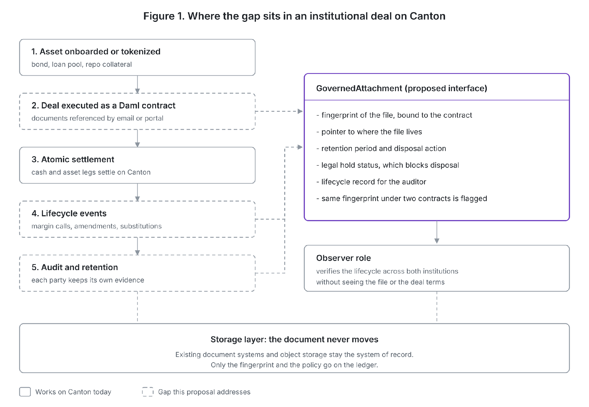
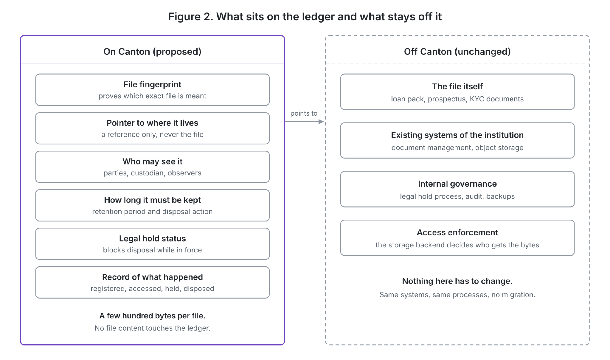
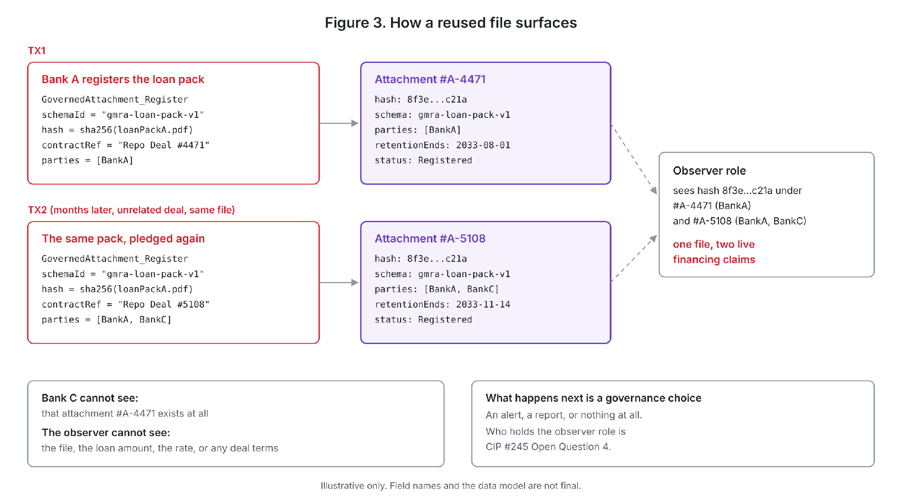
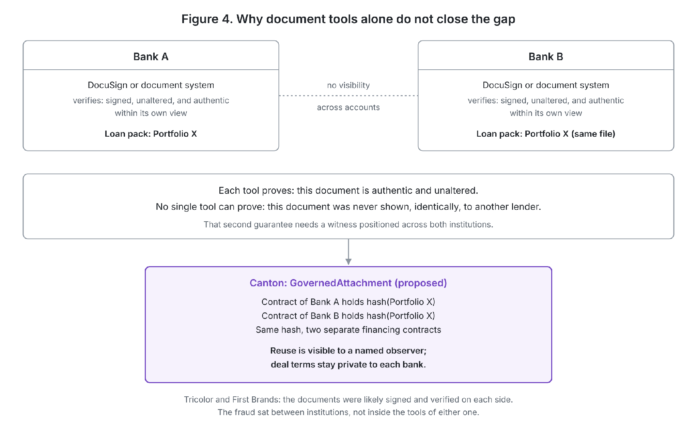

# Governed Attachments: File Governance for Multi-Party Contracts

## Development Fund Proposal

| Field | Value |
| :---- | :---- |
| Organization | Lighthouse |
| Author / Primary Contact | Nandit Mehra, Co-founder & CEO, [nandit@lighthouse.storage](mailto:nandit@lighthouse.storage) |
| Status | Submitted |
| Created | 2026-11-26 |
| Proposal Type | RFP-aligned |
| RFP / Roadmap Area | RFP 12, RWA Standards: Daml and Institutional RWA Workflow Standards (asset metadata; repo, collateral, lending and servicing workflows; integration mappings for existing institutional systems). Also supports RFP 27, Security Monitoring, Auditability and Evidence |
| Related CIP | [CIP #245: File Governance for Multi-Party Contracts](https://github.com/canton-foundation/cips/pull/245) |
| Champion | [Zhi Zhang](https://github.com/canton-foundation/canton-dev-fund/blob/main/sig-directory.md#identity--metadata), Edge & Node (Identity & Metadata SIG) |
| Total Funding Request | Up to 2,800,000 CC: 1,250,000 CC build (M1 to M3), 150,000 CC maintenance (M5), up to 1,400,000 CC paid only per external adopter (M4, 50% of the total) |
| Project Duration | Build: 6 months from approval. Adoption window: to approval + 18 months. Maintenance: 12 months after M3 |
| Maximum Amount / Duration | N/A (RFP 12 sets no maximum) |
| Label | regulatory-compliance |

---

## Abstract

Institutional applications on Canton, such as repo, private credit, tokenized bonds and custody, depend on documents that never touch the ledger: loan packs, prospectuses, KYC files, signed agreements. Today, every team that needs to link a contract to a document builds its own way of doing it, and in practice the link is an email or a portal. Two counterparties have no way to confirm they hold the same file. An auditor has no way to confirm a file was kept for its retention period and then disposed of. This gap sits between institutions, where the tools of any one institution cannot see.

Governed Attachments fixes this by giving Canton a shared Daml standard for attaching files to contracts. Think of it as a shared index card for each document: which exact file, where it lives, who may see it, how long it must be kept, and what has happened to it. Canton holds the card. The file stays where the institution keeps it today. The standard is defined in [CIP #245](https://github.com/canton-foundation/cips/pull/245), and this proposal funds its reference implementation.

This is not a theoretical proposal. We have built a working prototype of the flow with a live UI at [enterprise.lighthouse.storage](https://enterprise.lighthouse.storage/), and Lighthouse has run storage, encryption and access control in production since 2021 for 35K+ developers and teams.

The grant ships the Daml packages, a TypeScript SDK with adapters for the storage institutions already use, **a reference UI**, two reference flows on TestNet, and a conformance suite, all open source under Apache-2.0. Half of the funding (50%) is paid only when external teams adopt the standard.

---

## Specification

### 1. Objective

**Problem:** When a Canton contract between two institutions depends on a file, the file and the contract live in different worlds. This creates three gaps:

* **No shared proof of the same document.** Each side can show the file is authentic inside its own systems, but neither can show the other holds the identical version.

* **No shared lifecycle record.** Record-keeping rules require some records to be kept for set periods (for example SEC Rule 17a-4 for broker-dealers), and privacy law requires others to be deleted (for example GDPR Article 17). Between institutions, the only evidence that either happened is a covenant in a PDF.

* **No way to see the same file used twice.** In Tricolor (2025), First Brands (2025) and Qingdao (2014), the same documents or collateral backed more than one financing. The checks run by each lender passed, because each lender could only see its own deal.

Each of these slows the move of document-heavy workflows onto Canton. Teams rebuild the same attachment logic in every application, and institutions keep the paper trail off-ledger because there is no shared way to put it on.

Figure 1 shows where this gap sits in a typical institutional deal. Tokenization and settlement already work on Canton. Deal execution, lifecycle events and audit are where the documents fall out of the picture.

**Intended outcome:** An open, published Daml standard that any Canton application can use to attach files to contracts. A team registers a document class once, with its retention period and disposal rule. It then attaches files to any contract by fingerprint and pointer, records access, legal holds and disposal as on-ledger events an auditor can verify, and receives a private notice if the same file is attached to a second live contract. Institutions keep their files and their document systems as they are.

This is one objective. Asset registries, credentials and data-access products are out of scope (see Non-duplication).

### 2. Implementation Mechanics

We build this in five parts. Parts 2.1, 2.3 and 2.4 can be used as an opt-in Daml library before CIP #245 is approved. Part 2.5, freezing the interface as a network standard, starts only once the CIP is approved.

The design keeps the ledger footprint minimal. Figure 2 shows the boundary: Canton holds a small record per file, and everything else stays where it is today.

#### 2.1 Core lifecycle package (Daml)

* AttachmentSchema: registered once per document class. Carries default retention, disposition action (delete, retain, return to custodian) and required observers.

* GovernedAttachment interface and reference template. Fields: fingerprint, DataLocation (institution-managed, content-addressed, custom), contract reference, custodian, parties, observers, retention end, optional legal hold, link to a superseded attachment.

* Choices: Register, RecordAccess, ApplyHold, LiftHold, Dispose.

* Rules enforced in Daml:

  * A legal hold blocks disposal whatever the retention date.

  * Where two retention periods apply, the later one governs.

  * A disposed attachment keeps its record, because proof of destruction is what an auditor asks for.

#### 2.2 Cross-contract reuse check

* A registry party sees only (schemaId, fingerprint) pairs. It never sees the file, the deal terms, amounts or rates.

* On Register, it checks for a live claim on the same fingerprint. Each affected registering party gets its own notice. An auditor role sees collisions and nothing else.

* Fingerprints are hashes of whole documents, which in general carry enough unique content that a fingerprint cannot be reversed by guessing. Where a schema hashes a normalised subset of fields, M1 publishes the canonicalisation and its privacy trade-off.

* The registry operator is pluggable (CIP #245 Open Question 4). The reference ships two options: a single market-utility party, and a decentralized party with threshold governance. 

* M1 publishes a disclosure table showing exactly what each role learns.

#### 2.3 SDK and storage adapters (TypeScript)

* Canonical fingerprinting per schema, so one document hashes the same way at every institution.

* Register, verify-against-ledger and lifecycle calls over the Canton JSON Ledger API.

* Location adapters: S3-compatible stores (AWS S3, Cloudflare R2, MinIO), pointers into the document management system of an institution, and content-addressed storage (IPFS, Filecoin, Walrus). File bytes never pass through Lighthouse unless an institution picks a Lighthouse backend.

#### 2.4 Reference flows on TestNet

* **Repo collateral pack:** a loan pack is registered under one repo deal. Registering the same pack under a second deal raises a reuse notice to both registering parties. Figure 3 walks through this flow.

* **KYC pack lifecycle:** register, log access, apply a legal hold, lift it, dispose at retention end, and verify the disposal as an auditor without seeing the file.

#### 2.5 Standard v1.0 and conformance suite

Once CIP #245 is approved, the interface is frozen as v1.0 to match the accepted text. A conformance suite ships alongside it, so any other implementation can prove it follows the standard. If review changes the CIP, this step aligns the package to the final text.

#### What Already Exists vs. What Is Net-New

| Area | Today (Lighthouse prototype and CIP #245) | Funded by this grant |
| :---- | :---- | :---- |
| Daml model | Illustrative interface in CIP #245 and a working prototype of the flow | Production package with interfaces, reference templates and Daml Script tests |
| Storage | Lighthouse backends (IPFS, Filecoin, Walrus) | Adapters for the storage institutions already run (S3-compatible, DMS pointers) |
| Reuse check | Specified in CIP #245; a community prototype of the registry exists on the CIP PR | Privacy-scoped registry with a pluggable operator and a published disclosure table |
| Lifecycle evidence | Lifecycle tracking in the prototype | Legal holds, disposal records and an auditor verification path |
| Openness | Closed prototype, demo access on request | Apache-2.0 code, public DARs, docs, conformance suite |

### 3. Architectural Alignment

* **CIP #245.** CIP-0000 requires a reference implementation, with tests and documentation, before a Standards Track CIP can be Final. This grant delivers that implementation. The roadmap notes that CIPs needing implementation may be treated as Foundation RFPs once SVs approve them.

* **RFP 12, RWA Standards.** A reusable Daml standard for the documentation behind repo, collateral, lending and servicing workflows. It maps onto the storage systems institutions already run, and it supports many issuers and applications, not one vendor.

* **RFP 27, Auditability and Evidence.** Lifecycle records give auditors verifiable evidence without the underlying files leaving the institution.

* **Interface-first, like the token standard.** Follows the CIP-0056 / CIP-0112 pattern: a shared Daml interface plus reference templates that applications implement.

* **Canton privacy model.** Parties see only their own attachments; the registry sees fingerprints only. Nothing about a deal is disclosed to detect reuse.

#### Non-duplication

| Related work | What it covers | How Governed Attachments differs or composes |
| :---- | :---- | :---- |
| [#1104 Open Asset Registry Standard](https://github.com/canton-foundation/canton-dev-fund/pull/1104) (RFP 12, open) | Registry of loan and receivable assets, with cross-issuer duplicate checks | Governs the documents behind any contract, not asset records. The evidence fingerprint on an asset record can point to a governed attachment. |
| [#853 Governed Off-Ledger Data Exchange](https://github.com/canton-foundation/canton-dev-fund/pull/853) (RFP 12.1, in revision) | Who may access an off-ledger evidence package, for what purpose, until when | Governs the retention, hold and disposal of the record and its binding to a contract. An access layer like this can sit on top. |
| [#866 OS Ledger](https://github.com/canton-foundation/canton-dev-fund/pull/866), [#860 refusal record](https://github.com/canton-foundation/canton-dev-fund/pull/860) (RFP 27) | Accounting journals; records of refused actions | Different evidence. No overlap in scope. |
| [CIP #204, credentials standard](https://github.com/canton-foundation/cips/pull/204) (draft) | Party credentials and KYC claims | Independent. A KYC pack can be governed with or without CIP #204 credentials. |
| CIP-0056 / CIP-0112 token standard | Holdings and transfers | Attachments can reference holdings. No token-standard change. |
| Box, iManage, DocuSign, data rooms | Files inside one organization, or signatures | Stop at the boundary of each institution. Governed Attachments is the cross-institution layer and uses their retention vocabulary. |

### 4. Backward Compatibility

*No backward compatibility impact.* The work adds new, opt-in Daml packages and an SDK. It changes no protocol, Global Synchronizer component or existing interface.

---

## Prior Work and Current Status

We are not starting from zero. The grant funds new open-source work on top of infrastructure Lighthouse already runs and a prototype we have already built.

**Production infrastructure since 2021.** [Lighthouse](https://www.lighthouse.storage/) runs decentralized storage with client-side threshold encryption (Kavach) and permission-gated access control. It serves about 31,650 developers and teams, holds over 9 million files, and stores 15.6 TiB. Storage backends span IPFS, Filecoin and Walrus, with routing and encryption above them. That is the same storage-neutral position this standard takes. Lighthouse provides storage for Ocean Protocol, SingularityNET, Nuklai, Eternal AI, TopAI Network, Open Bagel and Blockfrost.

**Working prototype.** Lighthouse has built a prototype of the CIP #245 flow. Institutions sharing a Canton contract can verify they reference the same document and track its lifecycle, while the file stays in their own systems. The prototype UI is live at [**enterprise.lighthouse.storage**](https://enterprise.lighthouse.storage/); reviewers can get access on request. The Daml and SDK code of the prototype will be published under Apache-2.0 as part of Milestone 1. This grant does not pay for the prototype, which already exists, or for any hosted Lighthouse service.

**CIP and community.**

* CIP #245 has been submitted ([PR](https://github.com/canton-foundation/cips/pull/245)) and posted to cip-discuss with a request for technical feedback and sponsorship. Zhi Zhang (Edge & Node) is championing it.

* On the CIP PR, a HackCanton Season 3 team built a threshold-governed registry answering Open Question 4.

* Unlockit, an approved Development Fund grantee, offered to help explore cross-provider document distribution.

**Team.**

| Person | Role on this grant | Relevant experience |
| :---- | :---- | :---- |
| Nandit Mehra, Co-founder & CEO | Accountable lead, CIP author, adopter outreach | Building Lighthouse since 2021; previously software engineer at Fleek; Gitcoin Kernel Block III Fellow |
| Aakash Taneja, Tech Lead | Technical delivery: Daml packages, SDK/API, reference UI | Leads the Lighthouse architecture, including Kavach, its threshold encryption system |
| Shivang Kamboj, Marketing Lead | Co-marketing, adopter pipeline, community sessions | Leads growth at Lighthouse: launches, partner marketing, ecosystem programs |

---

## Milestones and Deliverables

All dates count from grant approval. M1 and M2 do not depend on CIP #245. M3 starts only once the CIP is approved, so no CC is paid for standardising text the SVs have not accepted.

### Milestone 1: Core lifecycle package and open prototype

* **Committed Date:** approval + 8 weeks

* **Focus:** The governed-attachment model, usable as an opt-in library

* **Deliverables / Value Metrics:**

  * Core Daml package (2.1): schema registry, attachment interface and reference template, all five lifecycle choices, hold and retention rules, Daml Script tests

  * LocalNet quickstart and developer guide

  * Published disclosure table and canonicalisation spec for two schemas (example, GMRA loan pack, KYC pack)

  * Prototype code public under Apache-2.0

  * Review session with the Identity & Metadata SIG

### Milestone 2: SDK/API, reference UI, storage adapters and reference flows on TestNet

* **Committed Date:** approval + 16 weeks

* **Focus:** Make it usable with the storage institutions already run

* **Deliverables / Value Metrics:**

  * TypeScript SDK/API on npm: fingerprinting, register, verify, lifecycle calls

  * Adapters for S3-compatible stores, DMS pointers and content-addressed storage

  * Reuse-check registry (2.2) with both operator options

  * Lifecycle flows running on TestNet, with public walkthroughs

  * At least one external design partner running a reference flow on TestNet against its own storage

  * Open-source reference UI (register, attach, lifecycle view, auditor view) running the reference flows on TestNet

### Milestone 3: Standard v1.0 and conformance suite (CIP-gated)

* **Committed Date:** the later of approval + 24 weeks, or 8 weeks after CIP #245 is approved

* **Focus:** Freeze the network standard to match the accepted CIP

* **Deliverables / Value Metrics:**

  * Interface v1.0 aligned to the approved CIP #245 text, with public DARs

  * Conformance suite any implementation can run

  * At least one integration not built by Lighthouse passing the suite

  * CIP #245 updated to cite the reference implementation

### Milestone 4: External adoption (paid per adopter)

* **Committed Date:** rolling, to approval + 18 months

* **Focus:** Real use by teams other than Lighthouse

* **Deliverables / Value Metrics:**

  * Each qualifying external team registers governed attachments in a live workflow: pilot on TestNet, or production on MainNet

  * The adopter confirms its use publicly on the proposal PR or in writing to the Tech & Ops Committee

  * Products run by Lighthouse, its affiliates, and the design partner from M2 do not count

### Milestone 5: Maintenance

* **Committed Date:** quarterly, for 12 months after M3

* **Focus:** Keep the standard current

* **Deliverables / Value Metrics:**

  * Compatibility with new Canton and Daml releases within 30 days

  * Security reports triaged within 72 hours

  * A short public report each quarter: releases, issues closed, adopters

---

## Acceptance Criteria

The Tech & Ops Committee evaluates each milestone on ecosystem value, not just on whether a deliverable was produced:

| Milestone | Accepted when |
| :---- | :---- |
| M1 | The Identity & Metadata SIG has reviewed the package and disclosure table, and 2 external teams have run the quickstart and filed public feedback |
| M2 | At least 1 external design partner runs a reference flow on TestNet against its own storage, and the SDK is published |
| M3 | CIP #245 is approved, interface v1.0 matches it, and at least 1 non-Lighthouse integration passes the conformance suite |
| M4 | Per adopter: public confirmation from the adopting team of live use, pilot or production, checkable on TestNet or MainNet |
| M5 | Quarterly report showing release compatibility, security response times and adoption |

Every milestone also requires public documentation, open-source code, and a recorded demo session with the champion and the Identity & Metadata SIG before acceptance. Milestone reviews are run with the champion, Zhi Zhang (Edge & Node), and the Identity & Metadata SIG.

---

## Funding

**Total Funding Request:** up to 2,800,000 CC. Of that, **1,400,000** CC (50%) is paid only for external adoption.

### Payment Breakdown by Milestone

| Milestone | CC | Paid |
| :---- | ----: | :---- |
| M1 Core lifecycle package and open prototype | 350,000 | upon committee acceptance |
| M2 SDK/API, reference UI, adapters, reference flows on TestNet | 500,000 | upon committee acceptance |
| M3 Standard v1.0 and conformance suite (CIP-gated) | 400,000 | upon committee acceptance |
| M4 External adoption | up to 1,400,000 | 100,000 per pilot adopter, 200,000 per production adopter (a pilot that moves to production is paid the difference) |
| M5 Maintenance, 12 months | 150,000 | 37,500 per quarter against the quarterly report |
| **Total** | **up to 2,800,000** |  |

### Cost Basis

* M1 to M3 take about 18 person-months: 2 Daml engineers and 1 TypeScript and storage engineer, over 6 months. Tech lead time is covered by Lighthouse.

* Lighthouse covers its own hosting, the existing prototype, and adopter outreach.

### Volatility Stipulation

The project duration is greater than 6 months. The grant is denominated in fixed Canton Coin and will require a re-evaluation at the 6-month mark.

---

## Sustainability

* **Owner:** Lighthouse maintains the packages, SDK and conformance suite for at least 12 months after M3, funded through M5. Lighthouse plans to keep maintaining them after that, because its storage products will integrate the standard.

* **Handover:** all code, DARs and docs live in a public Apache-2.0 repository with documented build and release steps. The interface is defined by the CIP, not by Lighthouse, so the Core Contributors or any adopter can take over maintenance at the M5 funding level.

* **Governance:** changes to the interface after v1.0 go through the CIP process, not a Lighthouse decision.

---

## Demand Evidence

**Recent losses.**

* In Tricolor and First Brands (both 2025) and Qingdao (2014), the same documents or collateral backed more than one financing, and lenders lost hundreds of millions of dollars ([Tricolor, CNBC](https://www.cnbc.com/2025/12/17/tricolor-execs-charged-with-systematic-fraud-after-subprime-auto-lender-roiled-banking-sector.html); [First Brands, GTR](https://www.gtreview.com/news/americas/first-brands-faces-investigation-into-double-financing-of-receivables-inventory/); [Qingdao, GTR](https://www.gtreview.com/news/asia/qingdao-fraud-probe-ends-with-jail-term/)).

* JPMorgan recorded a \$170M charge-off tied to Tricolor in Q3 2025 ([Banking Dive](https://www.bankingdive.com/news/jpmorgan-dimon-tricolor-chargeoff-earnings/802740/)). On 7 January 2026, its Kinexys unit and Digital Asset announced plans to issue JPM Coin natively on Canton ([The Block](https://www.theblock.co/news/business/2026-01-07-jpmorgan-jpm-coin-canton-384575)).

* After Qingdao, banks in Singapore set up a Trade Finance Registry to check whether a document had already been financed. It shows lenders have adopted a shared check before. It covers one market and relies on a single trusted operator.

**Industry data.**

* Capital markets spend an estimated \$50B a year reconciling mismatched records between institutions ([Axoni](https://axoni.com/press/unpacking-post-trade-reconciliation-challenges-part-2/)).

* Corporate dissatisfaction with KYC document processes rose from 73% in 2024 to 95% in 2026, and nearly half of corporates report sending sensitive files over plain email ([Encompass](https://www.encompasscorporation.com/blog/95-of-corporate-treasury-teams-are-frustrated-with-kyc/)).

**Engagement on CIP #245.**

* On the CIP #245 PR, a HackCanton Season 3 team built a working registry for Open Question 4.

* Unlockit offered to explore document distribution across storage providers.

---

## Co-Marketing

Upon each milestone release, Lighthouse will work with the Foundation on:

* announcement coordination across Canton and Lighthouse channels

* a technical blog on the reference flows, and a case study with the first production adopter

* a public walkthrough or workshop for builders, through the Identity & Metadata SIG or a community call

* a short demo video of the reuse notice and the auditor disposal check

---

## Motivation

The Foundation [roadmap](https://github.com/canton-foundation/canton-dev-fund/blob/main/2026-2028-strategic-roadmap.md) names financing through repo and securities lending, and fixed income such as Treasuries and corporate bonds, as core Canton use cases. Every one of these workflows carries documents. Today those documents stay in email and shared drives while the deal settles on-ledger, and each application that wants to connect the two builds its own model.

A shared standard helps four groups. Application teams integrate once instead of building their own attachment model. Institutions get proof of the same document, retention and disposal across counterparties, without moving files or replacing their document systems. Auditors and regulators get a lifecycle record they can verify without access to the files. And other standards work, such as asset registries and credential systems, can point to a governed attachment instead of inventing its own document link.

---

## Rationale

**Minimal on-ledger by design.** Canton holds a fingerprint, a pointer, permissions, retention terms and lifecycle events. Files stay where institutions keep them today, so adoption needs no migration and no new trust in a storage vendor.

**Why existing tools do not close the gap.** Document systems and e-signature tools prove a file is authentic inside one organization. None of them can show that the same file was also given to another lender, because no single-account tool sees both sides of a private deal. Figure 4 shows the difference.

**Alternatives considered:**

| Option | Why not |
| :---- | :---- |
| Put files or encrypted files on-ledger | Size, and privacy risk if keys leak. Also breaks regulated retention and deletion. |
| One trusted registry operator (the Singapore model) | Works for one market but becomes a trust bottleneck. Here the operator is pluggable, with a threshold-governed option. |
| Signed attestations only (Sign Protocol, EthSign style) | Proves who said what, not whether the same document was attested elsewhere. |
| Each app builds its own | What happens today. It produces incompatible models and no cross-app reuse check. |

**Extend, do not replace.** The standard reuses the retention, legal-hold and disposition vocabulary compliance teams already use in Box, iManage and OpenText. It also follows the interface-plus-reference pattern of the Canton token standard.

**Why us.** We have run storage, encryption and access control in production for five years across IPFS, Filecoin and Walrus. That is the same storage-neutral layer this standard puts on Canton. We also wrote the CIP and built the prototype, so the grant pays to finish and open the work, not to explore it. No Lighthouse product is needed to use the standard.

**Limits.** We want to be clear about what this does not do:

* A matching fingerprint proves the same file was presented twice. It does not catch a newly fabricated file that describes the same collateral.

* It helps only once the governing contract is on Canton. It does not fix deals that stay off-ledger.

* Lifecycle events are attestations, not enforcement. Canton cannot delete a file inside a bank system. It records that the accountable party asserts the deletion happened. That is more than a covenant in a PDF, but it is not proof of deletion.
